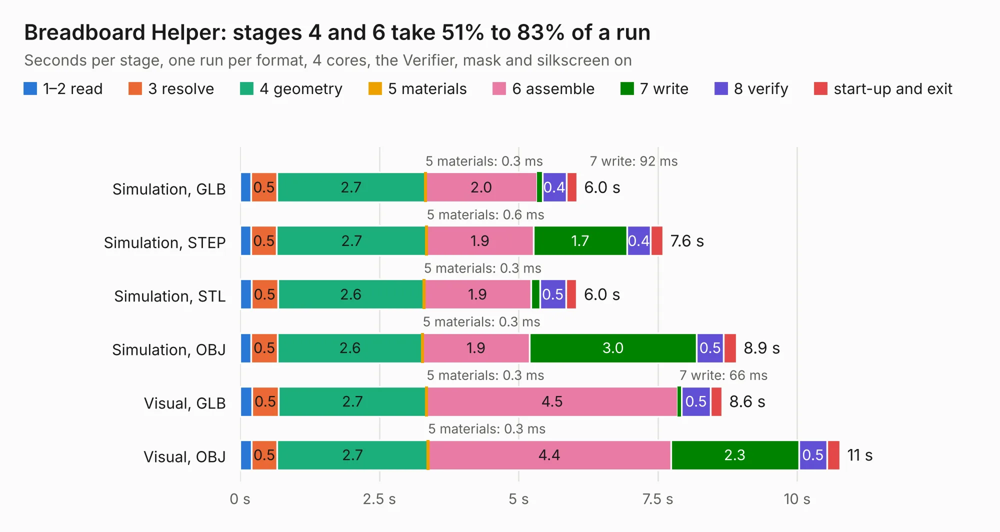

# 21. Breadboard Helper

Board 21 of the 3,109 of [Corpus Testing](../Corpus-Testing.md), on [Corpus Page 1](../CorpusTestingPages/Corpus-Testing-01.md#21-breadboard-helper).

| Mode and format | 1–2 read | 3 resolve | 4 geometry | 5 materials | 6 assemble | 7 write | 8 verify | start-up and exit | Total |
|---|---:|---:|---:|---:|---:|---:|---:|---:|---:|
| Simulation, GLB | 0.2 | 0.5 | 2.7 | 0.3&nbsp;ms | 2.0 | 92&nbsp;ms | 0.4 | 0.2 | 6.0 |
| Simulation, STEP | 0.2 | 0.5 | 2.7 | 0.6&nbsp;ms | 1.9 | 1.7 | 0.4 | 0.2 | 7.6 |
| Simulation, STL | 0.2 | 0.5 | 2.6 | 0.3&nbsp;ms | 1.9 | 0.2 | 0.5 | 0.2 | 6.0 |
| Simulation, OBJ | 0.2 | 0.5 | 2.6 | 0.3&nbsp;ms | 1.9 | 3.0 | 0.5 | 0.2 | 8.9 |
| Visual, GLB | 0.2 | 0.5 | 2.7 | 0.3&nbsp;ms | 4.5 | 66&nbsp;ms | 0.5 | 0.2 | 8.6 |
| Visual, OBJ | 0.2 | 0.5 | 2.7 | 0.3&nbsp;ms | 4.4 | 2.3 | 0.5 | 0.2 | 10.8 |

<table align="center"><tr><td valign="top">

| Board | Repo: [acwright/6502](https://github.com/acwright/6502) Board: `Breadboard Helper.kicad_pcb` |
|---|---|
| Folder | Hardware / Breadboard Helper / Rev 1.0 |
| Complexity | 170&nbsp;/&nbsp;1000 (size&nbsp;125, features&nbsp;45) |
| KESE&nbsp;features | through vias, filled zones, curved board outline |
| Tested | 9th November 2026 |
| Copper&nbsp;layers | 2 |
| File&nbsp;format | KiCad 10 (20260206) |
| Parts,&nbsp;tracks,&nbsp;vias | 3, 260, 12 |
| Triangles,&nbsp;simulation | 609,124 in 49 parts |
| Verifier | PASS in all six runs |

</td><td valign="top">

<table>
<tr><th>File type</th><th>File size</th><th>Peak memory used</th></tr>
<tr><th colspan="3" align="left">Simulation</th></tr>
<tr><td>GLB</td><td align="right">20&nbsp;MB</td><td align="right">343&nbsp;MB</td></tr>
<tr><td>STEP</td><td align="right">86&nbsp;MB</td><td align="right">385&nbsp;MB</td></tr>
<tr><td>STL</td><td align="right">30&nbsp;MB</td><td align="right">358&nbsp;MB</td></tr>
<tr><td>OBJ</td><td align="right">61&nbsp;MB</td><td align="right">435&nbsp;MB</td></tr>
<tr><th colspan="3" align="left">Visual</th></tr>
<tr><td>GLB</td><td align="right">15&nbsp;MB</td><td align="right">425&nbsp;MB</td></tr>
<tr><td>OBJ</td><td align="right">44&nbsp;MB</td><td align="right">426&nbsp;MB</td></tr>
</table>

</td></tr></table>

| Previous | Next |
|:---|---:|
| [20. Blinkenlights Card](b0020b_6502_Blinkenlights-Card.md) | [22. Clock Helper](b0022b_6502_Clock-Helper.md) |
