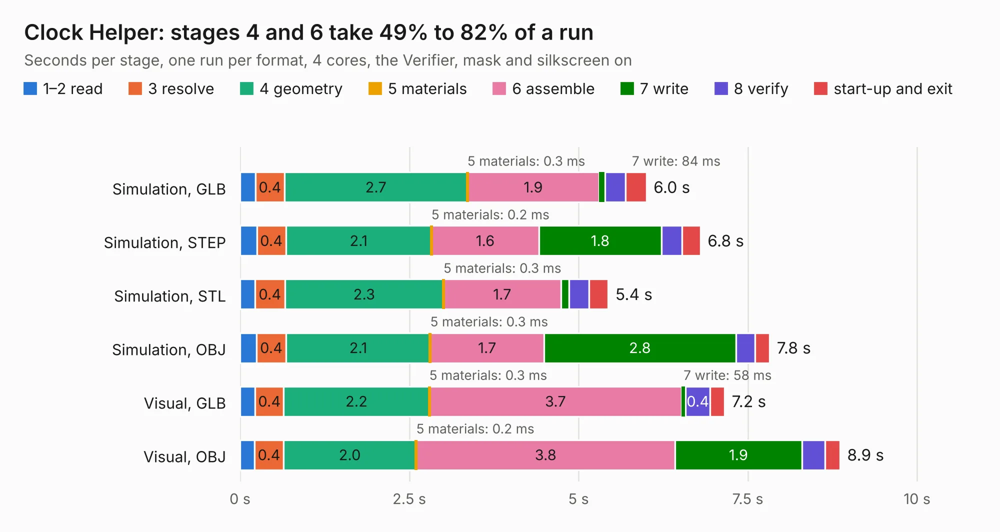

# 22. Clock Helper

Board 22 of the 3,103 of [Corpus Testing](../Corpus-Testing.md), on [Corpus Page 1](../CorpusTestingPages/Corpus-Testing-01.md#22-clock-helper).

| Mode and format | 1–2 read | 3 resolve | 4 geometry | 5 materials | 6 assemble | 7 write | 8 verify | start-up and exit | Total |
|---|---:|---:|---:|---:|---:|---:|---:|---:|---:|
| Simulation, GLB | 0.2 | 0.4 | 2.7 | 0.3&nbsp;ms | 1.9 | 84&nbsp;ms | 0.3 | 0.3 | 6.0 |
| Simulation, STEP | 0.2 | 0.4 | 2.1 | 0.2&nbsp;ms | 1.6 | 1.8 | 0.3 | 0.3 | 6.8 |
| Simulation, STL | 0.2 | 0.4 | 2.3 | 0.3&nbsp;ms | 1.7 | 0.1 | 0.3 | 0.3 | 5.4 |
| Simulation, OBJ | 0.2 | 0.4 | 2.1 | 0.3&nbsp;ms | 1.7 | 2.8 | 0.3 | 0.2 | 7.8 |
| Visual, GLB | 0.2 | 0.4 | 2.2 | 0.3&nbsp;ms | 3.7 | 58&nbsp;ms | 0.4 | 0.2 | 7.2 |
| Visual, OBJ | 0.2 | 0.4 | 2.0 | 0.2&nbsp;ms | 3.8 | 1.9 | 0.3 | 0.2 | 8.9 |

<table align="center"><tr><td valign="top">

| Board | Repo: [acwright/6502](https://github.com/acwright/6502) Board: `Clock Helper.kicad_pcb` |
|---|---|
| Folder | Hardware / Clock Helper / Rev 1.0 |
| Complexity | 187&nbsp;/&nbsp;1000 (size&nbsp;132, features&nbsp;55) |
| KESE&nbsp;features | through vias, rounded, trapezoid or chamfered pads, filled zones, curved board outline |
| Tested | 9th November 2026 |
| Copper&nbsp;layers | 2 |
| File&nbsp;format | KiCad 10 (20260206) |
| Parts,&nbsp;tracks,&nbsp;vias | 16, 97, 25 |
| Triangles,&nbsp;simulation | 479,936 in 37 parts |
| Verifier | PASS in all six runs |

</td><td valign="top">

<table>
<tr><th>File type</th><th>File size</th><th>Peak memory used</th></tr>
<tr><th colspan="3" align="left">Simulation</th></tr>
<tr><td>GLB</td><td align="right">16&nbsp;MB</td><td align="right">315&nbsp;MB</td></tr>
<tr><td>STEP</td><td align="right">68&nbsp;MB</td><td align="right">337&nbsp;MB</td></tr>
<tr><td>STL</td><td align="right">24&nbsp;MB</td><td align="right">304&nbsp;MB</td></tr>
<tr><td>OBJ</td><td align="right">48&nbsp;MB</td><td align="right">345&nbsp;MB</td></tr>
<tr><th colspan="3" align="left">Visual</th></tr>
<tr><td>GLB</td><td align="right">11&nbsp;MB</td><td align="right">342&nbsp;MB</td></tr>
<tr><td>OBJ</td><td align="right">33&nbsp;MB</td><td align="right">347&nbsp;MB</td></tr>
</table>

</td></tr></table>

| Previous | Next |
|:---|---:|
| [21. Breadboard Helper](b0021b_6502_Breadboard-Helper.md) | [23. CPU Card Pro](b0023b_6502_CPU-Card-Pro.md) |
