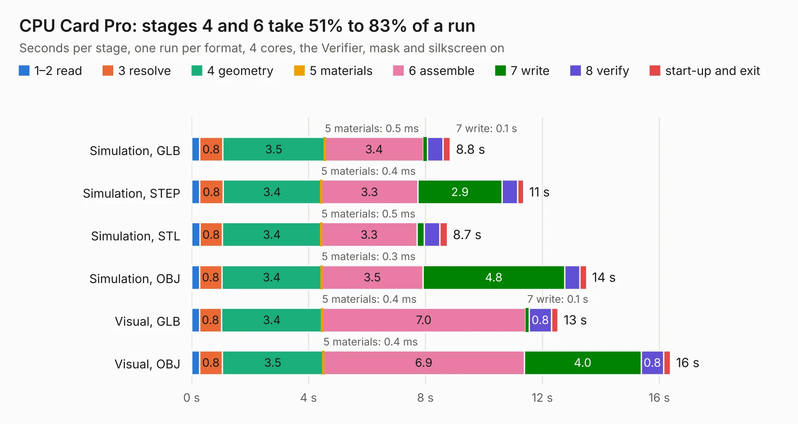

# 23. CPU Card Pro

Board 23 of the 3,123 of [Corpus Testing](../Corpus-Testing.md), on [Corpus Page 1](../CorpusTestingPages/Corpus-Testing-01.md#23-cpu-card-pro).

| Mode and format | 1–2 read | 3 resolve | 4 geometry | 5 materials | 6 assemble | 7 write | 8 verify | start-up and exit | Total |
|---|---:|---:|---:|---:|---:|---:|---:|---:|---:|
| Simulation, GLB | 0.3 | 0.8 | 3.5 | 0.5&nbsp;ms | 3.4 | 0.1 | 0.5 | 0.2 | 8.8 |
| Simulation, STEP | 0.3 | 0.8 | 3.4 | 0.4&nbsp;ms | 3.3 | 2.9 | 0.5 | 0.2 | 11.4 |
| Simulation, STL | 0.3 | 0.8 | 3.4 | 0.5&nbsp;ms | 3.3 | 0.3 | 0.5 | 0.3 | 8.7 |
| Simulation, OBJ | 0.3 | 0.8 | 3.4 | 0.3&nbsp;ms | 3.5 | 4.8 | 0.5 | 0.2 | 13.5 |
| Visual, GLB | 0.3 | 0.8 | 3.4 | 0.4&nbsp;ms | 7.0 | 0.1 | 0.8 | 0.2 | 12.5 |
| Visual, OBJ | 0.3 | 0.8 | 3.5 | 0.4&nbsp;ms | 6.9 | 4.0 | 0.8 | 0.2 | 16.4 |

<table align="center"><tr><td valign="top">

| Board | Repo: [acwright/6502](https://github.com/acwright/6502) Board: `CPU Card Pro.kicad_pcb` |
|---|---|
| Folder | Hardware / CPU Card Pro / Rev 1.0 |
| Complexity | 217&nbsp;/&nbsp;1000 (size&nbsp;162, features&nbsp;55) |
| KESE&nbsp;features | through vias, rounded, trapezoid or chamfered pads, filled zones, curved board outline |
| Tested | 9th November 2026 |
| Copper&nbsp;layers | 2 |
| File&nbsp;format | KiCad 10 (20260206) |
| Parts,&nbsp;tracks,&nbsp;vias | 17, 583, 151 |
| Triangles,&nbsp;simulation | 934,380 in 74 parts |
| Verifier | PASS in all six runs |

</td><td valign="top">

<table>
<tr><th>File type</th><th>File size</th><th>Peak memory used</th></tr>
<tr><th colspan="3" align="left">Simulation</th></tr>
<tr><td>GLB</td><td align="right">32&nbsp;MB</td><td align="right">446&nbsp;MB</td></tr>
<tr><td>STEP</td><td align="right">146&nbsp;MB</td><td align="right">560&nbsp;MB</td></tr>
<tr><td>STL</td><td align="right">47&nbsp;MB</td><td align="right">464&nbsp;MB</td></tr>
<tr><td>OBJ</td><td align="right">94&nbsp;MB</td><td align="right">629&nbsp;MB</td></tr>
<tr><th colspan="3" align="left">Visual</th></tr>
<tr><td>GLB</td><td align="right">25&nbsp;MB</td><td align="right">650&nbsp;MB</td></tr>
<tr><td>OBJ</td><td align="right">75&nbsp;MB</td><td align="right">677&nbsp;MB</td></tr>
</table>

</td></tr></table>

| Previous | Next |
|:---|---:|
| [22. Clock Helper](b0022b_6502_Clock-Helper.md) | [24. CPU Card](b0024b_6502_Hardware-CPU-Card-Rev-1-0_CPU-Card.md) |
