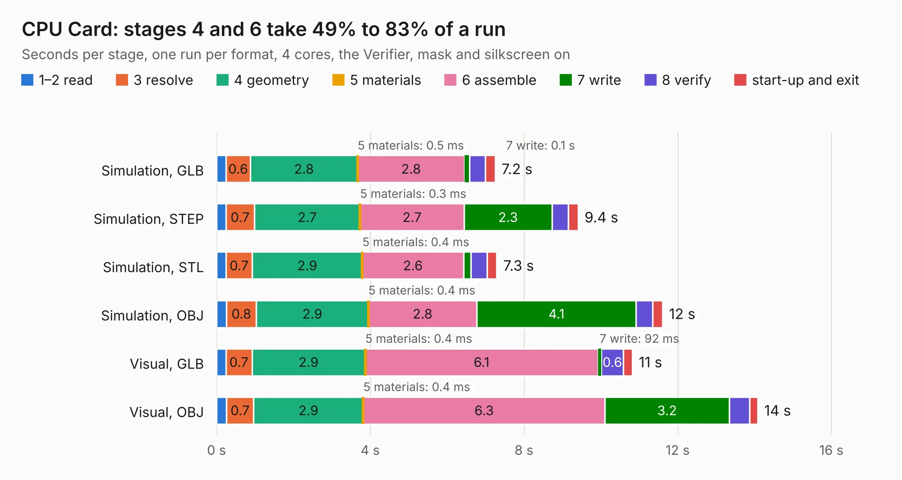

# 24. CPU Card

Board 24 of the 3,110 of [Corpus Testing](../Corpus-Testing.md), on [Corpus Page 1](../CorpusTestingPages/Corpus-Testing-01.md#24-cpu-card).

| Mode and format | 1–2 read | 3 resolve | 4 geometry | 5 materials | 6 assemble | 7 write | 8 verify | start-up and exit | Total |
|---|---:|---:|---:|---:|---:|---:|---:|---:|---:|
| Simulation, GLB | 0.2 | 0.6 | 2.8 | 0.5&nbsp;ms | 2.8 | 0.1 | 0.4 | 0.3 | 7.2 |
| Simulation, STEP | 0.2 | 0.7 | 2.7 | 0.3&nbsp;ms | 2.7 | 2.3 | 0.4 | 0.2 | 9.4 |
| Simulation, STL | 0.2 | 0.7 | 2.9 | 0.4&nbsp;ms | 2.6 | 0.2 | 0.4 | 0.3 | 7.3 |
| Simulation, OBJ | 0.3 | 0.8 | 2.9 | 0.4&nbsp;ms | 2.8 | 4.1 | 0.4 | 0.3 | 11.6 |
| Visual, GLB | 0.2 | 0.7 | 2.9 | 0.4&nbsp;ms | 6.1 | 92&nbsp;ms | 0.6 | 0.2 | 10.8 |
| Visual, OBJ | 0.3 | 0.7 | 2.9 | 0.4&nbsp;ms | 6.3 | 3.2 | 0.5 | 0.2 | 14.1 |

<table align="center"><tr><td valign="top">

| Board | Repo: [acwright/6502](https://github.com/acwright/6502) Board: `CPU Card.kicad_pcb` |
|---|---|
| Folder | Hardware / CPU Card / Rev 1.0 |
| Complexity | 232&nbsp;/&nbsp;1000 (size&nbsp;152, features&nbsp;80) |
| KESE&nbsp;features | through vias, custom pads, rounded, trapezoid or chamfered pads, filled zones, copper drawings, curved board outline |
| Tested | 9th November 2026 |
| Copper&nbsp;layers | 2 |
| File&nbsp;format | KiCad 10 (20260206) |
| Parts,&nbsp;tracks,&nbsp;vias | 12, 343, 124 |
| Triangles,&nbsp;simulation | 729,338 in 54 parts |
| Verifier | PASS in all six runs |

</td><td valign="top">

<table>
<tr><th>File type</th><th>File size</th><th>Peak memory used</th></tr>
<tr><th colspan="3" align="left">Simulation</th></tr>
<tr><td>GLB</td><td align="right">25&nbsp;MB</td><td align="right">407&nbsp;MB</td></tr>
<tr><td>STEP</td><td align="right">109&nbsp;MB</td><td align="right">461&nbsp;MB</td></tr>
<tr><td>STL</td><td align="right">36&nbsp;MB</td><td align="right">404&nbsp;MB</td></tr>
<tr><td>OBJ</td><td align="right">73&nbsp;MB</td><td align="right">537&nbsp;MB</td></tr>
<tr><th colspan="3" align="left">Visual</th></tr>
<tr><td>GLB</td><td align="right">19&nbsp;MB</td><td align="right">473&nbsp;MB</td></tr>
<tr><td>OBJ</td><td align="right">58&nbsp;MB</td><td align="right">455&nbsp;MB</td></tr>
</table>

</td></tr></table>

| Previous | Next |
|:---|---:|
| [23. CPU Card Pro](b0023b_6502_CPU-Card-Pro.md) | [25. CPU Card](b0025b_6502_Hardware-CPU-Card-Rev-1-1_CPU-Card.md) |
