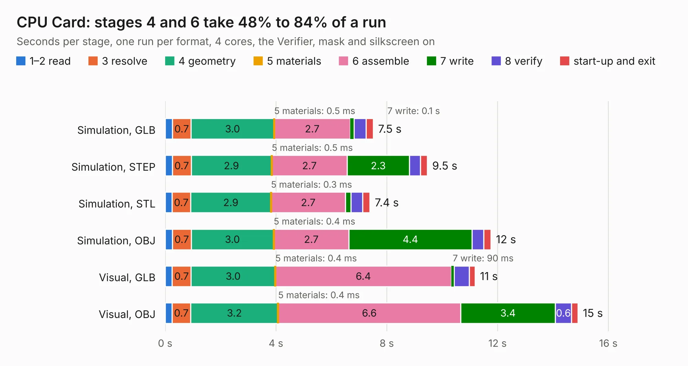

# 25. CPU Card

Board 25 of the 3,110 of [Corpus Testing](../Corpus-Testing.md), on [Corpus Page 1](../CorpusTestingPages/Corpus-Testing-01.md#25-cpu-card).

| Mode and format | 1–2 read | 3 resolve | 4 geometry | 5 materials | 6 assemble | 7 write | 8 verify | start-up and exit | Total |
|---|---:|---:|---:|---:|---:|---:|---:|---:|---:|
| Simulation, GLB | 0.3 | 0.7 | 3.0 | 0.5&nbsp;ms | 2.7 | 0.1 | 0.4 | 0.3 | 7.5 |
| Simulation, STEP | 0.3 | 0.7 | 2.9 | 0.5&nbsp;ms | 2.7 | 2.3 | 0.4 | 0.3 | 9.5 |
| Simulation, STL | 0.2 | 0.7 | 2.9 | 0.3&nbsp;ms | 2.7 | 0.2 | 0.4 | 0.3 | 7.4 |
| Simulation, OBJ | 0.3 | 0.7 | 3.0 | 0.4&nbsp;ms | 2.7 | 4.4 | 0.4 | 0.3 | 11.8 |
| Visual, GLB | 0.3 | 0.7 | 3.0 | 0.4&nbsp;ms | 6.4 | 90&nbsp;ms | 0.6 | 0.2 | 11.2 |
| Visual, OBJ | 0.2 | 0.7 | 3.2 | 0.4&nbsp;ms | 6.6 | 3.4 | 0.6 | 0.2 | 14.9 |

<table align="center"><tr><td valign="top">

| Board | Repo: [acwright/6502](https://github.com/acwright/6502) Board: `CPU Card.kicad_pcb` |
|---|---|
| Folder | Hardware / CPU Card / Rev 1.1 |
| Complexity | 232&nbsp;/&nbsp;1000 (size&nbsp;152, features&nbsp;80) |
| KESE&nbsp;features | through vias, custom pads, rounded, trapezoid or chamfered pads, filled zones, copper drawings, curved board outline |
| Tested | 9th November 2026 |
| Copper&nbsp;layers | 2 |
| File&nbsp;format | KiCad 10 (20260206) |
| Parts,&nbsp;tracks,&nbsp;vias | 12, 343, 124 |
| Triangles,&nbsp;simulation | 729,266 in 54 parts |
| Verifier | PASS in all six runs |

</td><td valign="top">

<table>
<tr><th>File type</th><th>File size</th><th>Peak memory used</th></tr>
<tr><th colspan="3" align="left">Simulation</th></tr>
<tr><td>GLB</td><td align="right">25&nbsp;MB</td><td align="right">405&nbsp;MB</td></tr>
<tr><td>STEP</td><td align="right">109&nbsp;MB</td><td align="right">463&nbsp;MB</td></tr>
<tr><td>STL</td><td align="right">36&nbsp;MB</td><td align="right">416&nbsp;MB</td></tr>
<tr><td>OBJ</td><td align="right">73&nbsp;MB</td><td align="right">515&nbsp;MB</td></tr>
<tr><th colspan="3" align="left">Visual</th></tr>
<tr><td>GLB</td><td align="right">19&nbsp;MB</td><td align="right">467&nbsp;MB</td></tr>
<tr><td>OBJ</td><td align="right">58&nbsp;MB</td><td align="right">472&nbsp;MB</td></tr>
</table>

</td></tr></table>

| Previous | Next |
|:---|---:|
| [24. CPU Card](b0024b_6502_Hardware-CPU-Card-Rev-1-0_CPU-Card.md) | [26. DB25 Helper](b0026b_6502_DB25-Helper.md) |
