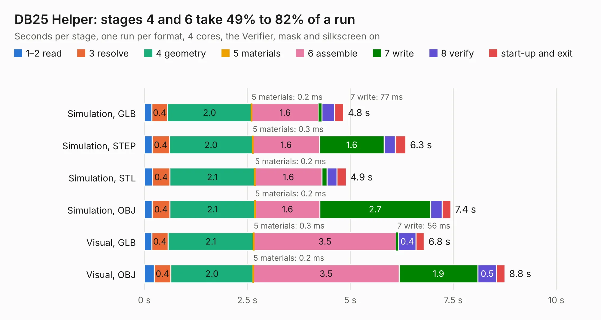

# 26. DB25 Helper

Board 26 of the 3,116 of [Corpus Testing](../Corpus-Testing.md), on [Corpus Page 1](../CorpusTestingPages/Corpus-Testing-01.md#26-db25-helper).

| Mode and format | 1–2 read | 3 resolve | 4 geometry | 5 materials | 6 assemble | 7 write | 8 verify | start-up and exit | Total |
|---|---:|---:|---:|---:|---:|---:|---:|---:|---:|
| Simulation, GLB | 0.2 | 0.4 | 2.0 | 0.2&nbsp;ms | 1.6 | 77&nbsp;ms | 0.3 | 0.2 | 4.8 |
| Simulation, STEP | 0.2 | 0.4 | 2.0 | 0.3&nbsp;ms | 1.6 | 1.6 | 0.3 | 0.3 | 6.3 |
| Simulation, STL | 0.2 | 0.4 | 2.1 | 0.2&nbsp;ms | 1.6 | 0.1 | 0.2 | 0.2 | 4.9 |
| Simulation, OBJ | 0.2 | 0.4 | 2.1 | 0.2&nbsp;ms | 1.6 | 2.7 | 0.3 | 0.2 | 7.4 |
| Visual, GLB | 0.2 | 0.4 | 2.1 | 0.3&nbsp;ms | 3.5 | 56&nbsp;ms | 0.4 | 0.2 | 6.8 |
| Visual, OBJ | 0.2 | 0.4 | 2.0 | 0.2&nbsp;ms | 3.5 | 1.9 | 0.5 | 0.2 | 8.8 |

<table align="center"><tr><td valign="top">

| Board | Repo: [acwright/6502](https://github.com/acwright/6502) Board: `DB25 Helper.kicad_pcb` |
|---|---|
| Folder | Hardware / DB25 Helper / Rev 1.0 |
| Complexity | 170&nbsp;/&nbsp;1000 (size&nbsp;125, features&nbsp;45) |
| KESE&nbsp;features | through vias, filled zones, curved board outline |
| Tested | 9th November 2026 |
| Copper&nbsp;layers | 2 |
| File&nbsp;format | KiCad 10 (20260206) |
| Parts,&nbsp;tracks,&nbsp;vias | 3, 145, 49 |
| Triangles,&nbsp;simulation | 495,190 in 32 parts |
| Verifier | PASS in all six runs |

</td><td valign="top">

<table>
<tr><th>File type</th><th>File size</th><th>Peak memory used</th></tr>
<tr><th colspan="3" align="left">Simulation</th></tr>
<tr><td>GLB</td><td align="right">17&nbsp;MB</td><td align="right">338&nbsp;MB</td></tr>
<tr><td>STEP</td><td align="right">64&nbsp;MB</td><td align="right">349&nbsp;MB</td></tr>
<tr><td>STL</td><td align="right">25&nbsp;MB</td><td align="right">336&nbsp;MB</td></tr>
<tr><td>OBJ</td><td align="right">49&nbsp;MB</td><td align="right">378&nbsp;MB</td></tr>
<tr><th colspan="3" align="left">Visual</th></tr>
<tr><td>GLB</td><td align="right">12&nbsp;MB</td><td align="right">352&nbsp;MB</td></tr>
<tr><td>OBJ</td><td align="right">35&nbsp;MB</td><td align="right">350&nbsp;MB</td></tr>
</table>

</td></tr></table>

| Previous | Next |
|:---|---:|
| [25. CPU Card](b0025b_6502_Hardware-CPU-Card-Rev-1-1_CPU-Card.md) | [27. GPIO Breadboard Helper](b0027b_6502_GPIO-Breadboard-Helper.md) |
