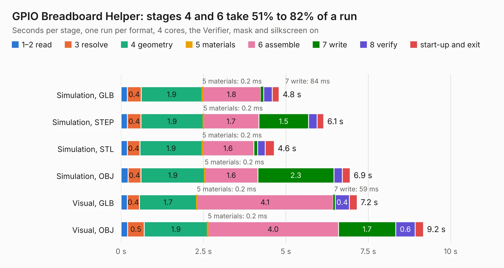

# 27. GPIO Breadboard Helper

Board 27 of the 3,122 of [Corpus Testing](../Corpus-Testing.md), on [Corpus Page 1](../CorpusTestingPages/Corpus-Testing-01.md#27-gpio-breadboard-helper).

| Mode and format | 1–2 read | 3 resolve | 4 geometry | 5 materials | 6 assemble | 7 write | 8 verify | start-up and exit | Total |
|---|---:|---:|---:|---:|---:|---:|---:|---:|---:|
| Simulation, GLB | 0.2 | 0.4 | 1.9 | 0.2&nbsp;ms | 1.8 | 84&nbsp;ms | 0.3 | 0.2 | 4.8 |
| Simulation, STEP | 0.2 | 0.4 | 1.9 | 0.2&nbsp;ms | 1.7 | 1.5 | 0.3 | 0.2 | 6.1 |
| Simulation, STL | 0.2 | 0.4 | 1.9 | 0.2&nbsp;ms | 1.6 | 0.1 | 0.2 | 0.3 | 4.6 |
| Simulation, OBJ | 0.2 | 0.4 | 1.9 | 0.2&nbsp;ms | 1.6 | 2.3 | 0.3 | 0.2 | 6.9 |
| Visual, GLB | 0.2 | 0.4 | 1.7 | 0.2&nbsp;ms | 4.1 | 59&nbsp;ms | 0.4 | 0.2 | 7.2 |
| Visual, OBJ | 0.2 | 0.5 | 1.9 | 0.2&nbsp;ms | 4.0 | 1.7 | 0.6 | 0.3 | 9.2 |

<table align="center"><tr><td valign="top">

| Board | Repo: [acwright/6502](https://github.com/acwright/6502) Board: `GPIO Breadboard Helper.kicad_pcb` |
|---|---|
| Folder | Hardware / GPIO Breadboard Helper / Rev 1.0 |
| Complexity | 174&nbsp;/&nbsp;1000 (size&nbsp;129, features&nbsp;45) |
| KESE&nbsp;features | through vias, filled zones, curved board outline |
| Tested | 9th November 2026 |
| Copper&nbsp;layers | 2 |
| File&nbsp;format | KiCad 10 (20260206) |
| Parts,&nbsp;tracks,&nbsp;vias | 4, 174, 48 |
| Triangles,&nbsp;simulation | 513,806 in 33 parts |
| Verifier | PASS in all six runs |

</td><td valign="top">

<table>
<tr><th>File type</th><th>File size</th><th>Peak memory used</th></tr>
<tr><th colspan="3" align="left">Simulation</th></tr>
<tr><td>GLB</td><td align="right">18&nbsp;MB</td><td align="right">317&nbsp;MB</td></tr>
<tr><td>STEP</td><td align="right">78&nbsp;MB</td><td align="right">359&nbsp;MB</td></tr>
<tr><td>STL</td><td align="right">26&nbsp;MB</td><td align="right">327&nbsp;MB</td></tr>
<tr><td>OBJ</td><td align="right">52&nbsp;MB</td><td align="right">391&nbsp;MB</td></tr>
<tr><th colspan="3" align="left">Visual</th></tr>
<tr><td>GLB</td><td align="right">13&nbsp;MB</td><td align="right">374&nbsp;MB</td></tr>
<tr><td>OBJ</td><td align="right">38&nbsp;MB</td><td align="right">372&nbsp;MB</td></tr>
</table>

</td></tr></table>

| Previous | Next |
|:---|---:|
| [26. DB25 Helper](b0026b_6502_DB25-Helper.md) | [28. GPIO Card](b0028b_6502_GPIO-Card.md) |
