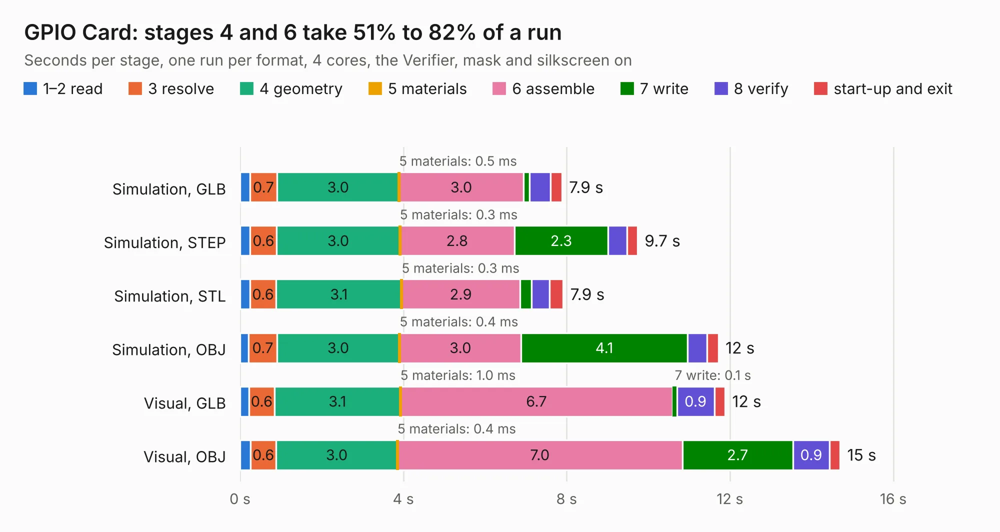

# 28. GPIO Card

Board 28 of the 3,118 of [Corpus Testing](../Corpus-Testing.md), on [Corpus Page 1](../CorpusTestingPages/Corpus-Testing-01.md#28-gpio-card).

| Mode and format | 1–2 read | 3 resolve | 4 geometry | 5 materials | 6 assemble | 7 write | 8 verify | start-up and exit | Total |
|---|---:|---:|---:|---:|---:|---:|---:|---:|---:|
| Simulation, GLB | 0.2 | 0.7 | 3.0 | 0.5&nbsp;ms | 3.0 | 0.2 | 0.5 | 0.3 | 7.9 |
| Simulation, STEP | 0.3 | 0.6 | 3.0 | 0.3&nbsp;ms | 2.8 | 2.3 | 0.5 | 0.3 | 9.7 |
| Simulation, STL | 0.2 | 0.6 | 3.1 | 0.3&nbsp;ms | 2.9 | 0.3 | 0.5 | 0.3 | 7.9 |
| Simulation, OBJ | 0.2 | 0.7 | 3.0 | 0.4&nbsp;ms | 3.0 | 4.1 | 0.5 | 0.3 | 11.7 |
| Visual, GLB | 0.2 | 0.6 | 3.1 | 1.0&nbsp;ms | 6.7 | 0.1 | 0.9 | 0.3 | 11.9 |
| Visual, OBJ | 0.3 | 0.6 | 3.0 | 0.4&nbsp;ms | 7.0 | 2.7 | 0.9 | 0.3 | 14.7 |

<table align="center"><tr><td valign="top">

| Board | Repo: [acwright/6502](https://github.com/acwright/6502) Board: `GPIO Card.kicad_pcb` |
|---|---|
| Folder | Hardware / GPIO Card / Rev 1.0 |
| Complexity | 228&nbsp;/&nbsp;1000 (size&nbsp;148, features&nbsp;80) |
| KESE&nbsp;features | through vias, custom pads, rounded, trapezoid or chamfered pads, filled zones, copper drawings, curved board outline |
| Tested | 9th November 2026 |
| Copper&nbsp;layers | 2 |
| File&nbsp;format | KiCad 10 (20260206) |
| Parts,&nbsp;tracks,&nbsp;vias | 10, 305, 102 |
| Triangles,&nbsp;simulation | 857,132 in 79 parts |
| Verifier | PASS in all six runs |

</td><td valign="top">

<table>
<tr><th>File type</th><th>File size</th><th>Peak memory used</th></tr>
<tr><th colspan="3" align="left">Simulation</th></tr>
<tr><td>GLB</td><td align="right">29&nbsp;MB</td><td align="right">439&nbsp;MB</td></tr>
<tr><td>STEP</td><td align="right">127&nbsp;MB</td><td align="right">501&nbsp;MB</td></tr>
<tr><td>STL</td><td align="right">43&nbsp;MB</td><td align="right">464&nbsp;MB</td></tr>
<tr><td>OBJ</td><td align="right">86&nbsp;MB</td><td align="right">616&nbsp;MB</td></tr>
<tr><th colspan="3" align="left">Visual</th></tr>
<tr><td>GLB</td><td align="right">21&nbsp;MB</td><td align="right">562&nbsp;MB</td></tr>
<tr><td>OBJ</td><td align="right">63&nbsp;MB</td><td align="right">554&nbsp;MB</td></tr>
</table>

</td></tr></table>

| Previous | Next |
|:---|---:|
| [27. GPIO Breadboard Helper](b0027b_6502_GPIO-Breadboard-Helper.md) | [29. GPIO Helper](b0029b_6502_GPIO-Helper.md) |
