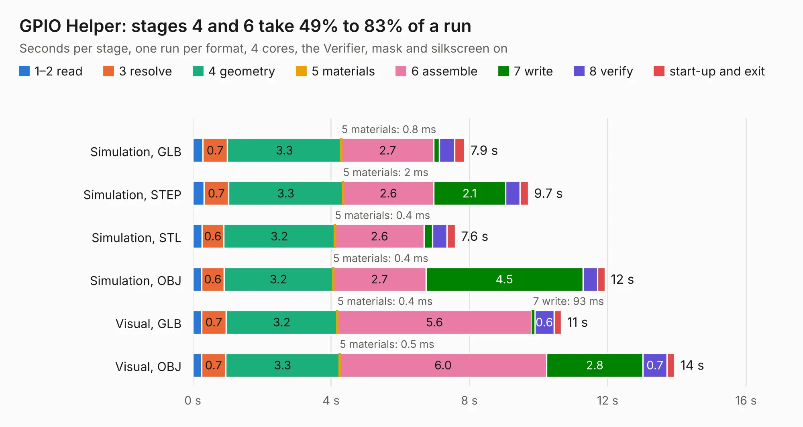

# 29. GPIO Helper

Board 29 of the 3,128 of [Corpus Testing](../Corpus-Testing.md), on [Corpus Page 1](../CorpusTestingPages/Corpus-Testing-01.md#29-gpio-helper).

| Mode and format | 1–2 read | 3 resolve | 4 geometry | 5 materials | 6 assemble | 7 write | 8 verify | start-up and exit | Total |
|---|---:|---:|---:|---:|---:|---:|---:|---:|---:|
| Simulation, GLB | 0.3 | 0.7 | 3.3 | 0.8&nbsp;ms | 2.7 | 0.2 | 0.4 | 0.3 | 7.9 |
| Simulation, STEP | 0.3 | 0.7 | 3.3 | 2&nbsp;ms | 2.6 | 2.1 | 0.4 | 0.2 | 9.7 |
| Simulation, STL | 0.3 | 0.6 | 3.2 | 0.4&nbsp;ms | 2.6 | 0.2 | 0.4 | 0.2 | 7.6 |
| Simulation, OBJ | 0.3 | 0.6 | 3.2 | 0.4&nbsp;ms | 2.7 | 4.5 | 0.4 | 0.2 | 11.9 |
| Visual, GLB | 0.3 | 0.7 | 3.2 | 0.4&nbsp;ms | 5.6 | 93&nbsp;ms | 0.6 | 0.2 | 10.7 |
| Visual, OBJ | 0.3 | 0.7 | 3.3 | 0.5&nbsp;ms | 6.0 | 2.8 | 0.7 | 0.2 | 13.9 |

<table align="center"><tr><td valign="top">

| Board | Repo: [acwright/6502](https://github.com/acwright/6502) Board: `GPIO Helper.kicad_pcb` |
|---|---|
| Folder | Hardware / GPIO Helper / Rev 1.0 |
| Complexity | 196&nbsp;/&nbsp;1000 (size&nbsp;151, features&nbsp;45) |
| KESE&nbsp;features | through vias, filled zones, curved board outline |
| Tested | 9th November 2026 |
| Copper&nbsp;layers | 2 |
| File&nbsp;format | KiCad 10 (20260206) |
| Parts,&nbsp;tracks,&nbsp;vias | 34, 179, 53 |
| Triangles,&nbsp;simulation | 844,730 in 40 parts |
| Verifier | PASS in all six runs |

</td><td valign="top">

<table>
<tr><th>File type</th><th>File size</th><th>Peak memory used</th></tr>
<tr><th colspan="3" align="left">Simulation</th></tr>
<tr><td>GLB</td><td align="right">28&nbsp;MB</td><td align="right">447&nbsp;MB</td></tr>
<tr><td>STEP</td><td align="right">115&nbsp;MB</td><td align="right">500&nbsp;MB</td></tr>
<tr><td>STL</td><td align="right">42&nbsp;MB</td><td align="right">497&nbsp;MB</td></tr>
<tr><td>OBJ</td><td align="right">85&nbsp;MB</td><td align="right">578&nbsp;MB</td></tr>
<tr><th colspan="3" align="left">Visual</th></tr>
<tr><td>GLB</td><td align="right">19&nbsp;MB</td><td align="right">504&nbsp;MB</td></tr>
<tr><td>OBJ</td><td align="right">57&nbsp;MB</td><td align="right">526&nbsp;MB</td></tr>
</table>

</td></tr></table>

| Previous | Next |
|:---|---:|
| [28. GPIO Card](b0028b_6502_GPIO-Card.md) | [30. Joystick Helper](b0030b_6502_Joystick-Helper.md) |
