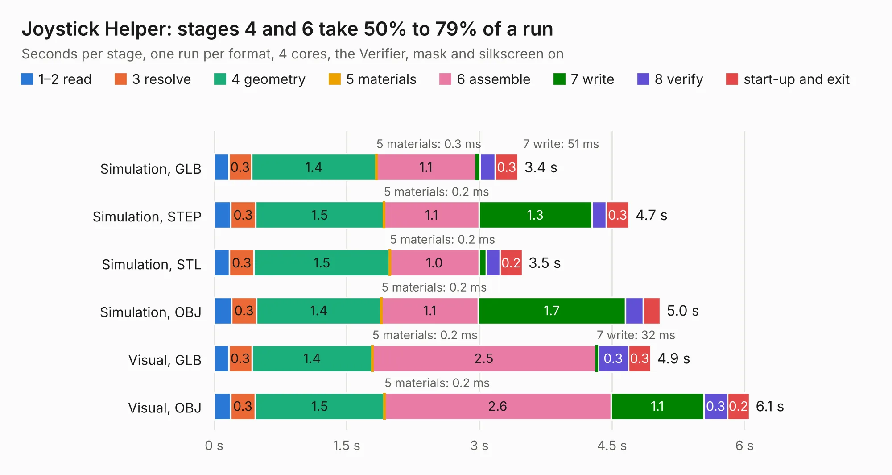

# 30. Joystick Helper

Board 30 of the 3,118 of [Corpus Testing](../Corpus-Testing.md), on [Corpus Page 1](../CorpusTestingPages/Corpus-Testing-01.md#30-joystick-helper).

| Mode and format | 1–2 read | 3 resolve | 4 geometry | 5 materials | 6 assemble | 7 write | 8 verify | start-up and exit | Total |
|---|---:|---:|---:|---:|---:|---:|---:|---:|---:|
| Simulation, GLB | 0.2 | 0.3 | 1.4 | 0.3&nbsp;ms | 1.1 | 51&nbsp;ms | 0.2 | 0.3 | 3.4 |
| Simulation, STEP | 0.2 | 0.3 | 1.5 | 0.2&nbsp;ms | 1.1 | 1.3 | 0.2 | 0.3 | 4.7 |
| Simulation, STL | 0.2 | 0.3 | 1.5 | 0.2&nbsp;ms | 1.0 | 84&nbsp;ms | 0.2 | 0.2 | 3.5 |
| Simulation, OBJ | 0.2 | 0.3 | 1.4 | 0.2&nbsp;ms | 1.1 | 1.7 | 0.2 | 0.2 | 5.0 |
| Visual, GLB | 0.2 | 0.3 | 1.4 | 0.2&nbsp;ms | 2.5 | 32&nbsp;ms | 0.3 | 0.3 | 4.9 |
| Visual, OBJ | 0.2 | 0.3 | 1.5 | 0.2&nbsp;ms | 2.6 | 1.1 | 0.3 | 0.2 | 6.1 |

<table align="center"><tr><td valign="top">

| Board | Repo: [acwright/6502](https://github.com/acwright/6502) Board: `Joystick Helper.kicad_pcb` |
|---|---|
| Folder | Hardware / Joystick Helper / Rev 1.0 |
| Complexity | 167&nbsp;/&nbsp;1000 (size&nbsp;122, features&nbsp;45) |
| KESE&nbsp;features | through vias, filled zones, curved board outline |
| Tested | 9th November 2026 |
| Copper&nbsp;layers | 2 |
| File&nbsp;format | KiCad 10 (20260206) |
| Parts,&nbsp;tracks,&nbsp;vias | 10, 75, 17 |
| Triangles,&nbsp;simulation | 327,932 in 22 parts |
| Verifier | PASS in all six runs |

</td><td valign="top">

<table>
<tr><th>File type</th><th>File size</th><th>Peak memory used</th></tr>
<tr><th colspan="3" align="left">Simulation</th></tr>
<tr><td>GLB</td><td align="right">11&nbsp;MB</td><td align="right">272&nbsp;MB</td></tr>
<tr><td>STEP</td><td align="right">43&nbsp;MB</td><td align="right">277&nbsp;MB</td></tr>
<tr><td>STL</td><td align="right">16&nbsp;MB</td><td align="right">252&nbsp;MB</td></tr>
<tr><td>OBJ</td><td align="right">33&nbsp;MB</td><td align="right">258&nbsp;MB</td></tr>
<tr><th colspan="3" align="left">Visual</th></tr>
<tr><td>GLB</td><td align="right">7.7&nbsp;MB</td><td align="right">253&nbsp;MB</td></tr>
<tr><td>OBJ</td><td align="right">22&nbsp;MB</td><td align="right">258&nbsp;MB</td></tr>
</table>

</td></tr></table>

| Previous | Next |
|:---|---:|
| [29. GPIO Helper](b0029b_6502_GPIO-Helper.md) | [31. Keyboard Encoder Helper](b0031b_6502_Keyboard-Encoder-Helper.md) |
