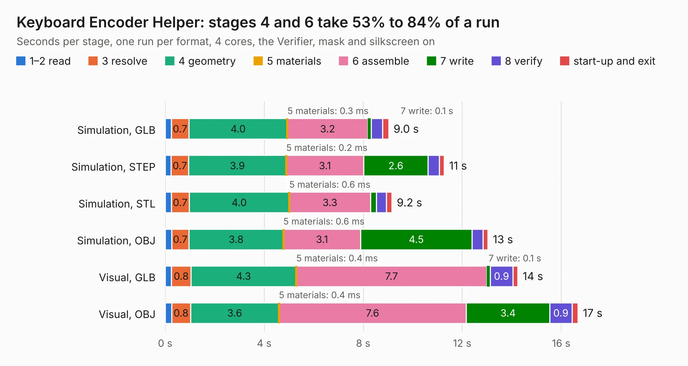

# 31. Keyboard Encoder Helper

Board 31 of the 3,130 of [Corpus Testing](../Corpus-Testing.md), on [Corpus Page 1](../CorpusTestingPages/Corpus-Testing-01.md#31-keyboard-encoder-helper).

| Mode and format | 1–2 read | 3 resolve | 4 geometry | 5 materials | 6 assemble | 7 write | 8 verify | start-up and exit | Total |
|---|---:|---:|---:|---:|---:|---:|---:|---:|---:|
| Simulation, GLB | 0.2 | 0.7 | 4.0 | 0.3&nbsp;ms | 3.2 | 0.1 | 0.5 | 0.2 | 9.0 |
| Simulation, STEP | 0.2 | 0.7 | 3.9 | 0.2&nbsp;ms | 3.1 | 2.6 | 0.5 | 0.2 | 11.3 |
| Simulation, STL | 0.2 | 0.7 | 4.0 | 0.6&nbsp;ms | 3.3 | 0.2 | 0.4 | 0.2 | 9.2 |
| Simulation, OBJ | 0.3 | 0.7 | 3.8 | 0.6&nbsp;ms | 3.1 | 4.5 | 0.4 | 0.2 | 13.0 |
| Visual, GLB | 0.3 | 0.8 | 4.3 | 0.4&nbsp;ms | 7.7 | 0.1 | 0.9 | 0.2 | 14.2 |
| Visual, OBJ | 0.3 | 0.8 | 3.6 | 0.4&nbsp;ms | 7.6 | 3.4 | 0.9 | 0.2 | 16.7 |

<table align="center"><tr><td valign="top">

| Board | Repo: [acwright/6502](https://github.com/acwright/6502) Board: `Keyboard Encoder Helper.kicad_pcb` |
|---|---|
| Folder | Hardware / Keyboard Encoder Helper / Rev 1.0 |
| Complexity | 205&nbsp;/&nbsp;1000 (size&nbsp;150, features&nbsp;55) |
| KESE&nbsp;features | through vias, rounded, trapezoid or chamfered pads, filled zones, curved board outline |
| Tested | 9th November 2026 |
| Copper&nbsp;layers | 2 |
| File&nbsp;format | KiCad 10 (20260206) |
| Parts,&nbsp;tracks,&nbsp;vias | 11, 364, 99 |
| Triangles,&nbsp;simulation | 975,048 in 51 parts |
| Verifier | PASS in all six runs |

</td><td valign="top">

<table>
<tr><th>File type</th><th>File size</th><th>Peak memory used</th></tr>
<tr><th colspan="3" align="left">Simulation</th></tr>
<tr><td>GLB</td><td align="right">33&nbsp;MB</td><td align="right">485&nbsp;MB</td></tr>
<tr><td>STEP</td><td align="right">140&nbsp;MB</td><td align="right">519&nbsp;MB</td></tr>
<tr><td>STL</td><td align="right">49&nbsp;MB</td><td align="right">493&nbsp;MB</td></tr>
<tr><td>OBJ</td><td align="right">98&nbsp;MB</td><td align="right">667&nbsp;MB</td></tr>
<tr><th colspan="3" align="left">Visual</th></tr>
<tr><td>GLB</td><td align="right">23&nbsp;MB</td><td align="right">561&nbsp;MB</td></tr>
<tr><td>OBJ</td><td align="right">68&nbsp;MB</td><td align="right">591&nbsp;MB</td></tr>
</table>

</td></tr></table>

| Previous | Next |
|:---|---:|
| [30. Joystick Helper](b0030b_6502_Joystick-Helper.md) | [32. Keyboard Helper](b0032b_6502_Keyboard-Helper.md) |
