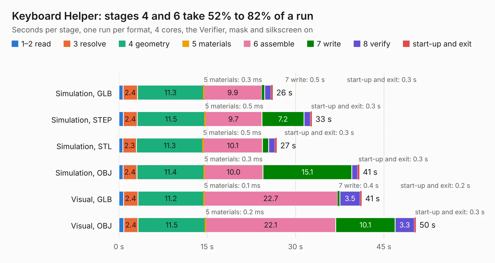

# 32. Keyboard Helper

Board 32 of the 3,127 of [Corpus Testing](../Corpus-Testing.md), on [Corpus Page 1](../CorpusTestingPages/Corpus-Testing-01.md#32-keyboard-helper).

| Mode and format | 1–2 read | 3 resolve | 4 geometry | 5 materials | 6 assemble | 7 write | 8 verify | start-up and exit | Total |
|---|---:|---:|---:|---:|---:|---:|---:|---:|---:|
| Simulation, GLB | 0.7 | 2.4 | 11.3 | 0.3&nbsp;ms | 9.9 | 0.5 | 1.1 | 0.3 | 26.1 |
| Simulation, STEP | 0.8 | 2.4 | 11.5 | 0.5&nbsp;ms | 9.7 | 7.2 | 1.1 | 0.3 | 32.8 |
| Simulation, STL | 0.7 | 2.3 | 11.3 | 0.5&nbsp;ms | 10.1 | 1.0 | 1.1 | 0.3 | 26.8 |
| Simulation, OBJ | 0.7 | 2.4 | 11.4 | 0.3&nbsp;ms | 10.0 | 15.1 | 1.0 | 0.3 | 40.8 |
| Visual, GLB | 0.8 | 2.4 | 11.2 | 0.1&nbsp;ms | 22.7 | 0.4 | 3.5 | 0.2 | 41.2 |
| Visual, OBJ | 0.9 | 2.4 | 11.5 | 0.2&nbsp;ms | 22.1 | 10.1 | 3.3 | 0.3 | 50.4 |

<table align="center"><tr><td valign="top">

| Board | Repo: [acwright/6502](https://github.com/acwright/6502) Board: `Keyboard Helper.kicad_pcb` |
|---|---|
| Folder | Hardware / Keyboard Helper / Rev 1.0 |
| Complexity | 232&nbsp;/&nbsp;1000 (size&nbsp;187, features&nbsp;45) |
| KESE&nbsp;features | through vias, filled zones, curved board outline |
| Tested | 9th November 2026 |
| Copper&nbsp;layers | 2 |
| File&nbsp;format | KiCad 10 (20260206) |
| Parts,&nbsp;tracks,&nbsp;vias | 90, 925, 245 |
| Triangles,&nbsp;simulation | 2,925,074 in 36 parts |
| Verifier | PASS in all six runs |

</td><td valign="top">

<table>
<tr><th>File type</th><th>File size</th><th>Peak memory used</th></tr>
<tr><th colspan="3" align="left">Simulation</th></tr>
<tr><td>GLB</td><td align="right">98&nbsp;MB</td><td align="right">1.2&nbsp;GB</td></tr>
<tr><td>STEP</td><td align="right">344&nbsp;MB</td><td align="right">1.3&nbsp;GB</td></tr>
<tr><td>STL</td><td align="right">146&nbsp;MB</td><td align="right">1.2&nbsp;GB</td></tr>
<tr><td>OBJ</td><td align="right">304&nbsp;MB</td><td align="right">1.9&nbsp;GB</td></tr>
<tr><th colspan="3" align="left">Visual</th></tr>
<tr><td>GLB</td><td align="right">69&nbsp;MB</td><td align="right">1.5&nbsp;GB</td></tr>
<tr><td>OBJ</td><td align="right">215&nbsp;MB</td><td align="right">1.4&nbsp;GB</td></tr>
</table>

</td></tr></table>

| Previous | Next |
|:---|---:|
| [31. Keyboard Encoder Helper](b0031b_6502_Keyboard-Encoder-Helper.md) | [33. LCD Board](b0033b_6502_LCD-Board.md) |
