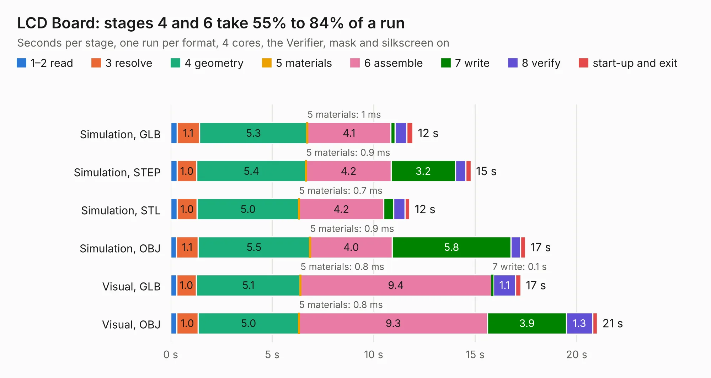

# 33. LCD Board

Board 33 of the 3,106 of [Corpus Testing](../Corpus-Testing.md), on [Corpus Page 1](../CorpusTestingPages/Corpus-Testing-01.md#33-lcd-board).

| Mode and format | 1–2 read | 3 resolve | 4 geometry | 5 materials | 6 assemble | 7 write | 8 verify | start-up and exit | Total |
|---|---:|---:|---:|---:|---:|---:|---:|---:|---:|
| Simulation, GLB | 0.3 | 1.1 | 5.3 | 1&nbsp;ms | 4.1 | 0.2 | 0.6 | 0.3 | 11.9 |
| Simulation, STEP | 0.3 | 1.0 | 5.4 | 0.9&nbsp;ms | 4.2 | 3.2 | 0.5 | 0.3 | 14.8 |
| Simulation, STL | 0.3 | 1.0 | 5.0 | 0.7&nbsp;ms | 4.2 | 0.5 | 0.6 | 0.2 | 11.8 |
| Simulation, OBJ | 0.3 | 1.1 | 5.5 | 0.9&nbsp;ms | 4.0 | 5.8 | 0.5 | 0.2 | 17.5 |
| Visual, GLB | 0.3 | 1.0 | 5.1 | 0.8&nbsp;ms | 9.4 | 0.1 | 1.1 | 0.3 | 17.2 |
| Visual, OBJ | 0.3 | 1.0 | 5.0 | 0.8&nbsp;ms | 9.3 | 3.9 | 1.3 | 0.2 | 21.0 |

<table align="center"><tr><td valign="top">

| Board | Repo: [acwright/6502](https://github.com/acwright/6502) Board: `LCD Board.kicad_pcb` |
|---|---|
| Folder | Hardware / LCD Board / Rev 1.0 |
| Complexity | 230&nbsp;/&nbsp;1000 (size&nbsp;150, features&nbsp;80) |
| KESE&nbsp;features | through vias, custom pads, rounded, trapezoid or chamfered pads, filled zones, copper drawings, curved board outline |
| Tested | 9th November 2026 |
| Copper&nbsp;layers | 2 |
| File&nbsp;format | KiCad 10 (20260206) |
| Parts,&nbsp;tracks,&nbsp;vias | 13, 309, 100 |
| Triangles,&nbsp;simulation | 1,237,574 in 85 parts |
| Verifier | PASS in all six runs |

</td><td valign="top">

<table>
<tr><th>File type</th><th>File size</th><th>Peak memory used</th></tr>
<tr><th colspan="3" align="left">Simulation</th></tr>
<tr><td>GLB</td><td align="right">42&nbsp;MB</td><td align="right">608&nbsp;MB</td></tr>
<tr><td>STEP</td><td align="right">171&nbsp;MB</td><td align="right">625&nbsp;MB</td></tr>
<tr><td>STL</td><td align="right">62&nbsp;MB</td><td align="right">598&nbsp;MB</td></tr>
<tr><td>OBJ</td><td align="right">125&nbsp;MB</td><td align="right">847&nbsp;MB</td></tr>
<tr><th colspan="3" align="left">Visual</th></tr>
<tr><td>GLB</td><td align="right">28&nbsp;MB</td><td align="right">711&nbsp;MB</td></tr>
<tr><td>OBJ</td><td align="right">84&nbsp;MB</td><td align="right">711&nbsp;MB</td></tr>
</table>

</td></tr></table>

| Previous | Next |
|:---|---:|
| [32. Keyboard Helper](b0032b_6502_Keyboard-Helper.md) | [34. LCD Card](b0034b_6502_LCD-Card.md) |
