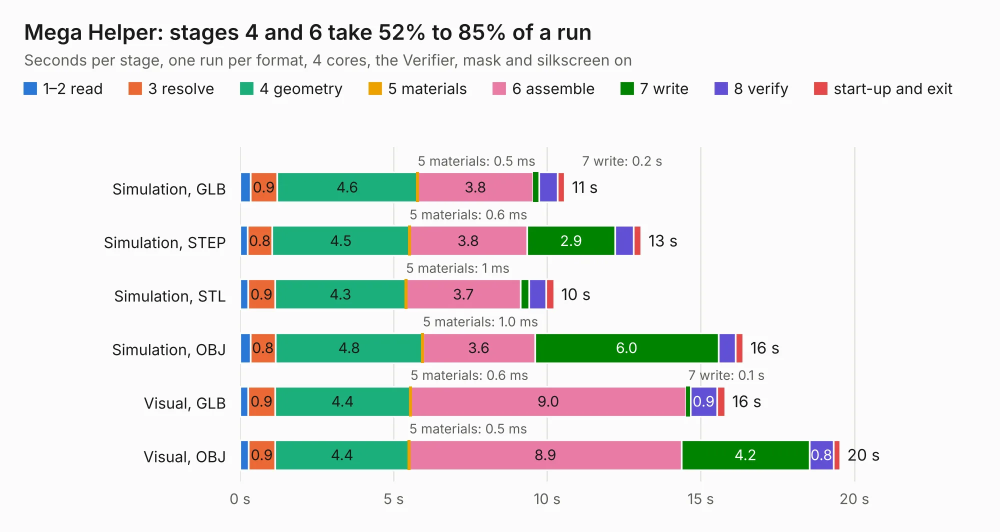

# 35. Mega Helper

Board 35 of the 3,139 of [Corpus Testing](../Corpus-Testing.md), on [Corpus Page 1](../CorpusTestingPages/Corpus-Testing-01.md#35-mega-helper).

| Mode and format | 1–2 read | 3 resolve | 4 geometry | 5 materials | 6 assemble | 7 write | 8 verify | start-up and exit | Total |
|---|---:|---:|---:|---:|---:|---:|---:|---:|---:|
| Simulation, GLB | 0.3 | 0.9 | 4.6 | 0.5&nbsp;ms | 3.8 | 0.2 | 0.6 | 0.2 | 10.6 |
| Simulation, STEP | 0.2 | 0.8 | 4.5 | 0.6&nbsp;ms | 3.8 | 2.9 | 0.6 | 0.2 | 13.1 |
| Simulation, STL | 0.3 | 0.9 | 4.3 | 1&nbsp;ms | 3.7 | 0.3 | 0.5 | 0.3 | 10.2 |
| Simulation, OBJ | 0.3 | 0.8 | 4.8 | 1.0&nbsp;ms | 3.6 | 6.0 | 0.6 | 0.2 | 16.4 |
| Visual, GLB | 0.3 | 0.9 | 4.4 | 0.6&nbsp;ms | 9.0 | 0.1 | 0.9 | 0.3 | 15.8 |
| Visual, OBJ | 0.3 | 0.9 | 4.4 | 0.5&nbsp;ms | 8.9 | 4.2 | 0.8 | 0.2 | 19.5 |

<table align="center"><tr><td valign="top">

| Board | Repo: [acwright/6502](https://github.com/acwright/6502) Board: `Mega Helper.kicad_pcb` |
|---|---|
| Folder | Hardware / Mega Helper / Rev 1.0 |
| Complexity | 163&nbsp;/&nbsp;1000 (size&nbsp;128, features&nbsp;35) |
| KESE&nbsp;features | through vias, filled zones |
| Tested | 9th November 2026 |
| Copper&nbsp;layers | 2 |
| File&nbsp;format | KiCad 10 (20260206) |
| Parts,&nbsp;tracks,&nbsp;vias | 2, 200, 75 |
| Triangles,&nbsp;simulation | 1,011,878 in 85 parts |
| Verifier | PASS in all six runs |

</td><td valign="top">

<table>
<tr><th>File type</th><th>File size</th><th>Peak memory used</th></tr>
<tr><th colspan="3" align="left">Simulation</th></tr>
<tr><td>GLB</td><td align="right">33&nbsp;MB</td><td align="right">494&nbsp;MB</td></tr>
<tr><td>STEP</td><td align="right">127&nbsp;MB</td><td align="right">555&nbsp;MB</td></tr>
<tr><td>STL</td><td align="right">51&nbsp;MB</td><td align="right">478&nbsp;MB</td></tr>
<tr><td>OBJ</td><td align="right">101&nbsp;MB</td><td align="right">675&nbsp;MB</td></tr>
<tr><th colspan="3" align="left">Visual</th></tr>
<tr><td>GLB</td><td align="right">24&nbsp;MB</td><td align="right">668&nbsp;MB</td></tr>
<tr><td>OBJ</td><td align="right">73&nbsp;MB</td><td align="right">672&nbsp;MB</td></tr>
</table>

</td></tr></table>

| Previous | Next |
|:---|---:|
| [34. LCD Card](b0034b_6502_LCD-Card.md) | [36. Memory Card](b0036b_6502_Memory-Card.md) |
