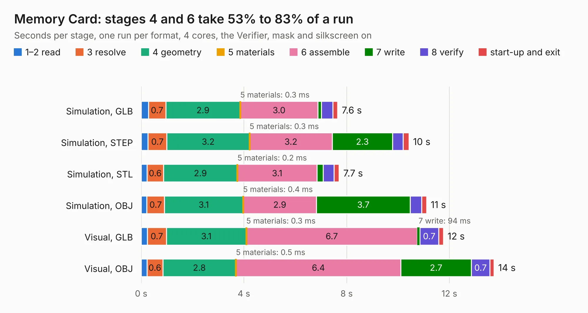

# 36. Memory Card

Board 36 of the 3,109 of [Corpus Testing](../Corpus-Testing.md), on [Corpus Page 1](../CorpusTestingPages/Corpus-Testing-01.md#36-memory-card).

| Mode and format | 1–2 read | 3 resolve | 4 geometry | 5 materials | 6 assemble | 7 write | 8 verify | start-up and exit | Total |
|---|---:|---:|---:|---:|---:|---:|---:|---:|---:|
| Simulation, GLB | 0.3 | 0.7 | 2.9 | 0.3&nbsp;ms | 3.0 | 0.1 | 0.4 | 0.2 | 7.6 |
| Simulation, STEP | 0.3 | 0.7 | 3.2 | 0.3&nbsp;ms | 3.2 | 2.3 | 0.4 | 0.2 | 10.4 |
| Simulation, STL | 0.2 | 0.6 | 2.9 | 0.2&nbsp;ms | 3.1 | 0.2 | 0.4 | 0.2 | 7.7 |
| Simulation, OBJ | 0.2 | 0.7 | 3.1 | 0.4&nbsp;ms | 2.9 | 3.7 | 0.4 | 0.2 | 11.1 |
| Visual, GLB | 0.2 | 0.7 | 3.1 | 0.3&nbsp;ms | 6.7 | 94&nbsp;ms | 0.7 | 0.2 | 11.8 |
| Visual, OBJ | 0.2 | 0.6 | 2.8 | 0.5&nbsp;ms | 6.4 | 2.7 | 0.7 | 0.2 | 13.7 |

<table align="center"><tr><td valign="top">

| Board | Repo: [acwright/6502](https://github.com/acwright/6502) Board: `Memory Card.kicad_pcb` |
|---|---|
| Folder | Hardware / Memory Card / Rev 1.0 |
| Complexity | 270&nbsp;/&nbsp;1000 (size&nbsp;160, features&nbsp;110) |
| KESE&nbsp;features | through vias, custom pads, rounded, trapezoid or chamfered pads, filled zones, copper drawings, curved board outline, stack-up, dielectric εr and tanδ |
| Tested | 9th November 2026 |
| Copper&nbsp;layers | 2 |
| File&nbsp;format | KiCad 10 (20260206) |
| Parts,&nbsp;tracks,&nbsp;vias | 18, 455, 145 |
| Triangles,&nbsp;simulation | 912,660 in 62 parts |
| Verifier | PASS in all six runs |

</td><td valign="top">

<table>
<tr><th>File type</th><th>File size</th><th>Peak memory used</th></tr>
<tr><th colspan="3" align="left">Simulation</th></tr>
<tr><td>GLB</td><td align="right">31&nbsp;MB</td><td align="right">420&nbsp;MB</td></tr>
<tr><td>STEP</td><td align="right">147&nbsp;MB</td><td align="right">527&nbsp;MB</td></tr>
<tr><td>STL</td><td align="right">46&nbsp;MB</td><td align="right">450&nbsp;MB</td></tr>
<tr><td>OBJ</td><td align="right">92&nbsp;MB</td><td align="right">632&nbsp;MB</td></tr>
<tr><th colspan="3" align="left">Visual</th></tr>
<tr><td>GLB</td><td align="right">24&nbsp;MB</td><td align="right">615&nbsp;MB</td></tr>
<tr><td>OBJ</td><td align="right">73&nbsp;MB</td><td align="right">604&nbsp;MB</td></tr>
</table>

</td></tr></table>

| Previous | Next |
|:---|---:|
| [35. Mega Helper](b0035b_6502_Mega-Helper.md) | [37. Prototype Card](b0037b_6502_Prototype-Card.md) |
