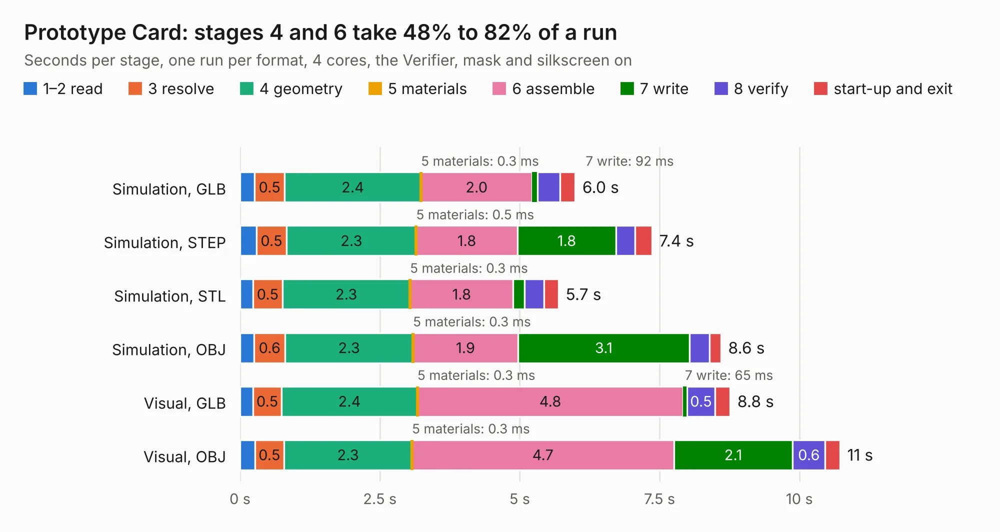

# 37. Prototype Card

Board 37 of the 3,127 of [Corpus Testing](../Corpus-Testing.md), on [Corpus Page 1](../CorpusTestingPages/Corpus-Testing-01.md#37-prototype-card).

| Mode and format | 1–2 read | 3 resolve | 4 geometry | 5 materials | 6 assemble | 7 write | 8 verify | start-up and exit | Total |
|---|---:|---:|---:|---:|---:|---:|---:|---:|---:|
| Simulation, GLB | 0.3 | 0.5 | 2.4 | 0.3&nbsp;ms | 2.0 | 92&nbsp;ms | 0.4 | 0.3 | 6.0 |
| Simulation, STEP | 0.3 | 0.5 | 2.3 | 0.5&nbsp;ms | 1.8 | 1.8 | 0.3 | 0.3 | 7.4 |
| Simulation, STL | 0.2 | 0.5 | 2.3 | 0.3&nbsp;ms | 1.8 | 0.2 | 0.4 | 0.3 | 5.7 |
| Simulation, OBJ | 0.3 | 0.6 | 2.3 | 0.3&nbsp;ms | 1.9 | 3.1 | 0.4 | 0.2 | 8.6 |
| Visual, GLB | 0.2 | 0.5 | 2.4 | 0.3&nbsp;ms | 4.8 | 65&nbsp;ms | 0.5 | 0.3 | 8.8 |
| Visual, OBJ | 0.3 | 0.5 | 2.3 | 0.3&nbsp;ms | 4.7 | 2.1 | 0.6 | 0.3 | 10.7 |

<table align="center"><tr><td valign="top">

| Board | Repo: [acwright/6502](https://github.com/acwright/6502) Board: `Prototype Card.kicad_pcb` |
|---|---|
| Folder | Hardware / Prototype Card / Rev 1.0 |
| Complexity | 193&nbsp;/&nbsp;1000 (size&nbsp;138, features&nbsp;55) |
| KESE&nbsp;features | through vias, rounded, trapezoid or chamfered pads, filled zones, curved board outline |
| Tested | 9th November 2026 |
| Copper&nbsp;layers | 2 |
| File&nbsp;format | KiCad 10 (20260206) |
| Parts,&nbsp;tracks,&nbsp;vias | 7, 346, 23 |
| Triangles,&nbsp;simulation | 497,896 in 57 parts |
| Verifier | PASS in all six runs |

</td><td valign="top">

<table>
<tr><th>File type</th><th>File size</th><th>Peak memory used</th></tr>
<tr><th colspan="3" align="left">Simulation</th></tr>
<tr><td>GLB</td><td align="right">17&nbsp;MB</td><td align="right">349&nbsp;MB</td></tr>
<tr><td>STEP</td><td align="right">80&nbsp;MB</td><td align="right">356&nbsp;MB</td></tr>
<tr><td>STL</td><td align="right">25&nbsp;MB</td><td align="right">337&nbsp;MB</td></tr>
<tr><td>OBJ</td><td align="right">51&nbsp;MB</td><td align="right">381&nbsp;MB</td></tr>
<tr><th colspan="3" align="left">Visual</th></tr>
<tr><td>GLB</td><td align="right">13&nbsp;MB</td><td align="right">366&nbsp;MB</td></tr>
<tr><td>OBJ</td><td align="right">38&nbsp;MB</td><td align="right">367&nbsp;MB</td></tr>
</table>

</td></tr></table>

| Previous | Next |
|:---|---:|
| [36. Memory Card](b0036b_6502_Memory-Card.md) | [38. PS2 Helper](b0038b_6502_PS2-Helper.md) |
