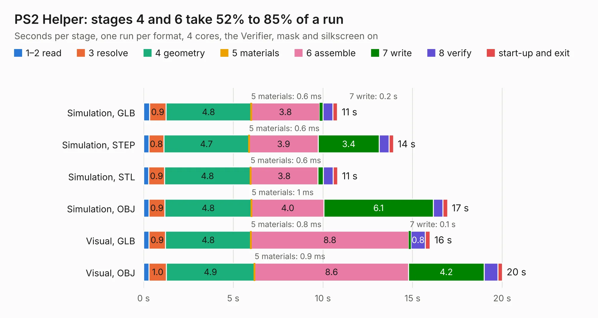

# 38 PS2 Helper

Board 38 of the 3,138 of [Corpus Testing](../Corpus-Testing.md), on [Corpus Page 1](../CorpusTestingPages/Corpus-Testing-01.md#38-ps2-helper).

| Mode and format | 1–2 read | 3 resolve | 4 geometry | 5 materials | 6 assemble | 7 write | 8 verify | start-up and exit | Total |
|---|---:|---:|---:|---:|---:|---:|---:|---:|---:|
| Simulation, GLB | 0.3 | 0.9 | 4.8 | 0.6&nbsp;ms | 3.8 | 0.2 | 0.6 | 0.2 | 10.8 |
| Simulation, STEP | 0.3 | 0.8 | 4.7 | 0.6&nbsp;ms | 3.9 | 3.4 | 0.5 | 0.3 | 13.9 |
| Simulation, STL | 0.3 | 0.9 | 4.8 | 0.6&nbsp;ms | 3.8 | 0.3 | 0.5 | 0.3 | 10.8 |
| Simulation, OBJ | 0.3 | 0.9 | 4.8 | 1&nbsp;ms | 4.0 | 6.1 | 0.5 | 0.3 | 17.0 |
| Visual, GLB | 0.3 | 0.9 | 4.8 | 0.8&nbsp;ms | 8.8 | 0.1 | 0.8 | 0.3 | 16.0 |
| Visual, OBJ | 0.3 | 1.0 | 4.9 | 0.9&nbsp;ms | 8.6 | 4.2 | 0.8 | 0.3 | 20.0 |

<table align="center"><tr><td valign="top">

| Board | Repo: [acwright/6502](https://github.com/acwright/6502) Board: `PS2 Helper.kicad_pcb` |
|---|---|
| Folder | Hardware / PS2 Helper / Rev 1.0 |
| Complexity | 212&nbsp;/&nbsp;1000 (size&nbsp;157, features&nbsp;55) |
| KESE&nbsp;features | through vias, rounded, trapezoid or chamfered pads, filled zones, curved board outline |
| Tested | 9th November 2026 |
| Copper&nbsp;layers | 2 |
| File&nbsp;format | KiCad 10 (20260206) |
| Parts,&nbsp;tracks,&nbsp;vias | 21, 350, 102 |
| Triangles,&nbsp;simulation | 1,097,420 in 61 parts |
| Verifier | PASS in all six runs |

</td><td valign="top">

<table>
<tr><th>File type</th><th>File size</th><th>Peak memory used</th></tr>
<tr><th colspan="3" align="left">Simulation</th></tr>
<tr><td>GLB</td><td align="right">37&nbsp;MB</td><td align="right">529&nbsp;MB</td></tr>
<tr><td>STEP</td><td align="right">156&nbsp;MB</td><td align="right">583&nbsp;MB</td></tr>
<tr><td>STL</td><td align="right">55&nbsp;MB</td><td align="right">553&nbsp;MB</td></tr>
<tr><td>OBJ</td><td align="right">110&nbsp;MB</td><td align="right">748&nbsp;MB</td></tr>
<tr><th colspan="3" align="left">Visual</th></tr>
<tr><td>GLB</td><td align="right">25&nbsp;MB</td><td align="right">612&nbsp;MB</td></tr>
<tr><td>OBJ</td><td align="right">76&nbsp;MB</td><td align="right">612&nbsp;MB</td></tr>
</table>

</td></tr></table>

| Previous | Next |
|:---|---:|
| [37 Prototype Card](b0037b_6502_Prototype-Card.md) | [39 RAM Card](b0039b_6502_RAM-Card.md) |
