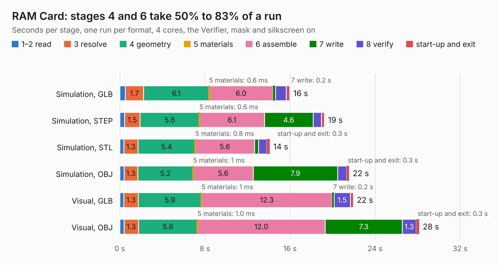

# 39. RAM Card

Board 39 of the 3,123 of [Corpus Testing](../Corpus-Testing.md), on [Corpus Page 1](../CorpusTestingPages/Corpus-Testing-01.md#39-ram-card).

| Mode and format | 1–2 read | 3 resolve | 4 geometry | 5 materials | 6 assemble | 7 write | 8 verify | start-up and exit | Total |
|---|---:|---:|---:|---:|---:|---:|---:|---:|---:|
| Simulation, GLB | 0.5 | 1.7 | 6.1 | 0.6&nbsp;ms | 6.0 | 0.2 | 1.0 | 0.3 | 16.0 |
| Simulation, STEP | 0.4 | 1.5 | 5.6 | 0.6&nbsp;ms | 6.1 | 4.6 | 0.8 | 0.3 | 19.2 |
| Simulation, STL | 0.4 | 1.3 | 5.4 | 0.8&nbsp;ms | 5.6 | 0.4 | 0.8 | 0.3 | 14.1 |
| Simulation, OBJ | 0.4 | 1.3 | 5.2 | 1&nbsp;ms | 5.6 | 7.9 | 0.8 | 0.3 | 21.6 |
| Visual, GLB | 0.4 | 1.3 | 5.9 | 1&nbsp;ms | 12.3 | 0.2 | 1.5 | 0.3 | 21.9 |
| Visual, OBJ | 0.4 | 1.3 | 5.6 | 1.0&nbsp;ms | 12.0 | 7.3 | 1.3 | 0.3 | 28.1 |

<table align="center"><tr><td valign="top">

| Board | Repo: [acwright/6502](https://github.com/acwright/6502) Board: `RAM Card.kicad_pcb` |
|---|---|
| Folder | Hardware / RAM Card / Rev 1.0 |
| Complexity | 280&nbsp;/&nbsp;1000 (size&nbsp;170, features&nbsp;110) |
| KESE&nbsp;features | through vias, custom pads, rounded, trapezoid or chamfered pads, filled zones, copper drawings, curved board outline, stack-up, dielectric εr and tanδ |
| Tested | 9th November 2026 |
| Copper&nbsp;layers | 2 |
| File&nbsp;format | KiCad 10 (20260206) |
| Parts,&nbsp;tracks,&nbsp;vias | 21, 760, 238 |
| Triangles,&nbsp;simulation | 1,263,002 in 84 parts |
| Verifier | PASS in all six runs |

</td><td valign="top">

<table>
<tr><th>File type</th><th>File size</th><th>Peak memory used</th></tr>
<tr><th colspan="3" align="left">Simulation</th></tr>
<tr><td>GLB</td><td align="right">43&nbsp;MB</td><td align="right">564&nbsp;MB</td></tr>
<tr><td>STEP</td><td align="right">194&nbsp;MB</td><td align="right">656&nbsp;MB</td></tr>
<tr><td>STL</td><td align="right">63&nbsp;MB</td><td align="right">575&nbsp;MB</td></tr>
<tr><td>OBJ</td><td align="right">128&nbsp;MB</td><td align="right">839&nbsp;MB</td></tr>
<tr><th colspan="3" align="left">Visual</th></tr>
<tr><td>GLB</td><td align="right">34&nbsp;MB</td><td align="right">680&nbsp;MB</td></tr>
<tr><td>OBJ</td><td align="right">104&nbsp;MB</td><td align="right">869&nbsp;MB</td></tr>
</table>

</td></tr></table>

| Previous | Next |
|:---|---:|
| [38. PS2 Helper](b0038b_6502_PS2-Helper.md) | [40. RTC Card](b0040b_6502_RTC-Card.md) |
