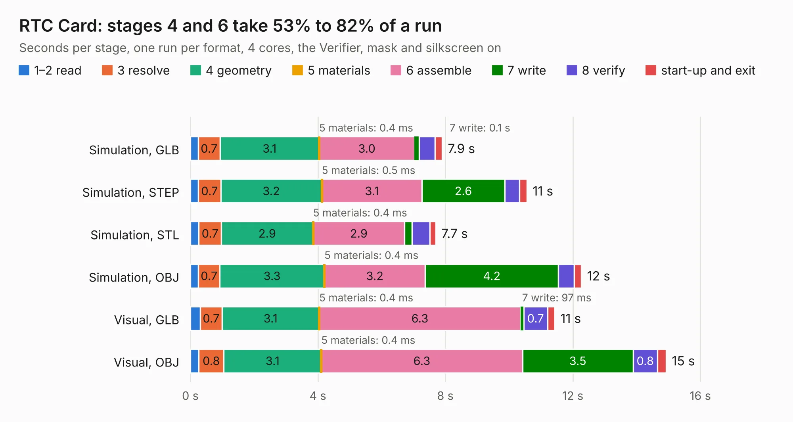

# 40. RTC Card

Board 40 of the 3,130 of [Corpus Testing](../Corpus-Testing.md), on [Corpus Page 1](../CorpusTestingPages/Corpus-Testing-01.md#40-rtc-card).

| Mode and format | 1–2 read | 3 resolve | 4 geometry | 5 materials | 6 assemble | 7 write | 8 verify | start-up and exit | Total |
|---|---:|---:|---:|---:|---:|---:|---:|---:|---:|
| Simulation, GLB | 0.2 | 0.7 | 3.1 | 0.4&nbsp;ms | 3.0 | 0.1 | 0.5 | 0.2 | 7.9 |
| Simulation, STEP | 0.3 | 0.7 | 3.2 | 0.5&nbsp;ms | 3.1 | 2.6 | 0.5 | 0.2 | 10.6 |
| Simulation, STL | 0.3 | 0.7 | 2.9 | 0.4&nbsp;ms | 2.9 | 0.2 | 0.6 | 0.2 | 7.7 |
| Simulation, OBJ | 0.3 | 0.7 | 3.3 | 0.4&nbsp;ms | 3.2 | 4.2 | 0.5 | 0.2 | 12.3 |
| Visual, GLB | 0.3 | 0.7 | 3.1 | 0.4&nbsp;ms | 6.3 | 97&nbsp;ms | 0.7 | 0.2 | 11.4 |
| Visual, OBJ | 0.3 | 0.8 | 3.1 | 0.4&nbsp;ms | 6.3 | 3.5 | 0.8 | 0.3 | 14.9 |

<table align="center"><tr><td valign="top">

| Board | Repo: [acwright/6502](https://github.com/acwright/6502) Board: `RTC Card.kicad_pcb` |
|---|---|
| Folder | Hardware / RTC Card / Rev 1.0 |
| Complexity | 235&nbsp;/&nbsp;1000 (size&nbsp;155, features&nbsp;80) |
| KESE&nbsp;features | through vias, custom pads, rounded, trapezoid or chamfered pads, filled zones, copper drawings, curved board outline |
| Tested | 9th November 2026 |
| Copper&nbsp;layers | 2 |
| File&nbsp;format | KiCad 10 (20260206) |
| Parts,&nbsp;tracks,&nbsp;vias | 16, 379, 111 |
| Triangles,&nbsp;simulation | 801,244 in 77 parts |
| Verifier | PASS in all six runs |

</td><td valign="top">

<table>
<tr><th>File type</th><th>File size</th><th>Peak memory used</th></tr>
<tr><th colspan="3" align="left">Simulation</th></tr>
<tr><td>GLB</td><td align="right">27&nbsp;MB</td><td align="right">390&nbsp;MB</td></tr>
<tr><td>STEP</td><td align="right">125&nbsp;MB</td><td align="right">491&nbsp;MB</td></tr>
<tr><td>STL</td><td align="right">40&nbsp;MB</td><td align="right">382&nbsp;MB</td></tr>
<tr><td>OBJ</td><td align="right">81&nbsp;MB</td><td align="right">586&nbsp;MB</td></tr>
<tr><th colspan="3" align="left">Visual</th></tr>
<tr><td>GLB</td><td align="right">21&nbsp;MB</td><td align="right">531&nbsp;MB</td></tr>
<tr><td>OBJ</td><td align="right">62&nbsp;MB</td><td align="right">502&nbsp;MB</td></tr>
</table>

</td></tr></table>

| Previous | Next |
|:---|---:|
| [39. RAM Card](b0039b_6502_RAM-Card.md) | [41. Serial Card Pro](b0041b_6502_Serial-Card-Pro.md) |
