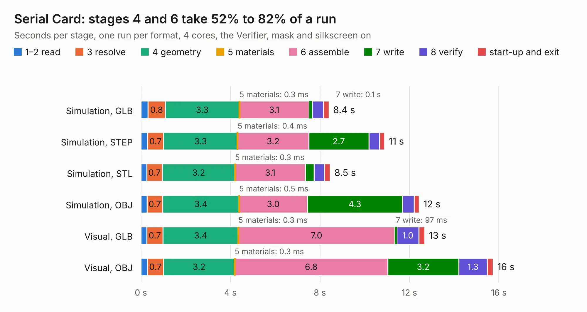

# 42. Serial Card

Board 42 of the 3,107 of [Corpus Testing](../Corpus-Testing.md), on [Corpus Page 1](../CorpusTestingPages/Corpus-Testing-01.md#42-serial-card).

| Mode and format | 1–2 read | 3 resolve | 4 geometry | 5 materials | 6 assemble | 7 write | 8 verify | start-up and exit | Total |
|---|---:|---:|---:|---:|---:|---:|---:|---:|---:|
| Simulation, GLB | 0.3 | 0.8 | 3.3 | 0.3&nbsp;ms | 3.1 | 0.1 | 0.5 | 0.2 | 8.4 |
| Simulation, STEP | 0.3 | 0.7 | 3.3 | 0.4&nbsp;ms | 3.2 | 2.7 | 0.5 | 0.2 | 10.9 |
| Simulation, STL | 0.3 | 0.7 | 3.2 | 0.3&nbsp;ms | 3.1 | 0.4 | 0.5 | 0.3 | 8.5 |
| Simulation, OBJ | 0.3 | 0.7 | 3.4 | 0.5&nbsp;ms | 3.0 | 4.3 | 0.5 | 0.2 | 12.4 |
| Visual, GLB | 0.3 | 0.7 | 3.4 | 0.3&nbsp;ms | 7.0 | 97&nbsp;ms | 1.0 | 0.3 | 12.7 |
| Visual, OBJ | 0.3 | 0.7 | 3.2 | 0.3&nbsp;ms | 6.8 | 3.2 | 1.3 | 0.3 | 15.7 |

<table align="center"><tr><td valign="top">

| Board | Repo: [acwright/6502](https://github.com/acwright/6502) Board: `Serial Card.kicad_pcb` |
|---|---|
| Folder | Hardware / Serial Card / Rev 1.0 |
| Complexity | 236&nbsp;/&nbsp;1000 (size&nbsp;156, features&nbsp;80) |
| KESE&nbsp;features | through vias, custom pads, rounded, trapezoid or chamfered pads, filled zones, copper drawings, curved board outline |
| Tested | 9th November 2026 |
| Copper&nbsp;layers | 2 |
| File&nbsp;format | KiCad 10 (20260206) |
| Parts,&nbsp;tracks,&nbsp;vias | 21, 364, 90 |
| Triangles,&nbsp;simulation | 799,922 in 82 parts |
| Verifier | PASS in all six runs |

</td><td valign="top">

<table>
<tr><th>File type</th><th>File size</th><th>Peak memory used</th></tr>
<tr><th colspan="3" align="left">Simulation</th></tr>
<tr><td>GLB</td><td align="right">27&nbsp;MB</td><td align="right">385&nbsp;MB</td></tr>
<tr><td>STEP</td><td align="right">124&nbsp;MB</td><td align="right">495&nbsp;MB</td></tr>
<tr><td>STL</td><td align="right">40&nbsp;MB</td><td align="right">403&nbsp;MB</td></tr>
<tr><td>OBJ</td><td align="right">80&nbsp;MB</td><td align="right">584&nbsp;MB</td></tr>
<tr><th colspan="3" align="left">Visual</th></tr>
<tr><td>GLB</td><td align="right">20&nbsp;MB</td><td align="right">480&nbsp;MB</td></tr>
<tr><td>OBJ</td><td align="right">60&nbsp;MB</td><td align="right">542&nbsp;MB</td></tr>
</table>

</td></tr></table>

| Previous | Next |
|:---|---:|
| [41. Serial Card Pro](b0041b_6502_Serial-Card-Pro.md) | [43. Sound Card](b0043b_6502_Sound-Card.md) |
