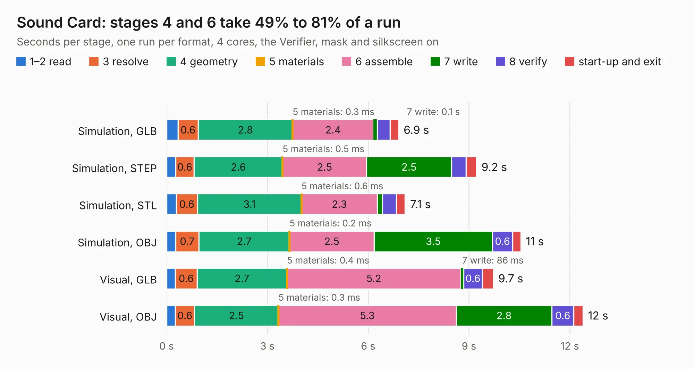

# 43. Sound Card

Board 43 of the 3,124 of [Corpus Testing](../Corpus-Testing.md), on [Corpus Page 1](../CorpusTestingPages/Corpus-Testing-01.md#43-sound-card).

| Mode and format | 1–2 read | 3 resolve | 4 geometry | 5 materials | 6 assemble | 7 write | 8 verify | start-up and exit | Total |
|---|---:|---:|---:|---:|---:|---:|---:|---:|---:|
| Simulation, GLB | 0.3 | 0.6 | 2.8 | 0.3&nbsp;ms | 2.4 | 0.1 | 0.4 | 0.3 | 6.9 |
| Simulation, STEP | 0.3 | 0.6 | 2.6 | 0.5&nbsp;ms | 2.5 | 2.5 | 0.4 | 0.3 | 9.2 |
| Simulation, STL | 0.3 | 0.6 | 3.1 | 0.6&nbsp;ms | 2.3 | 0.2 | 0.4 | 0.3 | 7.1 |
| Simulation, OBJ | 0.3 | 0.7 | 2.7 | 0.2&nbsp;ms | 2.5 | 3.5 | 0.6 | 0.2 | 10.5 |
| Visual, GLB | 0.3 | 0.6 | 2.7 | 0.4&nbsp;ms | 5.2 | 86&nbsp;ms | 0.6 | 0.3 | 9.7 |
| Visual, OBJ | 0.3 | 0.6 | 2.5 | 0.3&nbsp;ms | 5.3 | 2.8 | 0.6 | 0.3 | 12.4 |

<table align="center"><tr><td valign="top">

| Board | Repo: [acwright/6502](https://github.com/acwright/6502) Board: `Sound Card.kicad_pcb` |
|---|---|
| Folder | Hardware / Sound Card / Rev 1.0 |
| Complexity | 208&nbsp;/&nbsp;1000 (size&nbsp;143, features&nbsp;65) |
| KESE&nbsp;features | through vias, slotted holes, rounded, trapezoid or chamfered pads, filled zones, curved board outline |
| Tested | 9th November 2026 |
| Copper&nbsp;layers | 2 |
| File&nbsp;format | KiCad 10 (20260206) |
| Parts,&nbsp;tracks,&nbsp;vias | 12, 250, 55 |
| Triangles,&nbsp;simulation | 555,072 in 67 parts |
| Verifier | PASS in all six runs |

</td><td valign="top">

<table>
<tr><th>File type</th><th>File size</th><th>Peak memory used</th></tr>
<tr><th colspan="3" align="left">Simulation</th></tr>
<tr><td>GLB</td><td align="right">19&nbsp;MB</td><td align="right">345&nbsp;MB</td></tr>
<tr><td>STEP</td><td align="right">88&nbsp;MB</td><td align="right">387&nbsp;MB</td></tr>
<tr><td>STL</td><td align="right">28&nbsp;MB</td><td align="right">359&nbsp;MB</td></tr>
<tr><td>OBJ</td><td align="right">56&nbsp;MB</td><td align="right">427&nbsp;MB</td></tr>
<tr><th colspan="3" align="left">Visual</th></tr>
<tr><td>GLB</td><td align="right">14&nbsp;MB</td><td align="right">387&nbsp;MB</td></tr>
<tr><td>OBJ</td><td align="right">43&nbsp;MB</td><td align="right">386&nbsp;MB</td></tr>
</table>

</td></tr></table>

| Previous | Next |
|:---|---:|
| [42. Serial Card](b0042b_6502_Serial-Card.md) | [44. Storage Card Pro](b0044b_6502_Storage-Card-Pro.md) |
