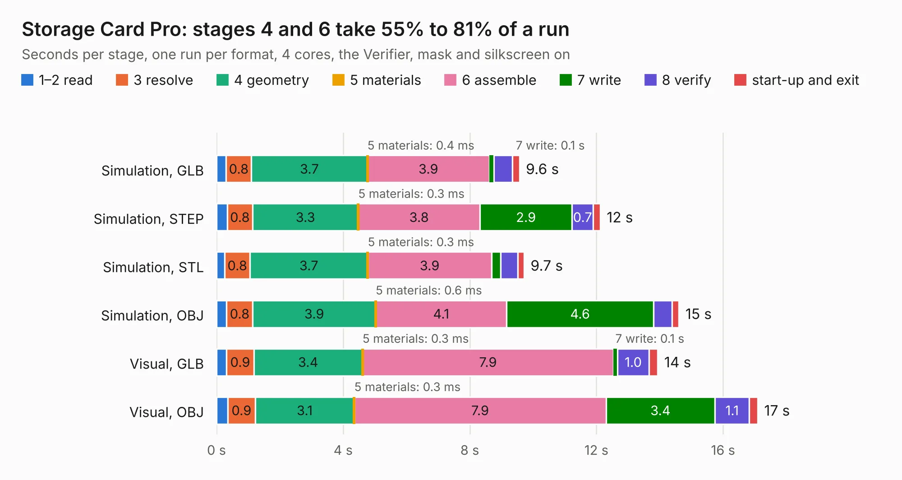

# 44. Storage Card Pro

Board 44 of the 3,139 of [Corpus Testing](../Corpus-Testing.md), on [Corpus Page 1](../CorpusTestingPages/Corpus-Testing-01.md#44-storage-card-pro).

| Mode and format | 1–2 read | 3 resolve | 4 geometry | 5 materials | 6 assemble | 7 write | 8 verify | start-up and exit | Total |
|---|---:|---:|---:|---:|---:|---:|---:|---:|---:|
| Simulation, GLB | 0.3 | 0.8 | 3.7 | 0.4&nbsp;ms | 3.9 | 0.1 | 0.6 | 0.2 | 9.6 |
| Simulation, STEP | 0.3 | 0.8 | 3.3 | 0.3&nbsp;ms | 3.8 | 2.9 | 0.7 | 0.2 | 12.1 |
| Simulation, STL | 0.3 | 0.8 | 3.7 | 0.3&nbsp;ms | 3.9 | 0.3 | 0.5 | 0.2 | 9.7 |
| Simulation, OBJ | 0.3 | 0.8 | 3.9 | 0.6&nbsp;ms | 4.1 | 4.6 | 0.6 | 0.2 | 14.6 |
| Visual, GLB | 0.3 | 0.9 | 3.4 | 0.3&nbsp;ms | 7.9 | 0.1 | 1.0 | 0.3 | 13.9 |
| Visual, OBJ | 0.4 | 0.9 | 3.1 | 0.3&nbsp;ms | 7.9 | 3.4 | 1.1 | 0.3 | 17.1 |

<table align="center"><tr><td valign="top">

| Board | Repo: [acwright/6502](https://github.com/acwright/6502) Board: `Storage Card Pro.kicad_pcb` |
|---|---|
| Folder | Hardware / Storage Card Pro / Rev 1.0 |
| Complexity | 218&nbsp;/&nbsp;1000 (size&nbsp;163, features&nbsp;55) |
| KESE&nbsp;features | through vias, rounded, trapezoid or chamfered pads, filled zones, curved board outline |
| Tested | 9th November 2026 |
| Copper&nbsp;layers | 2 |
| File&nbsp;format | KiCad 10 (20260206) |
| Parts,&nbsp;tracks,&nbsp;vias | 26, 471, 135 |
| Triangles,&nbsp;simulation | 942,536 in 82 parts |
| Verifier | PASS in all six runs |

</td><td valign="top">

<table>
<tr><th>File type</th><th>File size</th><th>Peak memory used</th></tr>
<tr><th colspan="3" align="left">Simulation</th></tr>
<tr><td>GLB</td><td align="right">32&nbsp;MB</td><td align="right">439&nbsp;MB</td></tr>
<tr><td>STEP</td><td align="right">153&nbsp;MB</td><td align="right">529&nbsp;MB</td></tr>
<tr><td>STL</td><td align="right">47&nbsp;MB</td><td align="right">445&nbsp;MB</td></tr>
<tr><td>OBJ</td><td align="right">95&nbsp;MB</td><td align="right">679&nbsp;MB</td></tr>
<tr><th colspan="3" align="left">Visual</th></tr>
<tr><td>GLB</td><td align="right">25&nbsp;MB</td><td align="right">561&nbsp;MB</td></tr>
<tr><td>OBJ</td><td align="right">77&nbsp;MB</td><td align="right">640&nbsp;MB</td></tr>
</table>

</td></tr></table>

| Previous | Next |
|:---|---:|
| [43. Sound Card](b0043b_6502_Sound-Card.md) | [45. Storage Card](b0045b_6502_Storage-Card.md) |
