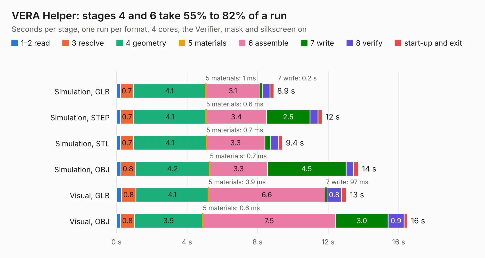

# 46. VERA Helper

Board 46 of the 3,131 of [Corpus Testing](../Corpus-Testing.md), on [Corpus Page 1](../CorpusTestingPages/Corpus-Testing-01.md#46-vera-helper).

| Mode and format | 1–2 read | 3 resolve | 4 geometry | 5 materials | 6 assemble | 7 write | 8 verify | start-up and exit | Total |
|---|---:|---:|---:|---:|---:|---:|---:|---:|---:|
| Simulation, GLB | 0.2 | 0.7 | 4.1 | 1&nbsp;ms | 3.1 | 0.2 | 0.4 | 0.2 | 8.9 |
| Simulation, STEP | 0.2 | 0.7 | 4.1 | 0.6&nbsp;ms | 3.4 | 2.5 | 0.5 | 0.2 | 11.7 |
| Simulation, STL | 0.2 | 0.7 | 4.1 | 0.7&nbsp;ms | 3.3 | 0.3 | 0.4 | 0.2 | 9.4 |
| Simulation, OBJ | 0.3 | 0.8 | 4.2 | 0.7&nbsp;ms | 3.3 | 4.5 | 0.4 | 0.3 | 13.7 |
| Visual, GLB | 0.3 | 0.8 | 4.1 | 0.9&nbsp;ms | 6.6 | 97&nbsp;ms | 0.8 | 0.3 | 13.0 |
| Visual, OBJ | 0.2 | 0.8 | 3.9 | 0.6&nbsp;ms | 7.5 | 3.0 | 0.9 | 0.2 | 16.5 |

<table align="center"><tr><td valign="top">

| Board | Repo: [acwright/6502](https://github.com/acwright/6502) Board: `VERA Helper.kicad_pcb` |
|---|---|
| Folder | Hardware / VERA Helper / Rev 1.0 |
| Complexity | 239&nbsp;/&nbsp;1000 (size&nbsp;149, features&nbsp;90) |
| KESE&nbsp;features | through vias, slotted holes, custom pads, rounded, trapezoid or chamfered pads, filled zones, copper drawings, curved board outline |
| Tested | 9th November 2026 |
| Copper&nbsp;layers | 2 |
| File&nbsp;format | KiCad 10 (20260206) |
| Parts,&nbsp;tracks,&nbsp;vias | 14, 294, 82 |
| Triangles,&nbsp;simulation | 1,073,128 in 71 parts |
| Verifier | PASS in all six runs |

</td><td valign="top">

<table>
<tr><th>File type</th><th>File size</th><th>Peak memory used</th></tr>
<tr><th colspan="3" align="left">Simulation</th></tr>
<tr><td>GLB</td><td align="right">36&nbsp;MB</td><td align="right">548&nbsp;MB</td></tr>
<tr><td>STEP</td><td align="right">149&nbsp;MB</td><td align="right">580&nbsp;MB</td></tr>
<tr><td>STL</td><td align="right">54&nbsp;MB</td><td align="right">532&nbsp;MB</td></tr>
<tr><td>OBJ</td><td align="right">108&nbsp;MB</td><td align="right">752&nbsp;MB</td></tr>
<tr><th colspan="3" align="left">Visual</th></tr>
<tr><td>GLB</td><td align="right">25&nbsp;MB</td><td align="right">663&nbsp;MB</td></tr>
<tr><td>OBJ</td><td align="right">76&nbsp;MB</td><td align="right">624&nbsp;MB</td></tr>
</table>

</td></tr></table>

| Previous | Next |
|:---|---:|
| [45. Storage Card](b0045b_6502_Storage-Card.md) | [47. VGA Card Pro](b0047b_6502_VGA-Card-Pro.md) |
