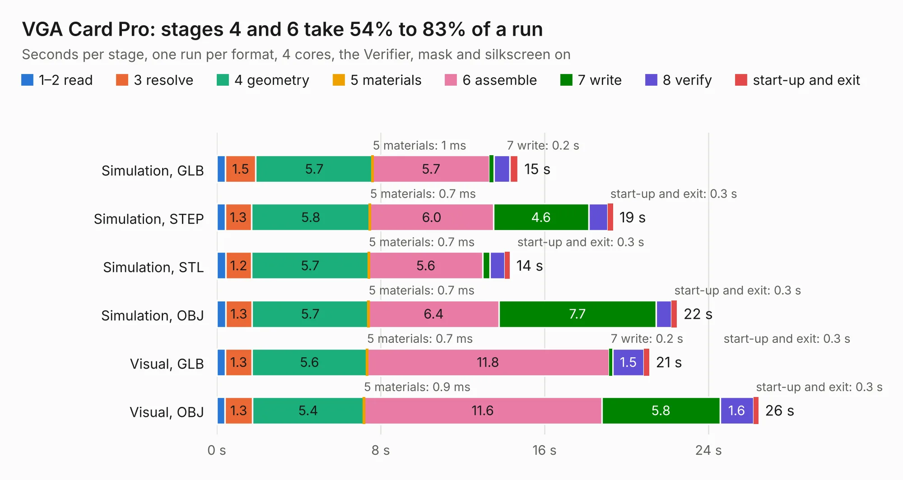

# 47. VGA Card Pro

Board 47 of the 3,105 of [Corpus Testing](../Corpus-Testing.md), on [Corpus Page 1](../CorpusTestingPages/Corpus-Testing-01.md#47-vga-card-pro).

| Mode and format | 1–2 read | 3 resolve | 4 geometry | 5 materials | 6 assemble | 7 write | 8 verify | start-up and exit | Total |
|---|---:|---:|---:|---:|---:|---:|---:|---:|---:|
| Simulation, GLB | 0.4 | 1.5 | 5.7 | 1&nbsp;ms | 5.7 | 0.2 | 0.8 | 0.4 | 14.7 |
| Simulation, STEP | 0.4 | 1.3 | 5.8 | 0.7&nbsp;ms | 6.0 | 4.6 | 0.9 | 0.3 | 19.3 |
| Simulation, STL | 0.4 | 1.2 | 5.7 | 0.7&nbsp;ms | 5.6 | 0.4 | 0.7 | 0.3 | 14.3 |
| Simulation, OBJ | 0.4 | 1.3 | 5.7 | 0.7&nbsp;ms | 6.4 | 7.7 | 0.8 | 0.3 | 22.5 |
| Visual, GLB | 0.4 | 1.3 | 5.6 | 0.7&nbsp;ms | 11.8 | 0.2 | 1.5 | 0.3 | 21.1 |
| Visual, OBJ | 0.4 | 1.3 | 5.4 | 0.9&nbsp;ms | 11.6 | 5.8 | 1.6 | 0.3 | 26.4 |

<table align="center"><tr><td valign="top">

| Board | Repo: [acwright/6502](https://github.com/acwright/6502) Board: `VGA Card Pro.kicad_pcb` |
|---|---|
| Folder | Hardware / VGA Card Pro / Rev 1.0 |
| Complexity | 262&nbsp;/&nbsp;1000 (size&nbsp;172, features&nbsp;90) |
| KESE&nbsp;features | through vias, custom pads, rounded, trapezoid or chamfered pads, drill offsets, filled zones, copper drawings, curved board outline |
| Tested | 9th November 2026 |
| Copper&nbsp;layers | 2 |
| File&nbsp;format | KiCad 10 (20260206) |
| Parts,&nbsp;tracks,&nbsp;vias | 33, 637, 197 |
| Triangles,&nbsp;simulation | 1,219,950 in 116 parts |
| Verifier | PASS in all six runs |

</td><td valign="top">

<table>
<tr><th>File type</th><th>File size</th><th>Peak memory used</th></tr>
<tr><th colspan="3" align="left">Simulation</th></tr>
<tr><td>GLB</td><td align="right">42&nbsp;MB</td><td align="right">526&nbsp;MB</td></tr>
<tr><td>STEP</td><td align="right">189&nbsp;MB</td><td align="right">653&nbsp;MB</td></tr>
<tr><td>STL</td><td align="right">61&nbsp;MB</td><td align="right">529&nbsp;MB</td></tr>
<tr><td>OBJ</td><td align="right">124&nbsp;MB</td><td align="right">830&nbsp;MB</td></tr>
<tr><th colspan="3" align="left">Visual</th></tr>
<tr><td>GLB</td><td align="right">32&nbsp;MB</td><td align="right">794&nbsp;MB</td></tr>
<tr><td>OBJ</td><td align="right">97&nbsp;MB</td><td align="right">733&nbsp;MB</td></tr>
</table>

</td></tr></table>

| Previous | Next |
|:---|---:|
| [46. VERA Helper](b0046b_6502_VERA-Helper.md) | [48. VGA Card](b0048b_6502_VGA-Card.md) |
