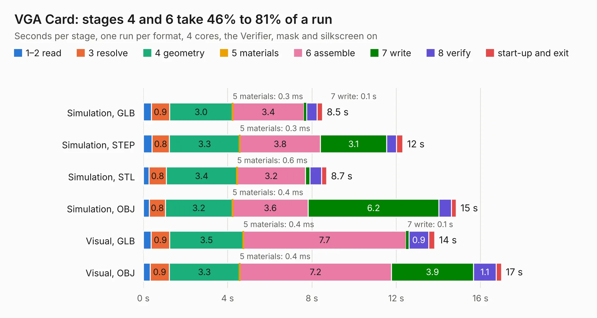

# 48 VGA Card

Board 48 of the 3,138 of [Corpus Testing](../Corpus-Testing.md), on [Corpus Page 1](../CorpusTestingPages/Corpus-Testing-01.md#48-vga-card).

| Mode and format | 1–2 read | 3 resolve | 4 geometry | 5 materials | 6 assemble | 7 write | 8 verify | start-up and exit | Total |
|---|---:|---:|---:|---:|---:|---:|---:|---:|---:|
| Simulation, GLB | 0.4 | 0.9 | 3.0 | 0.3&nbsp;ms | 3.4 | 0.1 | 0.5 | 0.3 | 8.5 |
| Simulation, STEP | 0.4 | 0.8 | 3.3 | 0.3&nbsp;ms | 3.8 | 3.1 | 0.5 | 0.3 | 12.3 |
| Simulation, STL | 0.3 | 0.8 | 3.4 | 0.6&nbsp;ms | 3.2 | 0.2 | 0.6 | 0.2 | 8.7 |
| Simulation, OBJ | 0.3 | 0.8 | 3.2 | 0.4&nbsp;ms | 3.6 | 6.2 | 0.6 | 0.2 | 14.9 |
| Visual, GLB | 0.4 | 0.9 | 3.5 | 0.4&nbsp;ms | 7.7 | 0.1 | 0.9 | 0.3 | 13.8 |
| Visual, OBJ | 0.3 | 0.9 | 3.3 | 0.4&nbsp;ms | 7.2 | 3.9 | 1.1 | 0.3 | 17.0 |

<table align="center"><tr><td valign="top">

| Board | Repo: [acwright/6502](https://github.com/acwright/6502) Board: `VGA Card.kicad_pcb` |
|---|---|
| Folder | Hardware / VGA Card / Rev 1.0 |
| Complexity | 230&nbsp;/&nbsp;1000 (size&nbsp;150, features&nbsp;80) |
| KESE&nbsp;features | through vias, custom pads, rounded, trapezoid or chamfered pads, filled zones, copper drawings, curved board outline |
| Tested | 9th November 2026 |
| Copper&nbsp;layers | 2 |
| File&nbsp;format | KiCad 10 (20260206) |
| Parts,&nbsp;tracks,&nbsp;vias | 12, 333, 102 |
| Triangles,&nbsp;simulation | 757,742 in 94 parts |
| Verifier | PASS in all six runs |

</td><td valign="top">

<table>
<tr><th>File type</th><th>File size</th><th>Peak memory used</th></tr>
<tr><th colspan="3" align="left">Simulation</th></tr>
<tr><td>GLB</td><td align="right">26&nbsp;MB</td><td align="right">372&nbsp;MB</td></tr>
<tr><td>STEP</td><td align="right">116&nbsp;MB</td><td align="right">464&nbsp;MB</td></tr>
<tr><td>STL</td><td align="right">38&nbsp;MB</td><td align="right">393&nbsp;MB</td></tr>
<tr><td>OBJ</td><td align="right">76&nbsp;MB</td><td align="right">558&nbsp;MB</td></tr>
<tr><th colspan="3" align="left">Visual</th></tr>
<tr><td>GLB</td><td align="right">19&nbsp;MB</td><td align="right">537&nbsp;MB</td></tr>
<tr><td>OBJ</td><td align="right">58&nbsp;MB</td><td align="right">519&nbsp;MB</td></tr>
</table>

</td></tr></table>

| Previous | Next |
|:---|---:|
| [47 VGA Card Pro](b0047b_6502_VGA-Card-Pro.md) | [49 Video Card Pro](b0049b_6502_Video-Card-Pro.md) |
