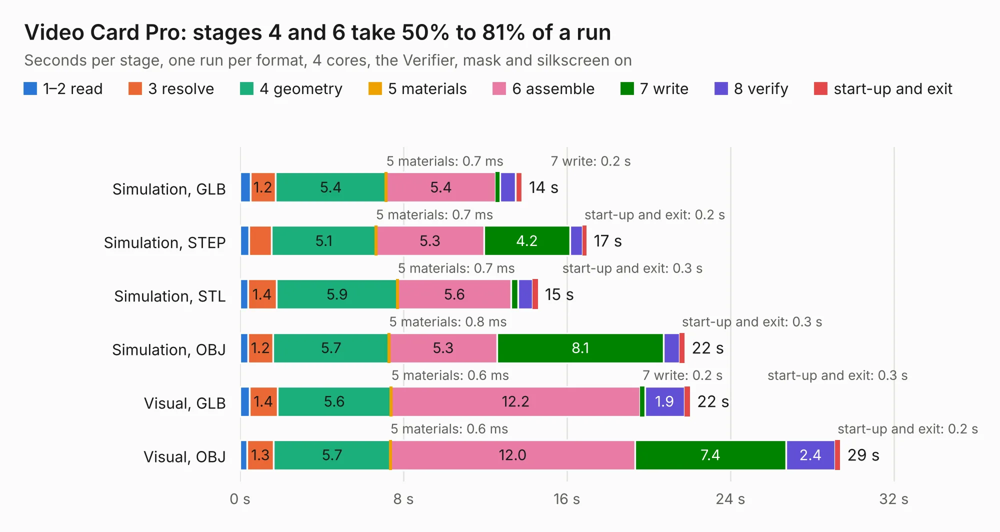

# 49. Video Card Pro

Board 49 of the 3,100 of [Corpus Testing](../Corpus-Testing.md), on [Corpus Page 1](../CorpusTestingPages/Corpus-Testing-01.md#49-video-card-pro).

| Mode and format | 1–2 read | 3 resolve | 4 geometry | 5 materials | 6 assemble | 7 write | 8 verify | start-up and exit | Total |
|---|---:|---:|---:|---:|---:|---:|---:|---:|---:|
| Simulation, GLB | 0.5 | 1.2 | 5.4 | 0.7&nbsp;ms | 5.4 | 0.2 | 0.8 | 0.3 | 13.8 |
| Simulation, STEP | 0.4 | 1.1 | 5.1 | 0.7&nbsp;ms | 5.3 | 4.2 | 0.6 | 0.2 | 17.0 |
| Simulation, STL | 0.4 | 1.4 | 5.9 | 0.7&nbsp;ms | 5.6 | 0.3 | 0.7 | 0.3 | 14.6 |
| Simulation, OBJ | 0.4 | 1.2 | 5.7 | 0.8&nbsp;ms | 5.3 | 8.1 | 0.8 | 0.3 | 21.8 |
| Visual, GLB | 0.5 | 1.4 | 5.6 | 0.6&nbsp;ms | 12.2 | 0.2 | 1.9 | 0.3 | 22.0 |
| Visual, OBJ | 0.4 | 1.3 | 5.7 | 0.6&nbsp;ms | 12.0 | 7.4 | 2.4 | 0.2 | 29.4 |

<table align="center"><tr><td valign="top">

| Board | Repo: [acwright/6502](https://github.com/acwright/6502) Board: `Video Card Pro.kicad_pcb` |
|---|---|
| Folder | Hardware / Video Card Pro / Rev 1.0 |
| Complexity | 274&nbsp;/&nbsp;1000 (size&nbsp;174, features&nbsp;100) |
| KESE&nbsp;features | through vias, slotted holes, custom pads, rounded, trapezoid or chamfered pads, drill offsets, filled zones, copper drawings, curved board outline |
| Tested | 9th November 2026 |
| Copper&nbsp;layers | 2 |
| File&nbsp;format | KiCad 10 (20260206) |
| Parts,&nbsp;tracks,&nbsp;vias | 33, 800, 202 |
| Triangles,&nbsp;simulation | 1,288,982 in 94 parts |
| Verifier | PASS in all six runs |

</td><td valign="top">

<table>
<tr><th>File type</th><th>File size</th><th>Peak memory used</th></tr>
<tr><th colspan="3" align="left">Simulation</th></tr>
<tr><td>GLB</td><td align="right">44&nbsp;MB</td><td align="right">548&nbsp;MB</td></tr>
<tr><td>STEP</td><td align="right">206&nbsp;MB</td><td align="right">648&nbsp;MB</td></tr>
<tr><td>STL</td><td align="right">64&nbsp;MB</td><td align="right">598&nbsp;MB</td></tr>
<tr><td>OBJ</td><td align="right">131&nbsp;MB</td><td align="right">873&nbsp;MB</td></tr>
<tr><th colspan="3" align="left">Visual</th></tr>
<tr><td>GLB</td><td align="right">34&nbsp;MB</td><td align="right">721&nbsp;MB</td></tr>
<tr><td>OBJ</td><td align="right">103&nbsp;MB</td><td align="right">732&nbsp;MB</td></tr>
</table>

</td></tr></table>

| Previous | Next |
|:---|---:|
| [48. VGA Card](b0048b_6502_VGA-Card.md) | [50. Video Card](b0050b_6502_Video-Card.md) |
