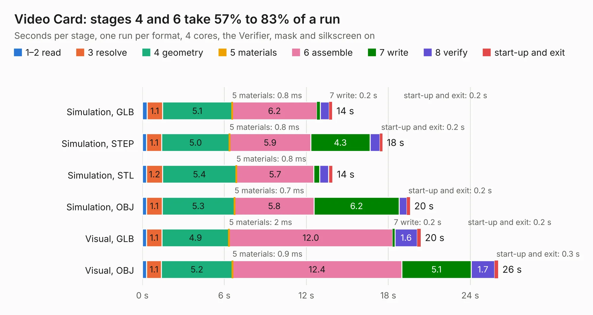

# 50. Video Card

Board 50 of the 3,128 of [Corpus Testing](../Corpus-Testing.md), on [Corpus Page 1](../CorpusTestingPages/Corpus-Testing-01.md#50-video-card).

| Mode and format | 1–2 read | 3 resolve | 4 geometry | 5 materials | 6 assemble | 7 write | 8 verify | start-up and exit | Total |
|---|---:|---:|---:|---:|---:|---:|---:|---:|---:|
| Simulation, GLB | 0.3 | 1.1 | 5.1 | 0.8&nbsp;ms | 6.2 | 0.2 | 0.7 | 0.2 | 13.9 |
| Simulation, STEP | 0.3 | 1.1 | 5.0 | 0.8&nbsp;ms | 5.9 | 4.3 | 0.7 | 0.2 | 17.6 |
| Simulation, STL | 0.3 | 1.2 | 5.4 | 0.8&nbsp;ms | 5.7 | 0.4 | 0.7 | 0.3 | 13.9 |
| Simulation, OBJ | 0.3 | 1.1 | 5.3 | 0.7&nbsp;ms | 5.8 | 6.2 | 0.6 | 0.2 | 19.6 |
| Visual, GLB | 0.3 | 1.1 | 4.9 | 2&nbsp;ms | 12.0 | 0.2 | 1.6 | 0.2 | 20.4 |
| Visual, OBJ | 0.3 | 1.1 | 5.2 | 0.9&nbsp;ms | 12.4 | 5.1 | 1.7 | 0.3 | 26.0 |

<table align="center"><tr><td valign="top">

| Board | Repo: [acwright/6502](https://github.com/acwright/6502) Board: `Video Card.kicad_pcb` |
|---|---|
| Folder | Hardware / Video Card / Rev 1.0 |
| Complexity | 276&nbsp;/&nbsp;1000 (size&nbsp;176, features&nbsp;100) |
| KESE&nbsp;features | through vias, slotted holes, custom pads, rounded, trapezoid or chamfered pads, drill offsets, filled zones, copper drawings, curved board outline |
| Tested | 9th November 2026 |
| Copper&nbsp;layers | 2 |
| File&nbsp;format | KiCad 10 (20260206) |
| Parts,&nbsp;tracks,&nbsp;vias | 35, 881, 231 |
| Triangles,&nbsp;simulation | 1,513,430 in 120 parts |
| Verifier | PASS in all six runs |

</td><td valign="top">

<table>
<tr><th>File type</th><th>File size</th><th>Peak memory used</th></tr>
<tr><th colspan="3" align="left">Simulation</th></tr>
<tr><td>GLB</td><td align="right">52&nbsp;MB</td><td align="right">597&nbsp;MB</td></tr>
<tr><td>STEP</td><td align="right">252&nbsp;MB</td><td align="right">790&nbsp;MB</td></tr>
<tr><td>STL</td><td align="right">76&nbsp;MB</td><td align="right">604&nbsp;MB</td></tr>
<tr><td>OBJ</td><td align="right">155&nbsp;MB</td><td align="right">1.0&nbsp;GB</td></tr>
<tr><th colspan="3" align="left">Visual</th></tr>
<tr><td>GLB</td><td align="right">40&nbsp;MB</td><td align="right">907&nbsp;MB</td></tr>
<tr><td>OBJ</td><td align="right">123&nbsp;MB</td><td align="right">929&nbsp;MB</td></tr>
</table>

</td></tr></table>

| Previous | Next |
|:---|---:|
| [49. Video Card Pro](b0049b_6502_Video-Card-Pro.md) | [51. Miniscope-v4-FlexPC](b0051b_Miniscope-v4_Development-Files-Individual-PCBs-Miniscope-v4-FlexPC-Miniscope-v4-FlexPC-array-clamp-KiCad_Miniscope-v4-FlexPC.md) |
