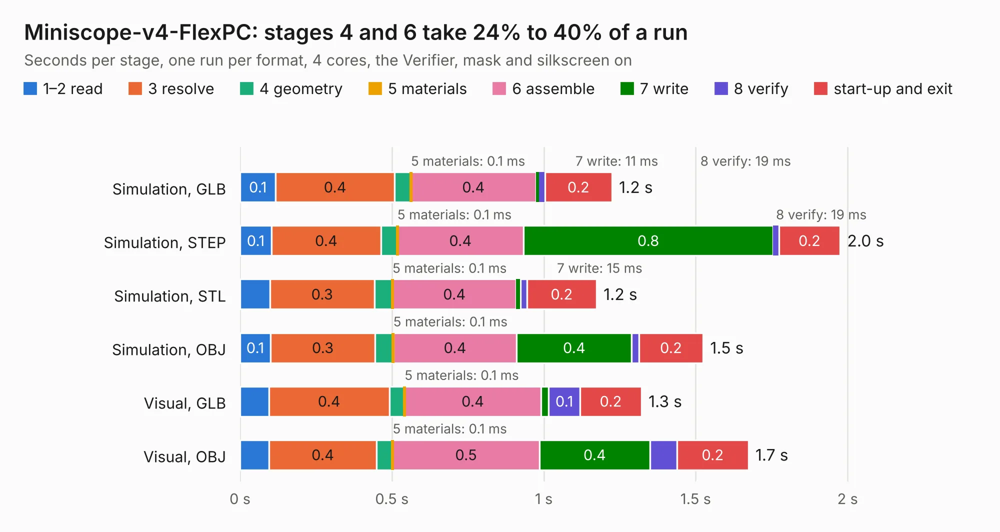

# 51. Miniscope-v4-FlexPC

Board 51 of the 3,118 of [Corpus Testing](../Corpus-Testing.md), on [Corpus Page 1](../CorpusTestingPages/Corpus-Testing-01.md#51-miniscope-v4-flexpc).

| Mode and format | 1–2 read | 3 resolve | 4 geometry | 5 materials | 6 assemble | 7 write | 8 verify | start-up and exit | Total |
|---|---:|---:|---:|---:|---:|---:|---:|---:|---:|
| Simulation, GLB | 0.1 | 0.4 | 54&nbsp;ms | 0.1&nbsp;ms | 0.4 | 11&nbsp;ms | 19&nbsp;ms | 0.2 | 1.2 |
| Simulation, STEP | 0.1 | 0.4 | 54&nbsp;ms | 0.1&nbsp;ms | 0.4 | 0.8 | 19&nbsp;ms | 0.2 | 2.0 |
| Simulation, STL | 98&nbsp;ms | 0.3 | 60&nbsp;ms | 0.1&nbsp;ms | 0.4 | 15&nbsp;ms | 21&nbsp;ms | 0.2 | 1.2 |
| Simulation, OBJ | 0.1 | 0.3 | 60&nbsp;ms | 0.1&nbsp;ms | 0.4 | 0.4 | 24&nbsp;ms | 0.2 | 1.5 |
| Visual, GLB | 95&nbsp;ms | 0.4 | 50&nbsp;ms | 0.1&nbsp;ms | 0.4 | 25&nbsp;ms | 0.1 | 0.2 | 1.3 |
| Visual, OBJ | 95&nbsp;ms | 0.4 | 53&nbsp;ms | 0.1&nbsp;ms | 0.5 | 0.4 | 89&nbsp;ms | 0.2 | 1.7 |

<table align="center"><tr><td valign="top">

| Board | Repo: [Aharoni-Lab/Miniscope-v4](https://github.com/Aharoni-Lab/Miniscope-v4) Board: `Miniscope-v4-FlexPC.kicad_pcb` |
|---|---|
| Folder | Development Files / Individual PCBs / Miniscope-v4-FlexPC / Miniscope-v4-FlexPC-array-clamp / KiCad |
| Complexity | 85&nbsp;/&nbsp;1000 (size&nbsp;70, features&nbsp;15) |
| KESE&nbsp;features | through vias |
| Tested | 9th November 2026 |
| Copper&nbsp;layers | 2 |
| File&nbsp;format | KiCad 5 (20171130) |
| Parts,&nbsp;tracks,&nbsp;vias | 6, 3, 1 |
| Triangles,&nbsp;simulation | 64,520 in 5 parts |
| Note | panel |
| Verifier | PASS in all six runs |

</td><td valign="top">

<table>
<tr><th>File type</th><th>File size</th><th>Peak memory used</th></tr>
<tr><th colspan="3" align="left">Simulation</th></tr>
<tr><td>GLB</td><td align="right">2.3&nbsp;MB</td><td align="right">83&nbsp;MB</td></tr>
<tr><td>STEP</td><td align="right">13&nbsp;MB</td><td align="right">195&nbsp;MB</td></tr>
<tr><td>STL</td><td align="right">3.2&nbsp;MB</td><td align="right">81&nbsp;MB</td></tr>
<tr><td>OBJ</td><td align="right">6.5&nbsp;MB</td><td align="right">105&nbsp;MB</td></tr>
<tr><th colspan="3" align="left">Visual</th></tr>
<tr><td>GLB</td><td align="right">2.3&nbsp;MB</td><td align="right">127&nbsp;MB</td></tr>
<tr><td>OBJ</td><td align="right">6.4&nbsp;MB</td><td align="right">134&nbsp;MB</td></tr>
</table>

</td></tr></table>

| Previous | Next |
|:---|---:|
| [50. Video Card](b0050b_6502_Video-Card.md) | [52. Miniscope-v4-FlexPC](b0052b_Miniscope-v4_Development-Files-Individual-PCBs-Miniscope-v4-FlexPC-Miniscope-v4-FlexPC-array-double-sided-KiCad_Miniscope-v4-FlexPC.md) |
