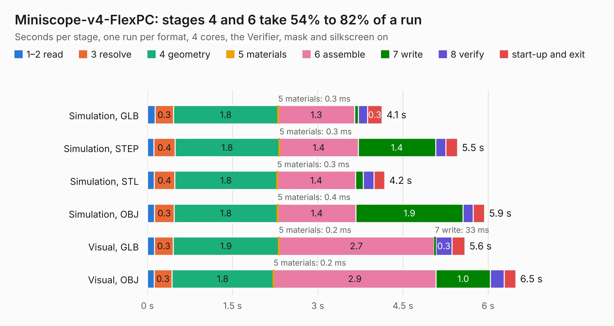

# 52. Miniscope-v4-FlexPC

Board 52 of the 3,110 of [Corpus Testing](../Corpus-Testing.md), on [Corpus Page 1](../CorpusTestingPages/Corpus-Testing-01.md#52-miniscope-v4-flexpc).

| Mode and format | 1–2 read | 3 resolve | 4 geometry | 5 materials | 6 assemble | 7 write | 8 verify | start-up and exit | Total |
|---|---:|---:|---:|---:|---:|---:|---:|---:|---:|
| Simulation, GLB | 0.1 | 0.3 | 1.8 | 0.3&nbsp;ms | 1.3 | 65&nbsp;ms | 0.2 | 0.3 | 4.1 |
| Simulation, STEP | 0.1 | 0.4 | 1.8 | 0.3&nbsp;ms | 1.4 | 1.4 | 0.2 | 0.2 | 5.5 |
| Simulation, STL | 0.1 | 0.4 | 1.8 | 0.3&nbsp;ms | 1.4 | 0.1 | 0.2 | 0.2 | 4.2 |
| Simulation, OBJ | 0.1 | 0.3 | 1.8 | 0.4&nbsp;ms | 1.4 | 1.9 | 0.2 | 0.2 | 5.9 |
| Visual, GLB | 0.1 | 0.3 | 1.9 | 0.2&nbsp;ms | 2.7 | 33&nbsp;ms | 0.3 | 0.2 | 5.6 |
| Visual, OBJ | 0.1 | 0.3 | 1.8 | 0.2&nbsp;ms | 2.9 | 1.0 | 0.2 | 0.2 | 6.5 |

<table align="center"><tr><td valign="top">

| Board | Repo: [Aharoni-Lab/Miniscope-v4](https://github.com/Aharoni-Lab/Miniscope-v4) Board: `Miniscope-v4-FlexPC.kicad_pcb` |
|---|---|
| Folder | Development Files / Individual PCBs / Miniscope-v4-FlexPC / Miniscope-v4-FlexPC-array-double-sided / KiCad |
| Complexity | 168&nbsp;/&nbsp;1000 (size&nbsp;123, features&nbsp;45) |
| KESE&nbsp;features | through vias, rounded, trapezoid or chamfered pads, filled zones |
| Tested | 9th November 2026 |
| Copper&nbsp;layers | 2 |
| File&nbsp;format | KiCad 5 (20171130) |
| Parts,&nbsp;tracks,&nbsp;vias | 8, 148, 2 |
| Triangles,&nbsp;simulation | 478,690 in 49 parts |
| Note | panel |
| Verifier | PASS in all six runs |

</td><td valign="top">

<table>
<tr><th>File type</th><th>File size</th><th>Peak memory used</th></tr>
<tr><th colspan="3" align="left">Simulation</th></tr>
<tr><td>GLB</td><td align="right">16&nbsp;MB</td><td align="right">304&nbsp;MB</td></tr>
<tr><td>STEP</td><td align="right">79&nbsp;MB</td><td align="right">321&nbsp;MB</td></tr>
<tr><td>STL</td><td align="right">24&nbsp;MB</td><td align="right">276&nbsp;MB</td></tr>
<tr><td>OBJ</td><td align="right">49&nbsp;MB</td><td align="right">356&nbsp;MB</td></tr>
<tr><th colspan="3" align="left">Visual</th></tr>
<tr><td>GLB</td><td align="right">8.0&nbsp;MB</td><td align="right">267&nbsp;MB</td></tr>
<tr><td>OBJ</td><td align="right">24&nbsp;MB</td><td align="right">269&nbsp;MB</td></tr>
</table>

</td></tr></table>

| Previous | Next |
|:---|---:|
| [51. Miniscope-v4-FlexPC](b0051b_Miniscope-v4_Development-Files-Individual-PCBs-Miniscope-v4-FlexPC-Miniscope-v4-FlexPC-array-clamp-KiCad_Miniscope-v4-FlexPC.md) | [53. Miniscope-v4-FlexPC](b0053b_Miniscope-v4_Development-Files-Individual-PCBs-Miniscope-v4-FlexPC-Miniscope-v4-FlexPC-array-KiCad_Miniscope-v4-FlexPC.md) |
