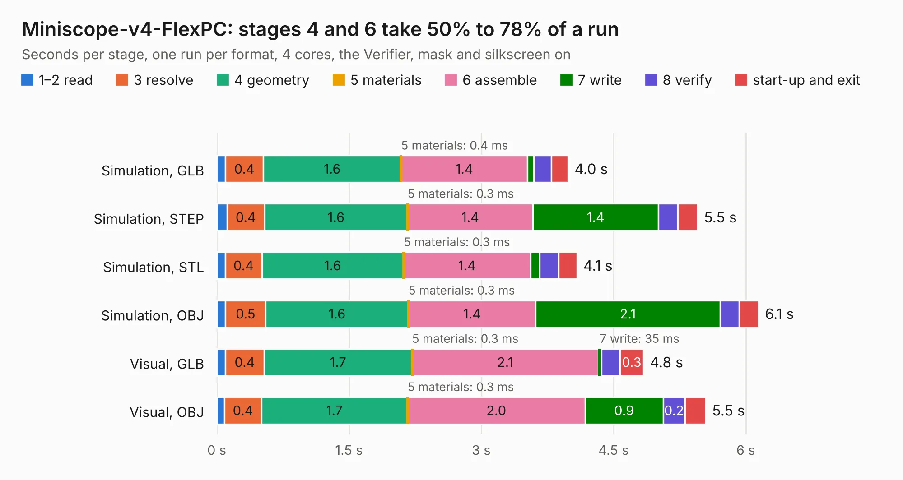

# 53. Miniscope-v4-FlexPC

Board 53 of the 3,109 of [Corpus Testing](../Corpus-Testing.md), on [Corpus Page 1](../CorpusTestingPages/Corpus-Testing-01.md#53-miniscope-v4-flexpc).

| Mode and format | 1–2 read | 3 resolve | 4 geometry | 5 materials | 6 assemble | 7 write | 8 verify | start-up and exit | Total |
|---|---:|---:|---:|---:|---:|---:|---:|---:|---:|
| Simulation, GLB | 98&nbsp;ms | 0.4 | 1.6 | 0.4&nbsp;ms | 1.4 | 69&nbsp;ms | 0.2 | 0.2 | 4.0 |
| Simulation, STEP | 0.1 | 0.4 | 1.6 | 0.3&nbsp;ms | 1.4 | 1.4 | 0.2 | 0.2 | 5.5 |
| Simulation, STL | 99&nbsp;ms | 0.4 | 1.6 | 0.3&nbsp;ms | 1.4 | 0.1 | 0.2 | 0.2 | 4.1 |
| Simulation, OBJ | 99&nbsp;ms | 0.5 | 1.6 | 0.3&nbsp;ms | 1.4 | 2.1 | 0.2 | 0.2 | 6.1 |
| Visual, GLB | 98&nbsp;ms | 0.4 | 1.7 | 0.3&nbsp;ms | 2.1 | 35&nbsp;ms | 0.2 | 0.3 | 4.8 |
| Visual, OBJ | 87&nbsp;ms | 0.4 | 1.7 | 0.3&nbsp;ms | 2.0 | 0.9 | 0.2 | 0.2 | 5.5 |

<table align="center"><tr><td valign="top">

| Board | Repo: [Aharoni-Lab/Miniscope-v4](https://github.com/Aharoni-Lab/Miniscope-v4) Board: `Miniscope-v4-FlexPC.kicad_pcb` |
|---|---|
| Folder | Development Files / Individual PCBs / Miniscope-v4-FlexPC / Miniscope-v4-FlexPC-array / KiCad |
| Complexity | 102&nbsp;/&nbsp;1000 (size&nbsp;102, features&nbsp;0) |
| Tested | 9th November 2026 |
| Copper&nbsp;layers | 2 |
| File&nbsp;format | KiCad 5 (20171130) |
| Parts,&nbsp;tracks,&nbsp;vias | 6, 50, 0 |
| Triangles,&nbsp;simulation | 399,432 in 49 parts |
| Note | panel |
| Verifier | PASS in all six runs |

</td><td valign="top">

<table>
<tr><th>File type</th><th>File size</th><th>Peak memory used</th></tr>
<tr><th colspan="3" align="left">Simulation</th></tr>
<tr><td>GLB</td><td align="right">13&nbsp;MB</td><td align="right">256&nbsp;MB</td></tr>
<tr><td>STEP</td><td align="right">61&nbsp;MB</td><td align="right">301&nbsp;MB</td></tr>
<tr><td>STL</td><td align="right">20&nbsp;MB</td><td align="right">261&nbsp;MB</td></tr>
<tr><td>OBJ</td><td align="right">40&nbsp;MB</td><td align="right">296&nbsp;MB</td></tr>
<tr><th colspan="3" align="left">Visual</th></tr>
<tr><td>GLB</td><td align="right">5.6&nbsp;MB</td><td align="right">242&nbsp;MB</td></tr>
<tr><td>OBJ</td><td align="right">16&nbsp;MB</td><td align="right">239&nbsp;MB</td></tr>
</table>

</td></tr></table>

| Previous | Next |
|:---|---:|
| [52. Miniscope-v4-FlexPC](b0052b_Miniscope-v4_Development-Files-Individual-PCBs-Miniscope-v4-FlexPC-Miniscope-v4-FlexPC-array-double-sided-KiCad_Miniscope-v4-FlexPC.md) | [54. BNO055_08092019](b0054b_Miniscope-v4_BNO055-08092019.md) |
