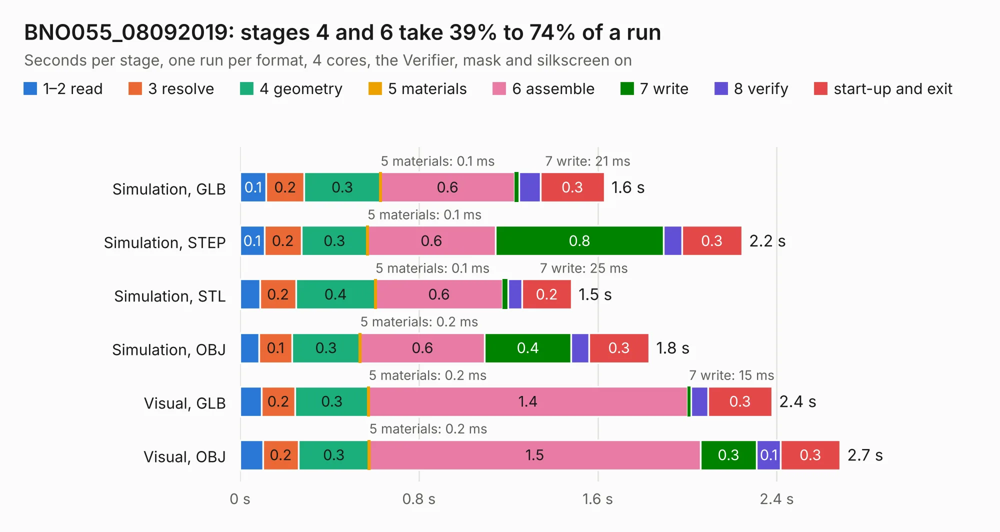

# 54. BNO055_08092019

Board 54 of the 3,127 of [Corpus Testing](../Corpus-Testing.md), on [Corpus Page 1](../CorpusTestingPages/Corpus-Testing-01.md#54-bno055_08092019).

| Mode and format | 1–2 read | 3 resolve | 4 geometry | 5 materials | 6 assemble | 7 write | 8 verify | start-up and exit | Total |
|---|---:|---:|---:|---:|---:|---:|---:|---:|---:|
| Simulation, GLB | 0.1 | 0.2 | 0.3 | 0.1&nbsp;ms | 0.6 | 21&nbsp;ms | 94&nbsp;ms | 0.3 | 1.6 |
| Simulation, STEP | 0.1 | 0.2 | 0.3 | 0.1&nbsp;ms | 0.6 | 0.8 | 81&nbsp;ms | 0.3 | 2.2 |
| Simulation, STL | 90&nbsp;ms | 0.2 | 0.4 | 0.1&nbsp;ms | 0.6 | 25&nbsp;ms | 62&nbsp;ms | 0.2 | 1.5 |
| Simulation, OBJ | 86&nbsp;ms | 0.1 | 0.3 | 0.2&nbsp;ms | 0.6 | 0.4 | 79&nbsp;ms | 0.3 | 1.8 |
| Visual, GLB | 96&nbsp;ms | 0.2 | 0.3 | 0.2&nbsp;ms | 1.4 | 15&nbsp;ms | 78&nbsp;ms | 0.3 | 2.4 |
| Visual, OBJ | 0.1 | 0.2 | 0.3 | 0.2&nbsp;ms | 1.5 | 0.3 | 0.1 | 0.3 | 2.7 |

<table align="center"><tr><td valign="top">

| Board | Repo: [Aharoni-Lab/Miniscope-v4](https://github.com/Aharoni-Lab/Miniscope-v4) Board: `BNO055_08092019.kicad_pcb` |
|---|---|
| Folder | Development Files / Individual PCBs / Miniscope-v4-IMU / KiCad / BNO055_08092019 |
| Complexity | 216&nbsp;/&nbsp;1000 (size&nbsp;181, features&nbsp;35) |
| KESE&nbsp;features | through vias, filled zones |
| Tested | 9th November 2026 |
| Copper&nbsp;layers | 4 |
| File&nbsp;format | KiCad 5 (20171130) |
| Parts,&nbsp;tracks,&nbsp;vias | 8, 64, 12 |
| Triangles,&nbsp;simulation | 77,112 in 26 parts |
| Verifier | PASS in all six runs |

</td><td valign="top">

<table>
<tr><th>File type</th><th>File size</th><th>Peak memory used</th></tr>
<tr><th colspan="3" align="left">Simulation</th></tr>
<tr><td>GLB</td><td align="right">2.8&nbsp;MB</td><td align="right">176&nbsp;MB</td></tr>
<tr><td>STEP</td><td align="right">9.3&nbsp;MB</td><td align="right">175&nbsp;MB</td></tr>
<tr><td>STL</td><td align="right">3.9&nbsp;MB</td><td align="right">174&nbsp;MB</td></tr>
<tr><td>OBJ</td><td align="right">7.6&nbsp;MB</td><td align="right">173&nbsp;MB</td></tr>
<tr><th colspan="3" align="left">Visual</th></tr>
<tr><td>GLB</td><td align="right">1.8&nbsp;MB</td><td align="right">153&nbsp;MB</td></tr>
<tr><td>OBJ</td><td align="right">4.9&nbsp;MB</td><td align="right">153&nbsp;MB</td></tr>
</table>

</td></tr></table>

| Previous | Next |
|:---|---:|
| [53. Miniscope-v4-FlexPC](b0053b_Miniscope-v4_Development-Files-Individual-PCBs-Miniscope-v4-FlexPC-Miniscope-v4-FlexPC-array-KiCad_Miniscope-v4-FlexPC.md) | [55. MS_v4_ETL_LED_Driver](b0055b_Miniscope-v4_MS-v4-ETL-LED-Driver.md) |
