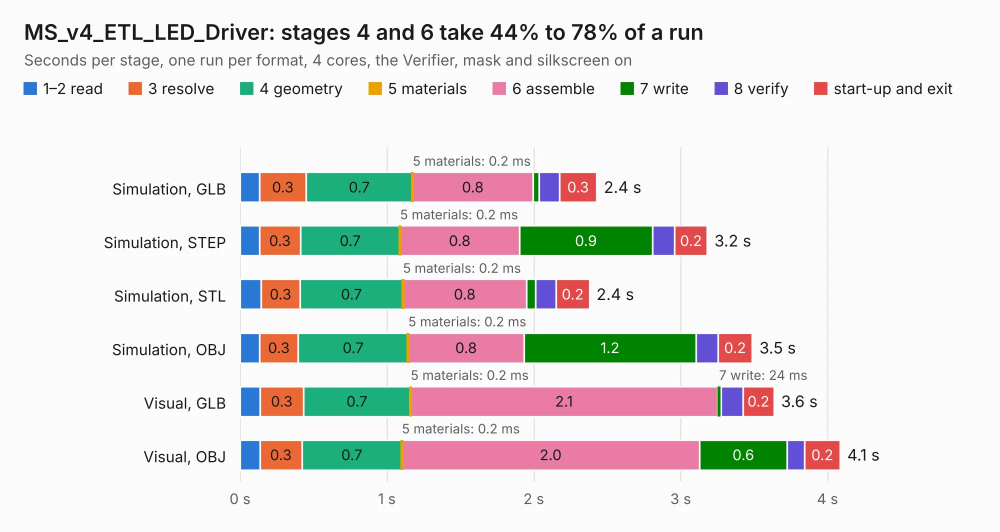

# 55. MS_v4_ETL_LED_Driver

Board 55 of the 3,130 of [Corpus Testing](../Corpus-Testing.md), on [Corpus Page 1](../CorpusTestingPages/Corpus-Testing-01.md#55-ms_v4_etl_led_driver).

| Mode and format | 1–2 read | 3 resolve | 4 geometry | 5 materials | 6 assemble | 7 write | 8 verify | start-up and exit | Total |
|---|---:|---:|---:|---:|---:|---:|---:|---:|---:|
| Simulation, GLB | 0.1 | 0.3 | 0.7 | 0.2&nbsp;ms | 0.8 | 43&nbsp;ms | 0.1 | 0.3 | 2.4 |
| Simulation, STEP | 0.1 | 0.3 | 0.7 | 0.2&nbsp;ms | 0.8 | 0.9 | 0.2 | 0.2 | 3.2 |
| Simulation, STL | 0.1 | 0.3 | 0.7 | 0.2&nbsp;ms | 0.8 | 60&nbsp;ms | 0.1 | 0.2 | 2.4 |
| Simulation, OBJ | 0.1 | 0.3 | 0.7 | 0.2&nbsp;ms | 0.8 | 1.2 | 0.1 | 0.2 | 3.5 |
| Visual, GLB | 0.1 | 0.3 | 0.7 | 0.2&nbsp;ms | 2.1 | 24&nbsp;ms | 0.2 | 0.2 | 3.6 |
| Visual, OBJ | 0.1 | 0.3 | 0.7 | 0.2&nbsp;ms | 2.0 | 0.6 | 0.1 | 0.2 | 4.1 |

<table align="center"><tr><td valign="top">

| Board | Repo: [Aharoni-Lab/Miniscope-v4](https://github.com/Aharoni-Lab/Miniscope-v4) Board: `MS_v4_ETL_LED_Driver.kicad_pcb` |
|---|---|
| Folder | Development Files / Individual PCBs / Miniscope-v4-LED-ETL-Driver / KiCad |
| Complexity | 201&nbsp;/&nbsp;1000 (size&nbsp;166, features&nbsp;35) |
| KESE&nbsp;features | through vias, filled zones |
| Tested | 9th November 2026 |
| Copper&nbsp;layers | 6 |
| File&nbsp;format | KiCad 5 (20171130) |
| Parts,&nbsp;tracks,&nbsp;vias | 17, 181, 29 |
| Triangles,&nbsp;simulation | 222,592 in 36 parts |
| Verifier | PASS in all six runs |

</td><td valign="top">

<table>
<tr><th>File type</th><th>File size</th><th>Peak memory used</th></tr>
<tr><th colspan="3" align="left">Simulation</th></tr>
<tr><td>GLB</td><td align="right">7.8&nbsp;MB</td><td align="right">210&nbsp;MB</td></tr>
<tr><td>STEP</td><td align="right">25&nbsp;MB</td><td align="right">221&nbsp;MB</td></tr>
<tr><td>STL</td><td align="right">11&nbsp;MB</td><td align="right">208&nbsp;MB</td></tr>
<tr><td>OBJ</td><td align="right">22&nbsp;MB</td><td align="right">218&nbsp;MB</td></tr>
<tr><th colspan="3" align="left">Visual</th></tr>
<tr><td>GLB</td><td align="right">4.1&nbsp;MB</td><td align="right">180&nbsp;MB</td></tr>
<tr><td>OBJ</td><td align="right">12&nbsp;MB</td><td align="right">182&nbsp;MB</td></tr>
</table>

</td></tr></table>

| Previous | Next |
|:---|---:|
| [54. BNO055_08092019](b0054b_Miniscope-v4_BNO055-08092019.md) | [56. Miniscope-v4-MCU](b0056b_Miniscope-v4_Miniscope-v4-MCU.md) |
