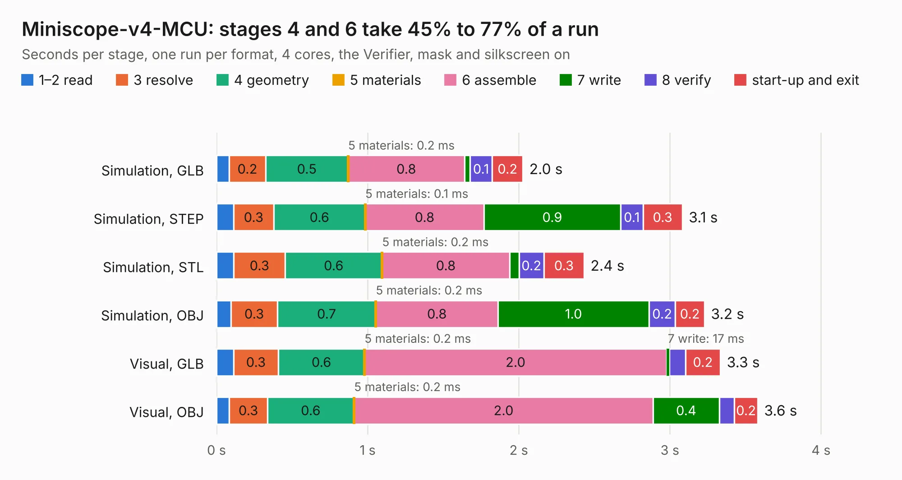

# 56. Miniscope-v4-MCU

Board 56 of the 3,119 of [Corpus Testing](../Corpus-Testing.md), on [Corpus Page 1](../CorpusTestingPages/Corpus-Testing-01.md#56-miniscope-v4-mcu).

| Mode and format | 1–2 read | 3 resolve | 4 geometry | 5 materials | 6 assemble | 7 write | 8 verify | start-up and exit | Total |
|---|---:|---:|---:|---:|---:|---:|---:|---:|---:|
| Simulation, GLB | 84&nbsp;ms | 0.2 | 0.5 | 0.2&nbsp;ms | 0.8 | 36&nbsp;ms | 0.1 | 0.2 | 2.0 |
| Simulation, STEP | 0.1 | 0.3 | 0.6 | 0.1&nbsp;ms | 0.8 | 0.9 | 0.1 | 0.3 | 3.1 |
| Simulation, STL | 0.1 | 0.3 | 0.6 | 0.2&nbsp;ms | 0.8 | 63&nbsp;ms | 0.2 | 0.3 | 2.4 |
| Simulation, OBJ | 96&nbsp;ms | 0.3 | 0.7 | 0.2&nbsp;ms | 0.8 | 1.0 | 0.2 | 0.2 | 3.2 |
| Visual, GLB | 0.1 | 0.3 | 0.6 | 0.2&nbsp;ms | 2.0 | 17&nbsp;ms | 0.1 | 0.2 | 3.3 |
| Visual, OBJ | 85&nbsp;ms | 0.3 | 0.6 | 0.2&nbsp;ms | 2.0 | 0.4 | 99&nbsp;ms | 0.2 | 3.6 |

<table align="center"><tr><td valign="top">

| Board | Repo: [Aharoni-Lab/Miniscope-v4](https://github.com/Aharoni-Lab/Miniscope-v4) Board: `Miniscope-v4-MCU.kicad_pcb` |
|---|---|
| Folder | Development Files / Individual PCBs / Miniscope-v4-MCU / KiCad |
| Complexity | 226&nbsp;/&nbsp;1000 (size&nbsp;191, features&nbsp;35) |
| KESE&nbsp;features | through vias, filled zones |
| Tested | 9th November 2026 |
| Copper&nbsp;layers | 6 |
| File&nbsp;format | KiCad 5 (20171130) |
| Parts,&nbsp;tracks,&nbsp;vias | 5, 132, 32 |
| Triangles,&nbsp;simulation | 239,108 in 45 parts |
| Verifier | PASS in all six runs |

</td><td valign="top">

<table>
<tr><th>File type</th><th>File size</th><th>Peak memory used</th></tr>
<tr><th colspan="3" align="left">Simulation</th></tr>
<tr><td>GLB</td><td align="right">8.3&nbsp;MB</td><td align="right">200&nbsp;MB</td></tr>
<tr><td>STEP</td><td align="right">26&nbsp;MB</td><td align="right">214&nbsp;MB</td></tr>
<tr><td>STL</td><td align="right">12&nbsp;MB</td><td align="right">197&nbsp;MB</td></tr>
<tr><td>OBJ</td><td align="right">24&nbsp;MB</td><td align="right">200&nbsp;MB</td></tr>
<tr><th colspan="3" align="left">Visual</th></tr>
<tr><td>GLB</td><td align="right">3.9&nbsp;MB</td><td align="right">177&nbsp;MB</td></tr>
<tr><td>OBJ</td><td align="right">11&nbsp;MB</td><td align="right">178&nbsp;MB</td></tr>
</table>

</td></tr></table>

| Previous | Next |
|:---|---:|
| [55. MS_v4_ETL_LED_Driver](b0055b_Miniscope-v4_MS-v4-ETL-LED-Driver.md) | [57. Miniscope-v4-PYTHON480](b0057b_Miniscope-v4_Miniscope-v4-PYTHON480.md) |
