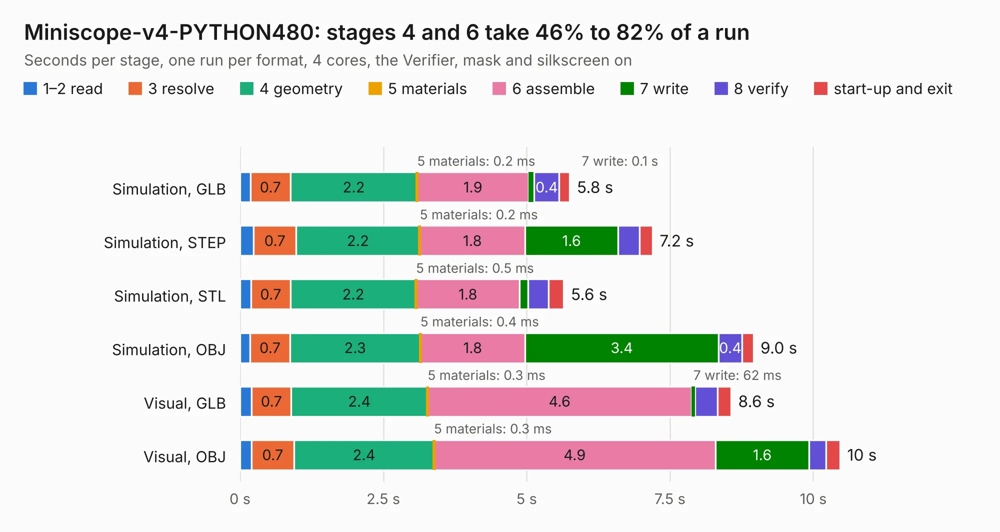

# 57. Miniscope-v4-PYTHON480

Board 57 of the 3,130 of [Corpus Testing](../Corpus-Testing.md), on [Corpus Page 1](../CorpusTestingPages/Corpus-Testing-01.md#57-miniscope-v4-python480).

| Mode and format | 1–2 read | 3 resolve | 4 geometry | 5 materials | 6 assemble | 7 write | 8 verify | start-up and exit | Total |
|---|---:|---:|---:|---:|---:|---:|---:|---:|---:|
| Simulation, GLB | 0.2 | 0.7 | 2.2 | 0.2&nbsp;ms | 1.9 | 0.1 | 0.4 | 0.2 | 5.8 |
| Simulation, STEP | 0.2 | 0.7 | 2.2 | 0.2&nbsp;ms | 1.8 | 1.6 | 0.4 | 0.2 | 7.2 |
| Simulation, STL | 0.2 | 0.7 | 2.2 | 0.5&nbsp;ms | 1.8 | 0.1 | 0.4 | 0.3 | 5.6 |
| Simulation, OBJ | 0.2 | 0.7 | 2.3 | 0.4&nbsp;ms | 1.8 | 3.4 | 0.4 | 0.2 | 9.0 |
| Visual, GLB | 0.2 | 0.7 | 2.4 | 0.3&nbsp;ms | 4.6 | 62&nbsp;ms | 0.4 | 0.2 | 8.6 |
| Visual, OBJ | 0.2 | 0.7 | 2.4 | 0.3&nbsp;ms | 4.9 | 1.6 | 0.3 | 0.2 | 10.5 |

<table align="center"><tr><td valign="top">

| Board | Repo: [Aharoni-Lab/Miniscope-v4](https://github.com/Aharoni-Lab/Miniscope-v4) Board: `Miniscope-v4-PYTHON480.kicad_pcb` |
|---|---|
| Folder | Development Files / Individual PCBs / Miniscope-v4-PYTHON480 / KiCad |
| Complexity | 282&nbsp;/&nbsp;1000 (size&nbsp;237, features&nbsp;45) |
| KESE&nbsp;features | through vias, rounded, trapezoid or chamfered pads, filled zones |
| Tested | 9th November 2026 |
| Copper&nbsp;layers | 6 |
| File&nbsp;format | KiCad 5 (20171130) |
| Parts,&nbsp;tracks,&nbsp;vias | 32, 355, 78 |
| Triangles,&nbsp;simulation | 642,990 in 68 parts |
| Verifier | PASS in all six runs |

</td><td valign="top">

<table>
<tr><th>File type</th><th>File size</th><th>Peak memory used</th></tr>
<tr><th colspan="3" align="left">Simulation</th></tr>
<tr><td>GLB</td><td align="right">22&nbsp;MB</td><td align="right">281&nbsp;MB</td></tr>
<tr><td>STEP</td><td align="right">75&nbsp;MB</td><td align="right">321&nbsp;MB</td></tr>
<tr><td>STL</td><td align="right">32&nbsp;MB</td><td align="right">279&nbsp;MB</td></tr>
<tr><td>OBJ</td><td align="right">67&nbsp;MB</td><td align="right">470&nbsp;MB</td></tr>
<tr><th colspan="3" align="left">Visual</th></tr>
<tr><td>GLB</td><td align="right">10&nbsp;MB</td><td align="right">301&nbsp;MB</td></tr>
<tr><td>OBJ</td><td align="right">31&nbsp;MB</td><td align="right">304&nbsp;MB</td></tr>
</table>

</td></tr></table>

| Previous | Next |
|:---|---:|
| [56. Miniscope-v4-MCU](b0056b_Miniscope-v4_Miniscope-v4-MCU.md) | [58. Miniscope-v4-Ser-Pow](b0058b_Miniscope-v4_Miniscope-v4-Ser-Pow.md) |
