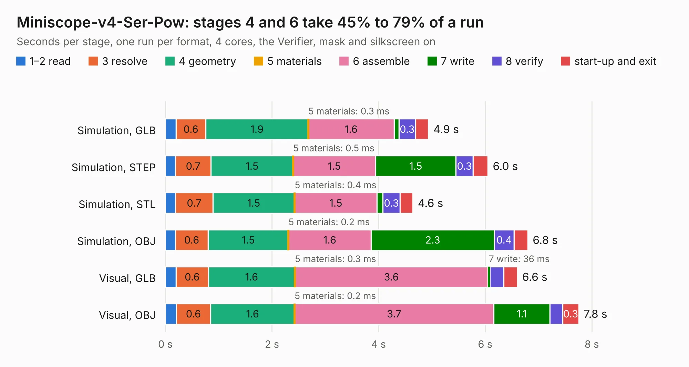

# 58. Miniscope-v4-Ser-Pow

Board 58 of the 3,109 of [Corpus Testing](../Corpus-Testing.md), on [Corpus Page 1](../CorpusTestingPages/Corpus-Testing-01.md#58-miniscope-v4-ser-pow).

| Mode and format | 1–2 read | 3 resolve | 4 geometry | 5 materials | 6 assemble | 7 write | 8 verify | start-up and exit | Total |
|---|---:|---:|---:|---:|---:|---:|---:|---:|---:|
| Simulation, GLB | 0.2 | 0.6 | 1.9 | 0.3&nbsp;ms | 1.6 | 91&nbsp;ms | 0.3 | 0.2 | 4.9 |
| Simulation, STEP | 0.2 | 0.7 | 1.5 | 0.5&nbsp;ms | 1.5 | 1.5 | 0.3 | 0.3 | 6.0 |
| Simulation, STL | 0.2 | 0.7 | 1.5 | 0.4&nbsp;ms | 1.5 | 0.1 | 0.3 | 0.2 | 4.6 |
| Simulation, OBJ | 0.2 | 0.6 | 1.5 | 0.2&nbsp;ms | 1.6 | 2.3 | 0.4 | 0.3 | 6.8 |
| Visual, GLB | 0.2 | 0.6 | 1.6 | 0.3&nbsp;ms | 3.6 | 36&nbsp;ms | 0.3 | 0.3 | 6.6 |
| Visual, OBJ | 0.2 | 0.6 | 1.6 | 0.2&nbsp;ms | 3.7 | 1.1 | 0.2 | 0.3 | 7.8 |

<table align="center"><tr><td valign="top">

| Board | Repo: [Aharoni-Lab/Miniscope-v4](https://github.com/Aharoni-Lab/Miniscope-v4) Board: `Miniscope-v4-Ser-Pow.kicad_pcb` |
|---|---|
| Folder | Development Files / Individual PCBs / Miniscope-v4-Ser-Pow / KiCad |
| Complexity | 267&nbsp;/&nbsp;1000 (size&nbsp;222, features&nbsp;45) |
| KESE&nbsp;features | through vias, rounded, trapezoid or chamfered pads, filled zones |
| Tested | 9th November 2026 |
| Copper&nbsp;layers | 6 |
| File&nbsp;format | KiCad 5 (20171130) |
| Parts,&nbsp;tracks,&nbsp;vias | 38, 265, 58 |
| Triangles,&nbsp;simulation | 446,544 in 46 parts |
| Verifier | PASS in all six runs |

</td><td valign="top">

<table>
<tr><th>File type</th><th>File size</th><th>Peak memory used</th></tr>
<tr><th colspan="3" align="left">Simulation</th></tr>
<tr><td>GLB</td><td align="right">16&nbsp;MB</td><td align="right">248&nbsp;MB</td></tr>
<tr><td>STEP</td><td align="right">48&nbsp;MB</td><td align="right">270&nbsp;MB</td></tr>
<tr><td>STL</td><td align="right">22&nbsp;MB</td><td align="right">244&nbsp;MB</td></tr>
<tr><td>OBJ</td><td align="right">46&nbsp;MB</td><td align="right">334&nbsp;MB</td></tr>
<tr><th colspan="3" align="left">Visual</th></tr>
<tr><td>GLB</td><td align="right">7.1&nbsp;MB</td><td align="right">253&nbsp;MB</td></tr>
<tr><td>OBJ</td><td align="right">21&nbsp;MB</td><td align="right">254&nbsp;MB</td></tr>
</table>

</td></tr></table>

| Previous | Next |
|:---|---:|
| [57. Miniscope-v4-PYTHON480](b0057b_Miniscope-v4_Miniscope-v4-PYTHON480.md) | [59. Miniscope-v4-PCB-fab-assembly](b0059b_Miniscope-v4_Miniscope-v4-PCB-fab-assembly.md) |
