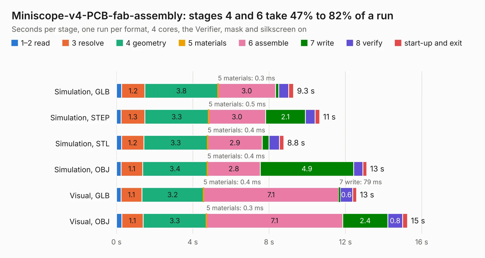

# 59. Miniscope-v4-PCB-fab-assembly

Board 59 of the 3,103 of [Corpus Testing](../Corpus-Testing.md), on [Corpus Page 1](../CorpusTestingPages/Corpus-Testing-01.md#59-miniscope-v4-pcb-fab-assembly).

| Mode and format | 1–2 read | 3 resolve | 4 geometry | 5 materials | 6 assemble | 7 write | 8 verify | start-up and exit | Total |
|---|---:|---:|---:|---:|---:|---:|---:|---:|---:|
| Simulation, GLB | 0.3 | 1.2 | 3.8 | 0.3&nbsp;ms | 3.0 | 0.2 | 0.5 | 0.3 | 9.3 |
| Simulation, STEP | 0.2 | 1.3 | 3.3 | 0.5&nbsp;ms | 3.0 | 2.1 | 0.5 | 0.2 | 10.7 |
| Simulation, STL | 0.3 | 1.2 | 3.3 | 0.4&nbsp;ms | 2.9 | 0.4 | 0.5 | 0.2 | 8.8 |
| Simulation, OBJ | 0.2 | 1.1 | 3.4 | 0.4&nbsp;ms | 2.8 | 4.9 | 0.5 | 0.2 | 13.1 |
| Visual, GLB | 0.2 | 1.1 | 3.2 | 0.4&nbsp;ms | 7.1 | 79&nbsp;ms | 0.6 | 0.2 | 12.6 |
| Visual, OBJ | 0.3 | 1.1 | 3.3 | 0.3&nbsp;ms | 7.1 | 2.4 | 0.8 | 0.3 | 15.3 |

<table align="center"><tr><td valign="top">

| Board | Repo: [Aharoni-Lab/Miniscope-v4](https://github.com/Aharoni-Lab/Miniscope-v4) Board: `Miniscope-v4-PCB-fab-assembly.kicad_pcb` |
|---|---|
| Folder | Development Files / Miniscope-v4-PCB-fab-assembly |
| Complexity | 310&nbsp;/&nbsp;1000 (size&nbsp;255, features&nbsp;55) |
| KESE&nbsp;features | through vias, rounded, trapezoid or chamfered pads, filled zones, curved board outline |
| Tested | 9th November 2026 |
| Copper&nbsp;layers | 6 |
| File&nbsp;format | KiCad 5 (20171130) |
| Parts,&nbsp;tracks,&nbsp;vias | 54, 668, 139 |
| Triangles,&nbsp;simulation | 1,120,536 in 105 parts |
| Verifier | PASS in all six runs |

</td><td valign="top">

<table>
<tr><th>File type</th><th>File size</th><th>Peak memory used</th></tr>
<tr><th colspan="3" align="left">Simulation</th></tr>
<tr><td>GLB</td><td align="right">39&nbsp;MB</td><td align="right">395&nbsp;MB</td></tr>
<tr><td>STEP</td><td align="right">130&nbsp;MB</td><td align="right">473&nbsp;MB</td></tr>
<tr><td>STL</td><td align="right">56&nbsp;MB</td><td align="right">425&nbsp;MB</td></tr>
<tr><td>OBJ</td><td align="right">116&nbsp;MB</td><td align="right">786&nbsp;MB</td></tr>
<tr><th colspan="3" align="left">Visual</th></tr>
<tr><td>GLB</td><td align="right">19&nbsp;MB</td><td align="right">481&nbsp;MB</td></tr>
<tr><td>OBJ</td><td align="right">57&nbsp;MB</td><td align="right">488&nbsp;MB</td></tr>
</table>

</td></tr></table>

| Previous | Next |
|:---|---:|
| [58. Miniscope-v4-Ser-Pow](b0058b_Miniscope-v4_Miniscope-v4-Ser-Pow.md) | [60. Miniscope-v4-PCB-fab-assembly_2](b0060b_Miniscope-v4_Miniscope-v4-PCB-fab-assembly-2.md) |
