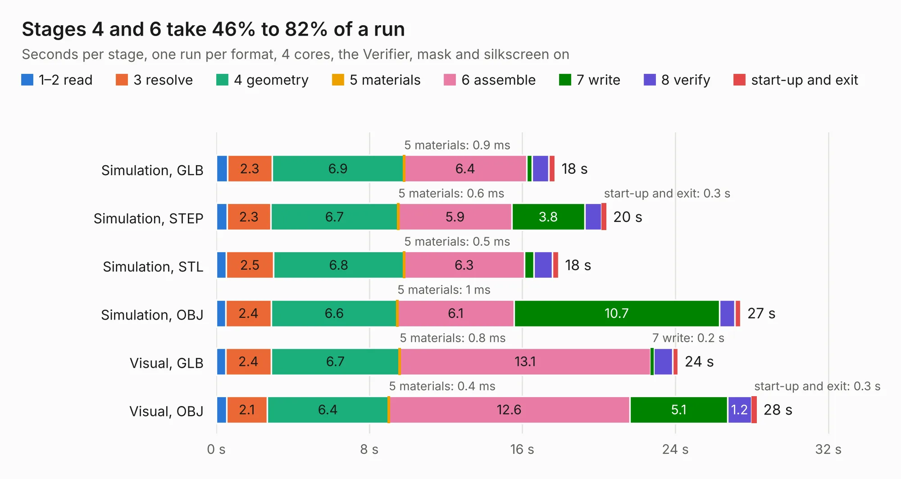

# 60. Miniscope-v4-PCB-fab-assembly_2

Board 60 of the 3,124 of [Corpus Testing](../Corpus-Testing.md), on [Corpus Page 1](../CorpusTestingPages/Corpus-Testing-01.md#60-miniscope-v4-pcb-fab-assembly_2).

| Mode and format | 1–2 read | 3 resolve | 4 geometry | 5 materials | 6 assemble | 7 write | 8 verify | start-up and exit | Total |
|---|---:|---:|---:|---:|---:|---:|---:|---:|---:|
| Simulation, GLB | 0.6 | 2.3 | 6.9 | 0.9&nbsp;ms | 6.4 | 0.3 | 0.9 | 0.3 | 17.7 |
| Simulation, STEP | 0.6 | 2.3 | 6.7 | 0.6&nbsp;ms | 5.9 | 3.8 | 0.9 | 0.3 | 20.4 |
| Simulation, STL | 0.5 | 2.5 | 6.8 | 0.5&nbsp;ms | 6.3 | 0.5 | 1.0 | 0.3 | 17.9 |
| Simulation, OBJ | 0.5 | 2.4 | 6.6 | 1&nbsp;ms | 6.1 | 10.7 | 0.8 | 0.3 | 27.4 |
| Visual, GLB | 0.5 | 2.4 | 6.7 | 0.8&nbsp;ms | 13.1 | 0.2 | 1.0 | 0.3 | 24.1 |
| Visual, OBJ | 0.5 | 2.1 | 6.4 | 0.4&nbsp;ms | 12.6 | 5.1 | 1.2 | 0.3 | 28.3 |

<table align="center"><tr><td valign="top">

| Board | Repo: [Aharoni-Lab/Miniscope-v4](https://github.com/Aharoni-Lab/Miniscope-v4) Board: `Miniscope-v4-PCB-fab-assembly_2.kicad_pcb` |
|---|---|
| Folder | Development Files / Miniscope-v4-PCB-fab-assembly |
| Complexity | 324&nbsp;/&nbsp;1000 (size&nbsp;269, features&nbsp;55) |
| KESE&nbsp;features | through vias, rounded, trapezoid or chamfered pads, filled zones, curved board outline |
| Tested | 9th November 2026 |
| Copper&nbsp;layers | 6 |
| File&nbsp;format | KiCad 5 (20171130) |
| Parts,&nbsp;tracks,&nbsp;vias | 91, 933, 197 |
| Triangles,&nbsp;simulation | 1,660,988 in 132 parts |
| Verifier | PASS in all six runs |

</td><td valign="top">

<table>
<tr><th>File type</th><th>File size</th><th>Peak memory used</th></tr>
<tr><th colspan="3" align="left">Simulation</th></tr>
<tr><td>GLB</td><td align="right">58&nbsp;MB</td><td align="right">505&nbsp;MB</td></tr>
<tr><td>STEP</td><td align="right">200&nbsp;MB</td><td align="right">608&nbsp;MB</td></tr>
<tr><td>STL</td><td align="right">83&nbsp;MB</td><td align="right">503&nbsp;MB</td></tr>
<tr><td>OBJ</td><td align="right">177&nbsp;MB</td><td align="right">1.1&nbsp;GB</td></tr>
<tr><th colspan="3" align="left">Visual</th></tr>
<tr><td>GLB</td><td align="right">28&nbsp;MB</td><td align="right">726&nbsp;MB</td></tr>
<tr><td>OBJ</td><td align="right">88&nbsp;MB</td><td align="right">723&nbsp;MB</td></tr>
</table>

</td></tr></table>

| Previous | Next |
|:---|---:|
| [59. Miniscope-v4-PCB-fab-assembly](b0059b_Miniscope-v4_Miniscope-v4-PCB-fab-assembly.md) | [61. Miniscope-v4-Rigid-Flex](b0061b_Miniscope-v4_Miniscope-v4-Rigid-Flex.md) |
