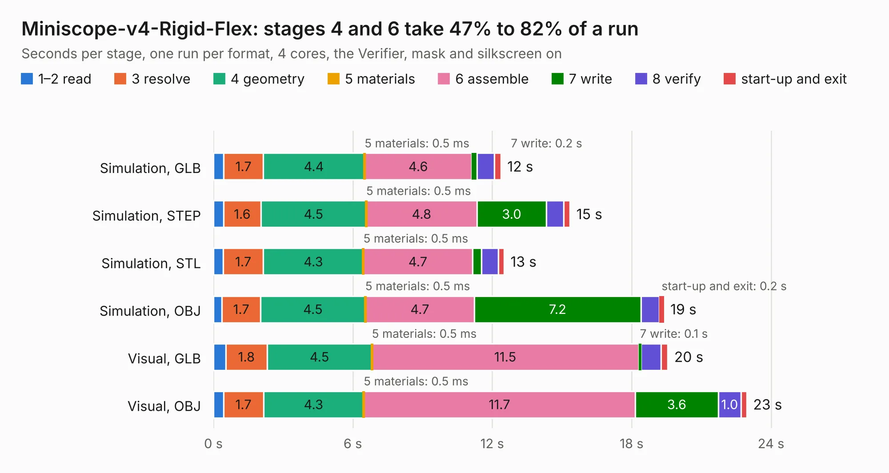

# 61 Miniscope-v4-Rigid-Flex

Board 61 of the 3,138 of [Corpus Testing](../Corpus-Testing.md), on [Corpus Page 1](../CorpusTestingPages/Corpus-Testing-01.md#61-miniscope-v4-rigid-flex).

| Mode and format | 1–2 read | 3 resolve | 4 geometry | 5 materials | 6 assemble | 7 write | 8 verify | start-up and exit | Total |
|---|---:|---:|---:|---:|---:|---:|---:|---:|---:|
| Simulation, GLB | 0.4 | 1.7 | 4.4 | 0.5&nbsp;ms | 4.6 | 0.2 | 0.7 | 0.3 | 12.4 |
| Simulation, STEP | 0.4 | 1.6 | 4.5 | 0.5&nbsp;ms | 4.8 | 3.0 | 0.7 | 0.3 | 15.3 |
| Simulation, STL | 0.4 | 1.7 | 4.3 | 0.5&nbsp;ms | 4.7 | 0.4 | 0.7 | 0.3 | 12.5 |
| Simulation, OBJ | 0.4 | 1.7 | 4.5 | 0.5&nbsp;ms | 4.7 | 7.2 | 0.8 | 0.2 | 19.4 |
| Visual, GLB | 0.5 | 1.8 | 4.5 | 0.5&nbsp;ms | 11.5 | 0.1 | 0.8 | 0.3 | 19.6 |
| Visual, OBJ | 0.4 | 1.7 | 4.3 | 0.5&nbsp;ms | 11.7 | 3.6 | 1.0 | 0.2 | 23.0 |

<table align="center"><tr><td valign="top">

| Board | Repo: [Aharoni-Lab/Miniscope-v4](https://github.com/Aharoni-Lab/Miniscope-v4) Board: `Miniscope-v4-Rigid-Flex.kicad_pcb` |
|---|---|
| Folder | Miniscope-v4-Rigid-Flex / KiCad |
| Complexity | 353&nbsp;/&nbsp;1000 (size&nbsp;273, features&nbsp;80) |
| KESE&nbsp;features | through vias, custom pads, rounded, trapezoid or chamfered pads, filled zones, copper drawings, curved board outline |
| Tested | 9th November 2026 |
| Copper&nbsp;layers | 6 |
| File&nbsp;format | KiCad 9 (20241229) |
| Parts,&nbsp;tracks,&nbsp;vias | 99, 1,047, 164 |
| Triangles,&nbsp;simulation | 1,439,938 in 126 parts |
| Verifier | PASS in all six runs |

</td><td valign="top">

<table>
<tr><th>File type</th><th>File size</th><th>Peak memory used</th></tr>
<tr><th colspan="3" align="left">Simulation</th></tr>
<tr><td>GLB</td><td align="right">50&nbsp;MB</td><td align="right">486&nbsp;MB</td></tr>
<tr><td>STEP</td><td align="right">184&nbsp;MB</td><td align="right">568&nbsp;MB</td></tr>
<tr><td>STL</td><td align="right">72&nbsp;MB</td><td align="right">518&nbsp;MB</td></tr>
<tr><td>OBJ</td><td align="right">151&nbsp;MB</td><td align="right">991&nbsp;MB</td></tr>
<tr><th colspan="3" align="left">Visual</th></tr>
<tr><td>GLB</td><td align="right">24&nbsp;MB</td><td align="right">624&nbsp;MB</td></tr>
<tr><td>OBJ</td><td align="right">75&nbsp;MB</td><td align="right">609&nbsp;MB</td></tr>
</table>

</td></tr></table>

| Previous | Next |
|:---|---:|
| [60 Miniscope-v4-PCB-fab-assembly_2](b0060b_Miniscope-v4_Miniscope-v4-PCB-fab-assembly-2.md) | [62 Miniscope-v4-VDD-PIX-FC](b0062b_Miniscope-v4_Miniscope-v4-VDD-PIX-FC.md) |
