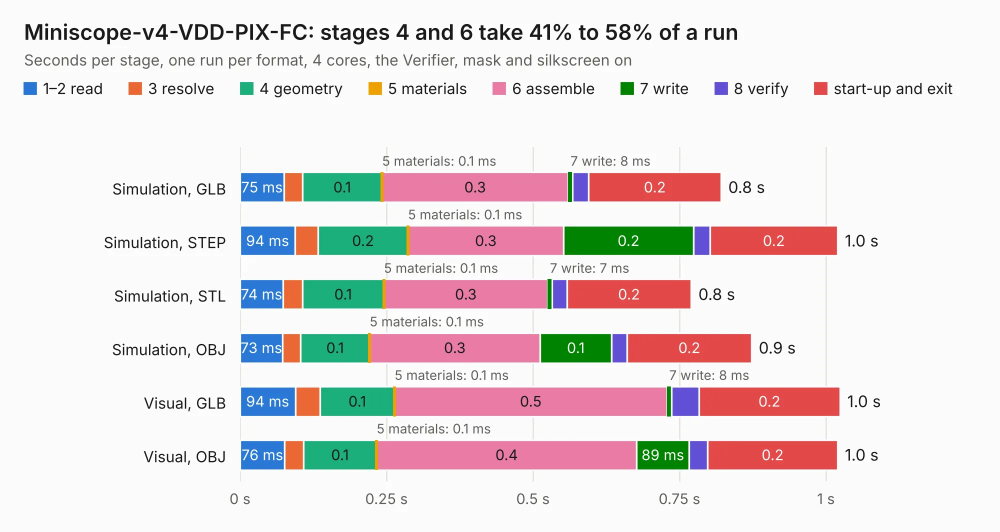

# 62. Miniscope-v4-VDD-PIX-FC

Board 62 of the 3,103 of [Corpus Testing](../Corpus-Testing.md), on [Corpus Page 1](../CorpusTestingPages/Corpus-Testing-01.md#62-miniscope-v4-vdd-pix-fc).

| Mode and format | 1–2 read | 3 resolve | 4 geometry | 5 materials | 6 assemble | 7 write | 8 verify | start-up and exit | Total |
|---|---:|---:|---:|---:|---:|---:|---:|---:|---:|
| Simulation, GLB | 75&nbsp;ms | 32&nbsp;ms | 0.1 | 0.1&nbsp;ms | 0.3 | 8&nbsp;ms | 27&nbsp;ms | 0.2 | 0.8 |
| Simulation, STEP | 94&nbsp;ms | 39&nbsp;ms | 0.2 | 0.1&nbsp;ms | 0.3 | 0.2 | 28&nbsp;ms | 0.2 | 1.0 |
| Simulation, STL | 74&nbsp;ms | 33&nbsp;ms | 0.1 | 0.1&nbsp;ms | 0.3 | 7&nbsp;ms | 25&nbsp;ms | 0.2 | 0.8 |
| Simulation, OBJ | 73&nbsp;ms | 31&nbsp;ms | 0.1 | 0.1&nbsp;ms | 0.3 | 0.1 | 26&nbsp;ms | 0.2 | 0.9 |
| Visual, GLB | 94&nbsp;ms | 42&nbsp;ms | 0.1 | 0.1&nbsp;ms | 0.5 | 8&nbsp;ms | 47&nbsp;ms | 0.2 | 1.0 |
| Visual, OBJ | 76&nbsp;ms | 32&nbsp;ms | 0.1 | 0.1&nbsp;ms | 0.4 | 89&nbsp;ms | 32&nbsp;ms | 0.2 | 1.0 |

<table align="center"><tr><td valign="top">

| Board | Repo: [Aharoni-Lab/Miniscope-v4](https://github.com/Aharoni-Lab/Miniscope-v4) Board: `Miniscope-v4-VDD-PIX-FC.kicad_pcb` |
|---|---|
| Folder | Miniscope-v4-VDD-PIX-FC / Miniscope-v4-VDD-PIX-FC |
| Complexity | 128&nbsp;/&nbsp;1000 (size&nbsp;83, features&nbsp;45) |
| KESE&nbsp;features | custom pads, rounded, trapezoid or chamfered pads, copper drawings, curved board outline |
| Tested | 9th November 2026 |
| Copper&nbsp;layers | 2 |
| File&nbsp;format | KiCad 5 (20171130) |
| Parts,&nbsp;tracks,&nbsp;vias | 4, 19, 0 |
| Triangles,&nbsp;simulation | 24,216 in 15 parts |
| Verifier | PASS in all six runs |

</td><td valign="top">

<table>
<tr><th>File type</th><th>File size</th><th>Peak memory used</th></tr>
<tr><th colspan="3" align="left">Simulation</th></tr>
<tr><td>GLB</td><td align="right">900&nbsp;kB</td><td align="right">64&nbsp;MB</td></tr>
<tr><td>STEP</td><td align="right">4.8&nbsp;MB</td><td align="right">67&nbsp;MB</td></tr>
<tr><td>STL</td><td align="right">1.2&nbsp;MB</td><td align="right">66&nbsp;MB</td></tr>
<tr><td>OBJ</td><td align="right">2.4&nbsp;MB</td><td align="right">68&nbsp;MB</td></tr>
<tr><th colspan="3" align="left">Visual</th></tr>
<tr><td>GLB</td><td align="right">516&nbsp;kB</td><td align="right">88&nbsp;MB</td></tr>
<tr><td>OBJ</td><td align="right">1.4&nbsp;MB</td><td align="right">88&nbsp;MB</td></tr>
</table>

</td></tr></table>

| Previous | Next |
|:---|---:|
| [61. Miniscope-v4-Rigid-Flex](b0061b_Miniscope-v4_Miniscope-v4-Rigid-Flex.md) | [63. interposer](b0063b_Open-Source-PC110_interposer.md) |
