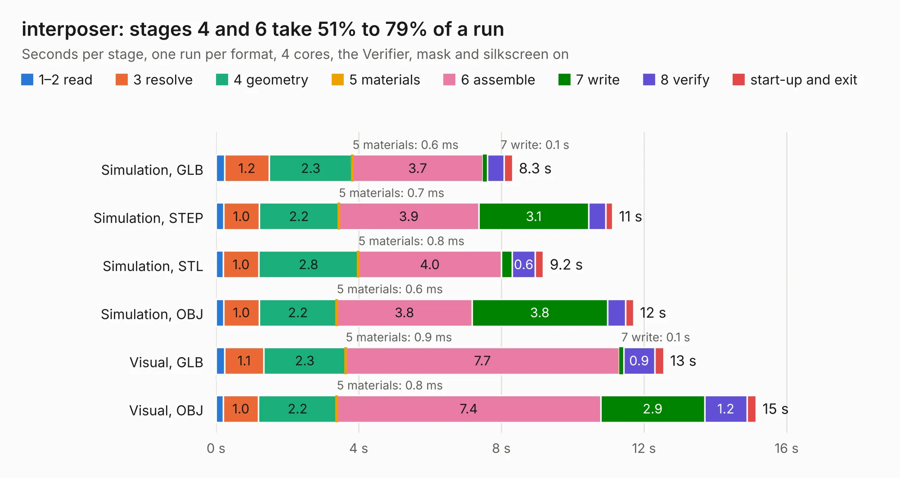

# 63. interposer

Board 63 of the 3,120 of [Corpus Testing](../Corpus-Testing.md), on [Corpus Page 1](../CorpusTestingPages/Corpus-Testing-01.md#63-interposer).

| Mode and format | 1–2 read | 3 resolve | 4 geometry | 5 materials | 6 assemble | 7 write | 8 verify | start-up and exit | Total |
|---|---:|---:|---:|---:|---:|---:|---:|---:|---:|
| Simulation, GLB | 0.2 | 1.2 | 2.3 | 0.6&nbsp;ms | 3.7 | 0.1 | 0.5 | 0.2 | 8.3 |
| Simulation, STEP | 0.2 | 1.0 | 2.2 | 0.7&nbsp;ms | 3.9 | 3.1 | 0.5 | 0.2 | 11.1 |
| Simulation, STL | 0.2 | 1.0 | 2.8 | 0.8&nbsp;ms | 4.0 | 0.3 | 0.6 | 0.2 | 9.2 |
| Simulation, OBJ | 0.2 | 1.0 | 2.2 | 0.6&nbsp;ms | 3.8 | 3.8 | 0.5 | 0.2 | 11.7 |
| Visual, GLB | 0.2 | 1.1 | 2.3 | 0.9&nbsp;ms | 7.7 | 0.1 | 0.9 | 0.3 | 12.6 |
| Visual, OBJ | 0.2 | 1.0 | 2.2 | 0.8&nbsp;ms | 7.4 | 2.9 | 1.2 | 0.3 | 15.1 |

<table align="center"><tr><td valign="top">

| Board | Repo: [ahmadexp/Open-Source-PC110](https://github.com/ahmadexp/Open-Source-PC110) Board: `interposer.kicad_pcb` |
|---|---|
| Folder | Components / U61-VL82C420FC5 / Interposer / interposer |
| Complexity | 235&nbsp;/&nbsp;1000 (size&nbsp;210, features&nbsp;25) |
| KESE&nbsp;features | through vias, copper drawings |
| Tested | 9th November 2026 |
| Copper&nbsp;layers | 2 |
| File&nbsp;format | KiCad 9 (20241229) |
| Parts,&nbsp;tracks,&nbsp;vias | 1, 2,968, 208 |
| Triangles,&nbsp;simulation | 929,806 in 246 parts |
| Verifier | PASS in all six runs |

</td><td valign="top">

<table>
<tr><th>File type</th><th>File size</th><th>Peak memory used</th></tr>
<tr><th colspan="3" align="left">Simulation</th></tr>
<tr><td>GLB</td><td align="right">32&nbsp;MB</td><td align="right">553&nbsp;MB</td></tr>
<tr><td>STEP</td><td align="right">161&nbsp;MB</td><td align="right">562&nbsp;MB</td></tr>
<tr><td>STL</td><td align="right">47&nbsp;MB</td><td align="right">561&nbsp;MB</td></tr>
<tr><td>OBJ</td><td align="right">94&nbsp;MB</td><td align="right">634&nbsp;MB</td></tr>
<tr><th colspan="3" align="left">Visual</th></tr>
<tr><td>GLB</td><td align="right">23&nbsp;MB</td><td align="right">688&nbsp;MB</td></tr>
<tr><td>OBJ</td><td align="right">70&nbsp;MB</td><td align="right">595&nbsp;MB</td></tr>
</table>

</td></tr></table>

| Previous | Next |
|:---|---:|
| [62. Miniscope-v4-VDD-PIX-FC](b0062b_Miniscope-v4_Miniscope-v4-VDD-PIX-FC.md) | [64. bgacpu-dualcon](b0064b_Open-Source-PC110_bgacpu-dualcon.md) |
