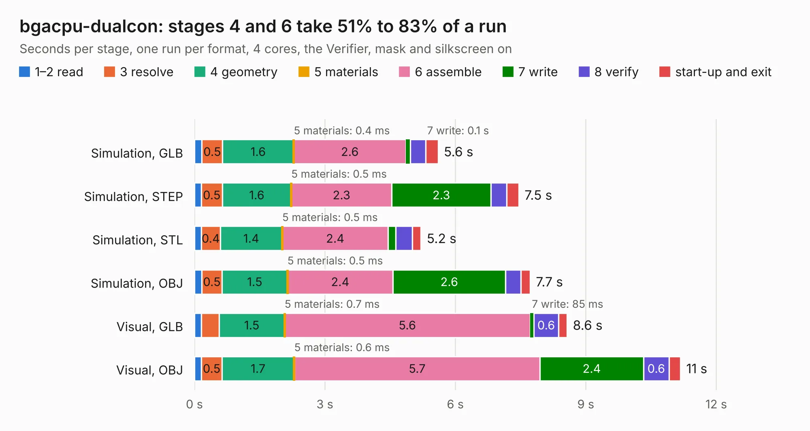

# 64. bgacpu-dualcon

Board 64 of the 3,122 of [Corpus Testing](../Corpus-Testing.md), on [Corpus Page 1](../CorpusTestingPages/Corpus-Testing-01.md#64-bgacpu-dualcon).

| Mode and format | 1–2 read | 3 resolve | 4 geometry | 5 materials | 6 assemble | 7 write | 8 verify | start-up and exit | Total |
|---|---:|---:|---:|---:|---:|---:|---:|---:|---:|
| Simulation, GLB | 0.2 | 0.5 | 1.6 | 0.4&nbsp;ms | 2.6 | 0.1 | 0.4 | 0.3 | 5.6 |
| Simulation, STEP | 0.2 | 0.5 | 1.6 | 0.5&nbsp;ms | 2.3 | 2.3 | 0.4 | 0.3 | 7.5 |
| Simulation, STL | 0.2 | 0.4 | 1.4 | 0.5&nbsp;ms | 2.4 | 0.2 | 0.4 | 0.2 | 5.2 |
| Simulation, OBJ | 0.2 | 0.5 | 1.5 | 0.5&nbsp;ms | 2.4 | 2.6 | 0.3 | 0.2 | 7.7 |
| Visual, GLB | 0.2 | 0.4 | 1.5 | 0.7&nbsp;ms | 5.6 | 85&nbsp;ms | 0.6 | 0.2 | 8.6 |
| Visual, OBJ | 0.2 | 0.5 | 1.7 | 0.6&nbsp;ms | 5.7 | 2.4 | 0.6 | 0.3 | 11.2 |

<table align="center"><tr><td valign="top">

| Board | Repo: [ahmadexp/Open-Source-PC110](https://github.com/ahmadexp/Open-Source-PC110) Board: `bgacpu-dualcon.kicad_pcb` |
|---|---|
| Folder | Mods / CPU Upgrade / bgacpu-dualcon |
| Complexity | 254&nbsp;/&nbsp;1000 (size&nbsp;209, features&nbsp;45) |
| KESE&nbsp;features | through vias, stack-up, dielectric εr and tanδ |
| Tested | 9th November 2026 |
| Copper&nbsp;layers | 2 |
| File&nbsp;format | KiCad 9 (20241229) |
| Parts,&nbsp;tracks,&nbsp;vias | 3, 773, 111 |
| Triangles,&nbsp;simulation | 540,030 in 147 parts |
| Verifier | PASS in all six runs |

</td><td valign="top">

<table>
<tr><th>File type</th><th>File size</th><th>Peak memory used</th></tr>
<tr><th colspan="3" align="left">Simulation</th></tr>
<tr><td>GLB</td><td align="right">19&nbsp;MB</td><td align="right">351&nbsp;MB</td></tr>
<tr><td>STEP</td><td align="right">82&nbsp;MB</td><td align="right">403&nbsp;MB</td></tr>
<tr><td>STL</td><td align="right">27&nbsp;MB</td><td align="right">354&nbsp;MB</td></tr>
<tr><td>OBJ</td><td align="right">55&nbsp;MB</td><td align="right">363&nbsp;MB</td></tr>
<tr><th colspan="3" align="left">Visual</th></tr>
<tr><td>GLB</td><td align="right">16&nbsp;MB</td><td align="right">433&nbsp;MB</td></tr>
<tr><td>OBJ</td><td align="right">48&nbsp;MB</td><td align="right">483&nbsp;MB</td></tr>
</table>

</td></tr></table>

| Previous | Next |
|:---|---:|
| [63. interposer](b0063b_Open-Source-PC110_interposer.md) | [65. pcb-bga-adapter-dualcon](b0065b_Open-Source-PC110_pcb-bga-adapter-dualcon.md) |
