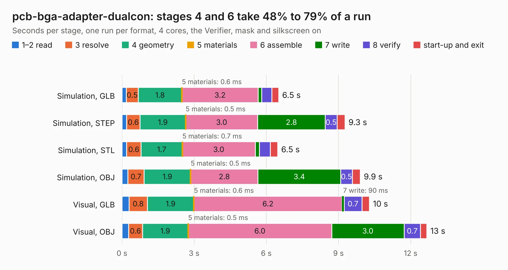

# 65. pcb-bga-adapter-dualcon

Board 65 of the 3,110 of [Corpus Testing](../Corpus-Testing.md), on [Corpus Page 1](../CorpusTestingPages/Corpus-Testing-01.md#65-pcb-bga-adapter-dualcon).

| Mode and format | 1–2 read | 3 resolve | 4 geometry | 5 materials | 6 assemble | 7 write | 8 verify | start-up and exit | Total |
|---|---:|---:|---:|---:|---:|---:|---:|---:|---:|
| Simulation, GLB | 0.2 | 0.5 | 1.8 | 0.6&nbsp;ms | 3.2 | 0.1 | 0.4 | 0.3 | 6.5 |
| Simulation, STEP | 0.2 | 0.6 | 1.9 | 0.5&nbsp;ms | 3.0 | 2.8 | 0.5 | 0.3 | 9.3 |
| Simulation, STL | 0.2 | 0.6 | 1.7 | 0.7&nbsp;ms | 3.0 | 0.2 | 0.5 | 0.3 | 6.5 |
| Simulation, OBJ | 0.2 | 0.7 | 1.9 | 0.5&nbsp;ms | 2.8 | 3.4 | 0.5 | 0.3 | 9.9 |
| Visual, GLB | 0.3 | 0.8 | 1.9 | 0.6&nbsp;ms | 6.2 | 90&nbsp;ms | 0.7 | 0.3 | 10.3 |
| Visual, OBJ | 0.3 | 0.6 | 1.9 | 0.5&nbsp;ms | 6.0 | 3.0 | 0.7 | 0.3 | 12.7 |

<table align="center"><tr><td valign="top">

| Board | Repo: [ahmadexp/Open-Source-PC110](https://github.com/ahmadexp/Open-Source-PC110) Board: `pcb-bga-adapter-dualcon.kicad_pcb` |
|---|---|
| Folder | Mods / CPU Upgrade / pcb-bga-adapter-dualcon |
| Complexity | 252&nbsp;/&nbsp;1000 (size&nbsp;207, features&nbsp;45) |
| KESE&nbsp;features | through vias, stack-up, dielectric εr and tanδ |
| Tested | 9th November 2026 |
| Copper&nbsp;layers | 2 |
| File&nbsp;format | KiCad 9 (20241229) |
| Parts,&nbsp;tracks,&nbsp;vias | 3, 625, 107 |
| Triangles,&nbsp;simulation | 526,464 in 147 parts |
| Verifier | PASS in all six runs |

</td><td valign="top">

<table>
<tr><th>File type</th><th>File size</th><th>Peak memory used</th></tr>
<tr><th colspan="3" align="left">Simulation</th></tr>
<tr><td>GLB</td><td align="right">18&nbsp;MB</td><td align="right">353&nbsp;MB</td></tr>
<tr><td>STEP</td><td align="right">82&nbsp;MB</td><td align="right">398&nbsp;MB</td></tr>
<tr><td>STL</td><td align="right">26&nbsp;MB</td><td align="right">346&nbsp;MB</td></tr>
<tr><td>OBJ</td><td align="right">53&nbsp;MB</td><td align="right">401&nbsp;MB</td></tr>
<tr><th colspan="3" align="left">Visual</th></tr>
<tr><td>GLB</td><td align="right">15&nbsp;MB</td><td align="right">479&nbsp;MB</td></tr>
<tr><td>OBJ</td><td align="right">47&nbsp;MB</td><td align="right">427&nbsp;MB</td></tr>
</table>

</td></tr></table>

| Previous | Next |
|:---|---:|
| [64. bgacpu-dualcon](b0064b_Open-Source-PC110_bgacpu-dualcon.md) | [66. DockingStation](b0066b_Open-Source-PC110_Mods-NewDock_DockingStation.md) |
