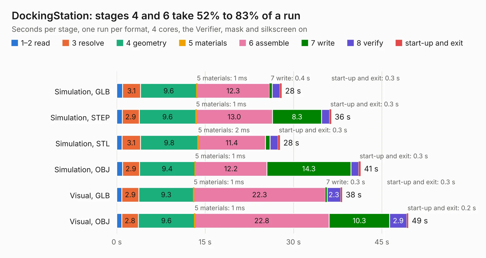

# 66. DockingStation

Board 66 of the 3,138 of [Corpus Testing](../Corpus-Testing.md), on [Corpus Page 1](../CorpusTestingPages/Corpus-Testing-01.md#66-dockingstation).

| Mode and format | 1–2 read | 3 resolve | 4 geometry | 5 materials | 6 assemble | 7 write | 8 verify | start-up and exit | Total |
|---|---:|---:|---:|---:|---:|---:|---:|---:|---:|
| Simulation, GLB | 1.0 | 3.1 | 9.6 | 1&nbsp;ms | 12.3 | 0.4 | 1.3 | 0.3 | 28.0 |
| Simulation, STEP | 0.9 | 2.9 | 9.6 | 1&nbsp;ms | 13.0 | 8.3 | 1.4 | 0.3 | 36.4 |
| Simulation, STL | 0.9 | 3.1 | 9.8 | 2&nbsp;ms | 11.4 | 0.8 | 1.3 | 0.3 | 27.7 |
| Simulation, OBJ | 1.0 | 2.9 | 9.4 | 1&nbsp;ms | 12.2 | 14.3 | 1.3 | 0.3 | 41.4 |
| Visual, GLB | 0.9 | 2.9 | 9.3 | 1&nbsp;ms | 22.3 | 0.3 | 2.3 | 0.3 | 38.3 |
| Visual, OBJ | 0.9 | 2.8 | 9.6 | 1&nbsp;ms | 22.8 | 10.3 | 2.9 | 0.2 | 49.5 |

<table align="center"><tr><td valign="top">

| Board | Repo: [ahmadexp/Open-Source-PC110](https://github.com/ahmadexp/Open-Source-PC110) Board: `DockingStation.kicad_pcb` |
|---|---|
| Folder | Mods / NewDock |
| Complexity | 322&nbsp;/&nbsp;1000 (size&nbsp;227, features&nbsp;95) |
| KESE&nbsp;features | through vias, slotted holes, rounded, trapezoid or chamfered pads, filled zones, copper text, stack-up, dielectric εr and tanδ |
| Tested | 9th November 2026 |
| Copper&nbsp;layers | 4 |
| File&nbsp;format | KiCad 9 (20241229) |
| Parts,&nbsp;tracks,&nbsp;vias | 217, 3,054, 269 |
| Triangles,&nbsp;simulation | 2,437,752 in 234 parts |
| Verifier | PASS in all six runs |

</td><td valign="top">

<table>
<tr><th>File type</th><th>File size</th><th>Peak memory used</th></tr>
<tr><th colspan="3" align="left">Simulation</th></tr>
<tr><td>GLB</td><td align="right">84&nbsp;MB</td><td align="right">825&nbsp;MB</td></tr>
<tr><td>STEP</td><td align="right">357&nbsp;MB</td><td align="right">1.1&nbsp;GB</td></tr>
<tr><td>STL</td><td align="right">122&nbsp;MB</td><td align="right">805&nbsp;MB</td></tr>
<tr><td>OBJ</td><td align="right">255&nbsp;MB</td><td align="right">1.6&nbsp;GB</td></tr>
<tr><th colspan="3" align="left">Visual</th></tr>
<tr><td>GLB</td><td align="right">59&nbsp;MB</td><td align="right">1.2&nbsp;GB</td></tr>
<tr><td>OBJ</td><td align="right">181&nbsp;MB</td><td align="right">1.3&nbsp;GB</td></tr>
</table>

</td></tr></table>

| Previous | Next |
|:---|---:|
| [65. pcb-bga-adapter-dualcon](b0065b_Open-Source-PC110_pcb-bga-adapter-dualcon.md) | [67. PC110](b0067b_Open-Source-PC110_Mods-PC110-ITX-all-in-one_PC110.md) |
