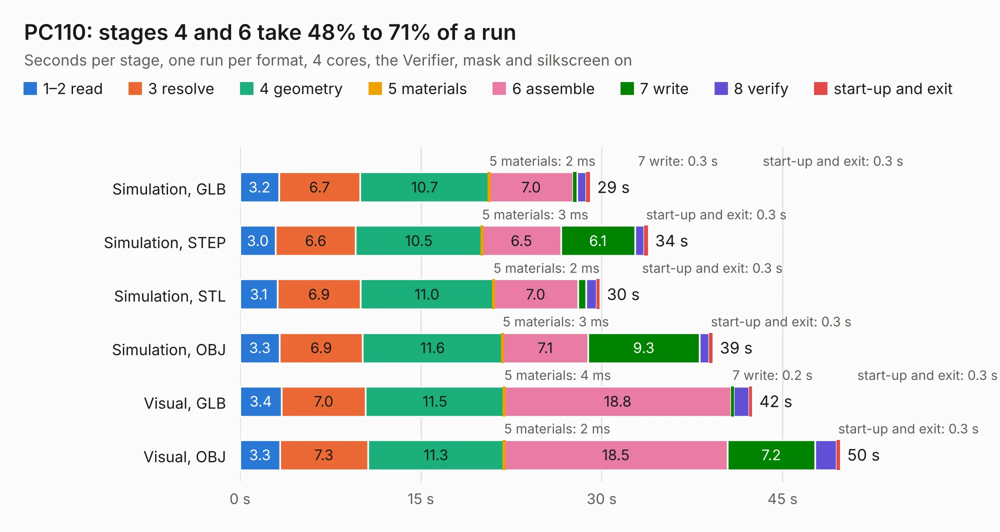

# 67. PC110

Board 67 of the 3,109 of [Corpus Testing](../Corpus-Testing.md), on [Corpus Page 1](../CorpusTestingPages/Corpus-Testing-01.md#67-pc110).

| Mode and format | 1–2 read | 3 resolve | 4 geometry | 5 materials | 6 assemble | 7 write | 8 verify | start-up and exit | Total |
|---|---:|---:|---:|---:|---:|---:|---:|---:|---:|
| Simulation, GLB | 3.2 | 6.7 | 10.7 | 2&nbsp;ms | 7.0 | 0.3 | 0.7 | 0.3 | 29.0 |
| Simulation, STEP | 3.0 | 6.6 | 10.5 | 3&nbsp;ms | 6.5 | 6.1 | 0.8 | 0.3 | 33.8 |
| Simulation, STL | 3.1 | 6.9 | 11.0 | 2&nbsp;ms | 7.0 | 0.7 | 0.9 | 0.3 | 29.8 |
| Simulation, OBJ | 3.3 | 6.9 | 11.6 | 3&nbsp;ms | 7.1 | 9.3 | 0.8 | 0.3 | 39.2 |
| Visual, GLB | 3.4 | 7.0 | 11.5 | 4&nbsp;ms | 18.8 | 0.2 | 1.3 | 0.3 | 42.5 |
| Visual, OBJ | 3.3 | 7.3 | 11.3 | 2&nbsp;ms | 18.5 | 7.2 | 1.8 | 0.3 | 49.8 |

<table align="center"><tr><td valign="top">

| Board | Repo: [ahmadexp/Open-Source-PC110](https://github.com/ahmadexp/Open-Source-PC110) Board: `PC110.kicad_pcb` |
|---|---|
| Folder | Mods / PC110-ITX-all-in-one |
| Complexity | 219&nbsp;/&nbsp;1000 (size&nbsp;164, features&nbsp;55) |
| KESE&nbsp;features | slotted holes, custom pads, rounded, trapezoid or chamfered pads, copper drawings, curved board outline |
| Tested | 9th November 2026 |
| Copper&nbsp;layers | 2 |
| File&nbsp;format | KiCad 9 (20241229) |
| Parts,&nbsp;tracks,&nbsp;vias | 1,482, 0, 0 |
| Triangles,&nbsp;simulation | 1,408,560 in 933 parts |
| Note | mostly unrouted |
| Verifier | PASS in all six runs |

</td><td valign="top">

<table>
<tr><th>File type</th><th>File size</th><th>Peak memory used</th></tr>
<tr><th colspan="3" align="left">Simulation</th></tr>
<tr><td>GLB</td><td align="right">49&nbsp;MB</td><td align="right">710&nbsp;MB</td></tr>
<tr><td>STEP</td><td align="right">173&nbsp;MB</td><td align="right">845&nbsp;MB</td></tr>
<tr><td>STL</td><td align="right">71&nbsp;MB</td><td align="right">746&nbsp;MB</td></tr>
<tr><td>OBJ</td><td align="right">151&nbsp;MB</td><td align="right">1.1&nbsp;GB</td></tr>
<tr><th colspan="3" align="left">Visual</th></tr>
<tr><td>GLB</td><td align="right">40&nbsp;MB</td><td align="right">1.1&nbsp;GB</td></tr>
<tr><td>OBJ</td><td align="right">122&nbsp;MB</td><td align="right">1.1&nbsp;GB</td></tr>
</table>

</td></tr></table>

| Previous | Next |
|:---|---:|
| [66. DockingStation](b0066b_Open-Source-PC110_Mods-NewDock_DockingStation.md) | [68. PC110-no-placement](b0068b_Open-Source-PC110_PC110-no-placement.md) |
