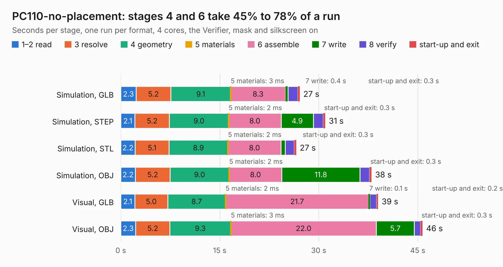

# 68. PC110-no-placement

Board 68 of the 3,112 of [Corpus Testing](../Corpus-Testing.md), on [Corpus Page 1](../CorpusTestingPages/Corpus-Testing-01.md#68-pc110-no-placement).

| Mode and format | 1–2 read | 3 resolve | 4 geometry | 5 materials | 6 assemble | 7 write | 8 verify | start-up and exit | Total |
|---|---:|---:|---:|---:|---:|---:|---:|---:|---:|
| Simulation, GLB | 2.3 | 5.2 | 9.1 | 3&nbsp;ms | 8.3 | 0.4 | 1.5 | 0.3 | 27.1 |
| Simulation, STEP | 2.1 | 5.2 | 9.0 | 2&nbsp;ms | 8.0 | 4.9 | 1.5 | 0.3 | 31.0 |
| Simulation, STL | 2.2 | 5.1 | 8.9 | 2&nbsp;ms | 8.0 | 0.6 | 1.4 | 0.3 | 26.6 |
| Simulation, OBJ | 2.2 | 5.2 | 9.0 | 2&nbsp;ms | 8.0 | 11.8 | 1.4 | 0.3 | 38.0 |
| Visual, GLB | 2.1 | 5.0 | 8.7 | 2&nbsp;ms | 21.7 | 0.1 | 1.0 | 0.2 | 39.0 |
| Visual, OBJ | 2.3 | 5.2 | 9.3 | 3&nbsp;ms | 22.0 | 5.7 | 1.0 | 0.3 | 45.7 |

<table align="center"><tr><td valign="top">

| Board | Repo: [ahmadexp/Open-Source-PC110](https://github.com/ahmadexp/Open-Source-PC110) Board: `PC110-no-placement.kicad_pcb` |
|---|---|
| Folder | Mods / PC110-ITX |
| Complexity | 272&nbsp;/&nbsp;1000 (size&nbsp;187, features&nbsp;85) |
| KESE&nbsp;features | slotted holes, custom pads, rounded, trapezoid or chamfered pads, copper drawings, curved board outline, stack-up, dielectric εr and tanδ |
| Tested | 9th November 2026 |
| Copper&nbsp;layers | 10 |
| File&nbsp;format | KiCad 9 (20241229) |
| Parts,&nbsp;tracks,&nbsp;vias | 934, 0, 0 |
| Triangles,&nbsp;simulation | 2,086,414 in 830 parts |
| Note | mostly unrouted |
| Verifier | PASS in all six runs |

</td><td valign="top">

<table>
<tr><th>File type</th><th>File size</th><th>Peak memory used</th></tr>
<tr><th colspan="3" align="left">Simulation</th></tr>
<tr><td>GLB</td><td align="right">63&nbsp;MB</td><td align="right">662&nbsp;MB</td></tr>
<tr><td>STEP</td><td align="right">194&nbsp;MB</td><td align="right">732&nbsp;MB</td></tr>
<tr><td>STL</td><td align="right">104&nbsp;MB</td><td align="right">653&nbsp;MB</td></tr>
<tr><td>OBJ</td><td align="right">223&nbsp;MB</td><td align="right">1.4&nbsp;GB</td></tr>
<tr><th colspan="3" align="left">Visual</th></tr>
<tr><td>GLB</td><td align="right">32&nbsp;MB</td><td align="right">894&nbsp;MB</td></tr>
<tr><td>OBJ</td><td align="right">100&nbsp;MB</td><td align="right">781&nbsp;MB</td></tr>
</table>

</td></tr></table>

| Previous | Next |
|:---|---:|
| [67. PC110](b0067b_Open-Source-PC110_Mods-PC110-ITX-all-in-one_PC110.md) | [69. PC110](b0069b_Open-Source-PC110_Mods-PC110-ITX_PC110.md) |
