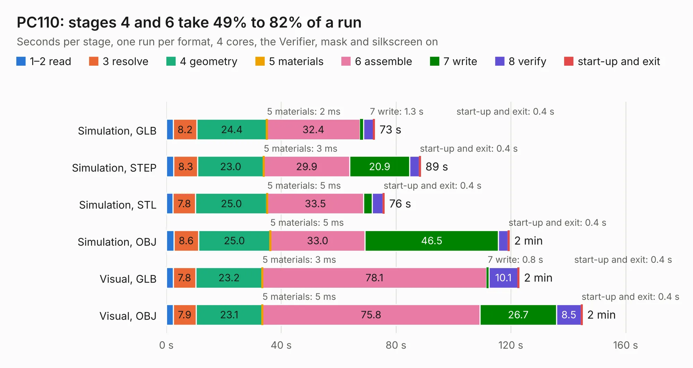

# 69. PC110

Board 69 of the 3,130 of [Corpus Testing](../Corpus-Testing.md), on [Corpus Page 1](../CorpusTestingPages/Corpus-Testing-01.md#69-pc110).

| Mode and format | 1–2 read | 3 resolve | 4 geometry | 5 materials | 6 assemble | 7 write | 8 verify | start-up and exit | Total |
|---|---:|---:|---:|---:|---:|---:|---:|---:|---:|
| Simulation, GLB | 2.4 | 8.2 | 24.4 | 2&nbsp;ms | 32.4 | 1.3 | 3.4 | 0.4 | 72.5 |
| Simulation, STEP | 2.6 | 8.3 | 23.0 | 3&nbsp;ms | 29.9 | 20.9 | 3.4 | 0.4 | 88.5 |
| Simulation, STL | 2.3 | 7.8 | 25.0 | 5&nbsp;ms | 33.5 | 3.0 | 3.8 | 0.4 | 75.9 |
| Simulation, OBJ | 2.6 | 8.6 | 25.0 | 5&nbsp;ms | 33.0 | 46.5 | 3.3 | 0.4 | 119.4 |
| Visual, GLB | 2.4 | 7.8 | 23.2 | 3&nbsp;ms | 78.1 | 0.8 | 10.1 | 0.4 | 122.8 |
| Visual, OBJ | 2.4 | 7.9 | 23.1 | 5&nbsp;ms | 75.8 | 26.7 | 8.5 | 0.4 | 144.8 |

<table align="center"><tr><td valign="top">

| Board | Repo: [ahmadexp/Open-Source-PC110](https://github.com/ahmadexp/Open-Source-PC110) Board: `PC110.kicad_pcb` |
|---|---|
| Folder | Mods / PC110-ITX |
| Complexity | 272&nbsp;/&nbsp;1000 (size&nbsp;187, features&nbsp;85) |
| KESE&nbsp;features | slotted holes, custom pads, rounded, trapezoid or chamfered pads, copper drawings, curved board outline, stack-up, dielectric εr and tanδ |
| Tested | 9th November 2026 |
| Copper&nbsp;layers | 10 |
| File&nbsp;format | KiCad 9 (20241229) |
| Parts,&nbsp;tracks,&nbsp;vias | 934, 0, 0 |
| Triangles,&nbsp;simulation | 5,605,872 in 1377 parts |
| Note | mostly unrouted |
| Verifier | PASS in all six runs |

</td><td valign="top">

<table>
<tr><th>File type</th><th>File size</th><th>Peak memory used</th></tr>
<tr><th colspan="3" align="left">Simulation</th></tr>
<tr><td>GLB</td><td align="right">182&nbsp;MB</td><td align="right">1.6&nbsp;GB</td></tr>
<tr><td>STEP</td><td align="right">860&nbsp;MB</td><td align="right">2.2&nbsp;GB</td></tr>
<tr><td>STL</td><td align="right">280&nbsp;MB</td><td align="right">1.6&nbsp;GB</td></tr>
<tr><td>OBJ</td><td align="right">604&nbsp;MB</td><td align="right">3.6&nbsp;GB</td></tr>
<tr><th colspan="3" align="left">Visual</th></tr>
<tr><td>GLB</td><td align="right">135&nbsp;MB</td><td align="right">2.1&nbsp;GB</td></tr>
<tr><td>OBJ</td><td align="right">429&nbsp;MB</td><td align="right">2.6&nbsp;GB</td></tr>
</table>

</td></tr></table>

| Previous | Next |
|:---|---:|
| [68. PC110-no-placement](b0068b_Open-Source-PC110_PC110-no-placement.md) | [70. DockingStation](b0070b_Open-Source-PC110_PCB-DockingStation_DockingStation.md) |
