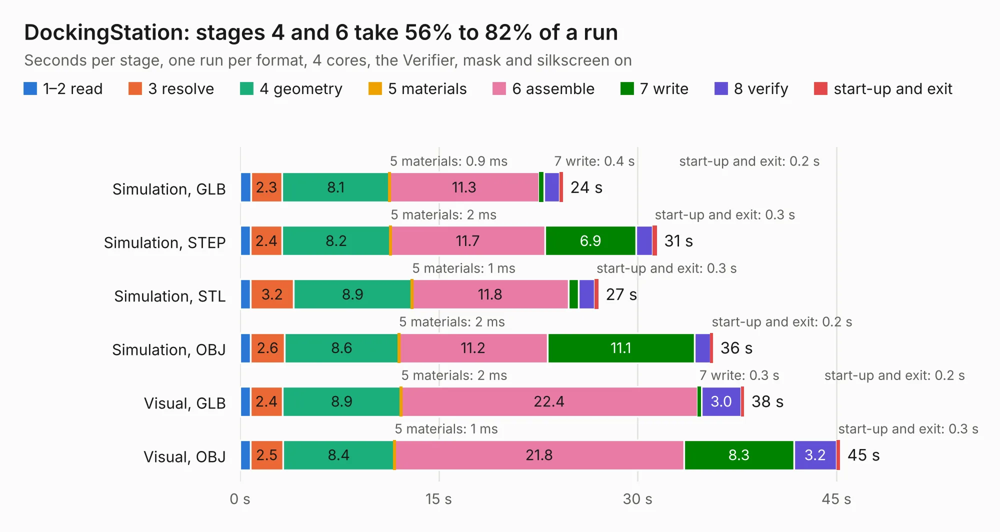

# 70. DockingStation

Board 70 of the 3,131 of [Corpus Testing](../Corpus-Testing.md), on [Corpus Page 1](../CorpusTestingPages/Corpus-Testing-01.md#70-dockingstation).

| Mode and format | 1–2 read | 3 resolve | 4 geometry | 5 materials | 6 assemble | 7 write | 8 verify | start-up and exit | Total |
|---|---:|---:|---:|---:|---:|---:|---:|---:|---:|
| Simulation, GLB | 0.8 | 2.3 | 8.1 | 0.9&nbsp;ms | 11.3 | 0.4 | 1.2 | 0.2 | 24.4 |
| Simulation, STEP | 0.8 | 2.4 | 8.2 | 2&nbsp;ms | 11.7 | 6.9 | 1.3 | 0.3 | 31.5 |
| Simulation, STL | 0.8 | 3.2 | 8.9 | 1&nbsp;ms | 11.8 | 0.8 | 1.2 | 0.3 | 27.0 |
| Simulation, OBJ | 0.8 | 2.6 | 8.6 | 2&nbsp;ms | 11.2 | 11.1 | 1.2 | 0.2 | 35.7 |
| Visual, GLB | 0.8 | 2.4 | 8.9 | 2&nbsp;ms | 22.4 | 0.3 | 3.0 | 0.2 | 38.0 |
| Visual, OBJ | 0.8 | 2.5 | 8.4 | 1&nbsp;ms | 21.8 | 8.3 | 3.2 | 0.3 | 45.3 |

<table align="center"><tr><td valign="top">

| Board | Repo: [ahmadexp/Open-Source-PC110](https://github.com/ahmadexp/Open-Source-PC110) Board: `DockingStation.kicad_pcb` |
|---|---|
| Folder | PCB / DockingStation |
| Complexity | 325&nbsp;/&nbsp;1000 (size&nbsp;230, features&nbsp;95) |
| KESE&nbsp;features | through vias, slotted holes, rounded, trapezoid or chamfered pads, filled zones, copper text, stack-up, dielectric εr and tanδ |
| Tested | 9th November 2026 |
| Copper&nbsp;layers | 4 |
| File&nbsp;format | KiCad 10 (20260206) |
| Parts,&nbsp;tracks,&nbsp;vias | 253, 3,270, 290 |
| Triangles,&nbsp;simulation | 2,650,988 in 277 parts |
| Verifier | PASS in all six runs |

</td><td valign="top">

<table>
<tr><th>File type</th><th>File size</th><th>Peak memory used</th></tr>
<tr><th colspan="3" align="left">Simulation</th></tr>
<tr><td>GLB</td><td align="right">91&nbsp;MB</td><td align="right">872&nbsp;MB</td></tr>
<tr><td>STEP</td><td align="right">398&nbsp;MB</td><td align="right">1.2&nbsp;GB</td></tr>
<tr><td>STL</td><td align="right">133&nbsp;MB</td><td align="right">889&nbsp;MB</td></tr>
<tr><td>OBJ</td><td align="right">279&nbsp;MB</td><td align="right">1.8&nbsp;GB</td></tr>
<tr><th colspan="3" align="left">Visual</th></tr>
<tr><td>GLB</td><td align="right">64&nbsp;MB</td><td align="right">1.2&nbsp;GB</td></tr>
<tr><td>OBJ</td><td align="right">200&nbsp;MB</td><td align="right">1.4&nbsp;GB</td></tr>
</table>

</td></tr></table>

| Previous | Next |
|:---|---:|
| [69. PC110](b0069b_Open-Source-PC110_Mods-PC110-ITX_PC110.md) | [71. PC110_membrance](b0071b_Open-Source-PC110_PC110-membrance.md) |
