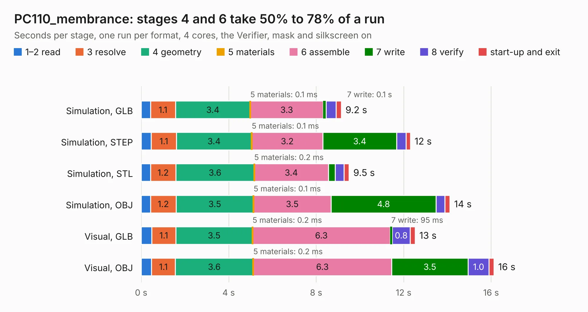

# 71. PC110_membrance

Board 71 of the 3,128 of [Corpus Testing](../Corpus-Testing.md), on [Corpus Page 1](../CorpusTestingPages/Corpus-Testing-01.md#71-pc110_membrance).

| Mode and format | 1–2 read | 3 resolve | 4 geometry | 5 materials | 6 assemble | 7 write | 8 verify | start-up and exit | Total |
|---|---:|---:|---:|---:|---:|---:|---:|---:|---:|
| Simulation, GLB | 0.4 | 1.1 | 3.4 | 0.1&nbsp;ms | 3.3 | 0.1 | 0.5 | 0.2 | 9.2 |
| Simulation, STEP | 0.5 | 1.1 | 3.4 | 0.1&nbsp;ms | 3.2 | 3.4 | 0.4 | 0.2 | 12.3 |
| Simulation, STL | 0.4 | 1.2 | 3.6 | 0.2&nbsp;ms | 3.4 | 0.3 | 0.4 | 0.2 | 9.5 |
| Simulation, OBJ | 0.4 | 1.2 | 3.5 | 0.1&nbsp;ms | 3.5 | 4.8 | 0.4 | 0.2 | 14.1 |
| Visual, GLB | 0.5 | 1.1 | 3.5 | 0.2&nbsp;ms | 6.3 | 95&nbsp;ms | 0.8 | 0.2 | 12.5 |
| Visual, OBJ | 0.5 | 1.1 | 3.6 | 0.2&nbsp;ms | 6.3 | 3.5 | 1.0 | 0.2 | 16.1 |

<table align="center"><tr><td valign="top">

| Board | Repo: [ahmadexp/Open-Source-PC110](https://github.com/ahmadexp/Open-Source-PC110) Board: `PC110_membrance.kicad_pcb` |
|---|---|
| Folder | PCB / Keyboard / Membrane |
| Complexity | 207&nbsp;/&nbsp;1000 (size&nbsp;127, features&nbsp;80) |
| KESE&nbsp;features | through vias, copper drawings, curved board outline, tracks bare of mask, stack-up, dielectric εr and tanδ |
| Tested | 9th November 2026 |
| Copper&nbsp;layers | 2 |
| File&nbsp;format | KiCad 9 (20241229) |
| Parts,&nbsp;tracks,&nbsp;vias | 0, 762, 32 |
| Triangles,&nbsp;simulation | 823,958 in 7 parts |
| Note | no components |
| Verifier | PASS in all six runs |

</td><td valign="top">

<table>
<tr><th>File type</th><th>File size</th><th>Peak memory used</th></tr>
<tr><th colspan="3" align="left">Simulation</th></tr>
<tr><td>GLB</td><td align="right">30&nbsp;MB</td><td align="right">508&nbsp;MB</td></tr>
<tr><td>STEP</td><td align="right">223&nbsp;MB</td><td align="right">580&nbsp;MB</td></tr>
<tr><td>STL</td><td align="right">41&nbsp;MB</td><td align="right">509&nbsp;MB</td></tr>
<tr><td>OBJ</td><td align="right">87&nbsp;MB</td><td align="right">608&nbsp;MB</td></tr>
<tr><th colspan="3" align="left">Visual</th></tr>
<tr><td>GLB</td><td align="right">20&nbsp;MB</td><td align="right">502&nbsp;MB</td></tr>
<tr><td>OBJ</td><td align="right">60&nbsp;MB</td><td align="right">526&nbsp;MB</td></tr>
</table>

</td></tr></table>

| Previous | Next |
|:---|---:|
| [70. DockingStation](b0070b_Open-Source-PC110_PCB-DockingStation_DockingStation.md) | [72. PC110](b0072b_Open-Source-PC110_PCB-Mainboard_PC110.md) |
