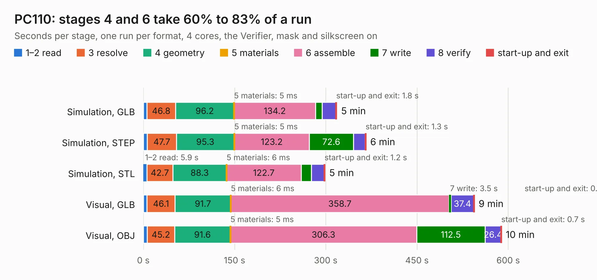

# 72. PC110

Board 72 of the 3,116 of [Corpus Testing](../Corpus-Testing.md), on [Corpus Page 1](../CorpusTestingPages/Corpus-Testing-01.md#72-pc110).

| Mode and format | 1–2 read | 3 resolve | 4 geometry | 5 materials | 6 assemble | 7 write | 8 verify | start-up and exit | Total |
|---|---:|---:|---:|---:|---:|---:|---:|---:|---:|
| Simulation, GLB | 6.1 | 46.8 | 96.2 | 5&nbsp;ms | 134.2 | 10.9 | 22.2 | 1.8 | 318.2 |
| Simulation, STEP | 6.6 | 47.7 | 95.3 | 5&nbsp;ms | 123.2 | 72.6 | 19.5 | 1.3 | 366.2 |
| Simulation, STL | 5.9 | 42.7 | 88.3 | 6&nbsp;ms | 122.7 | 16.6 | 21.3 | 1.2 | 298.6 |
| Simulation, OBJ | 6.1 | 48.6 | 105.5 | 10&nbsp;ms | 157.8 | 266.6 | 33.3 | 4.3 | 622.3 |
| Visual, GLB | 6.1 | 46.1 | 91.7 | 6&nbsp;ms | 358.7 | 3.5 | 37.4 | 0.9 | 544.4 |
| Visual, OBJ | 6.3 | 45.2 | 91.6 | 5&nbsp;ms | 306.3 | 112.5 | 26.4 | 0.7 | 589.0 |

<table align="center"><tr><td valign="top">

| Board | Repo: [ahmadexp/Open-Source-PC110](https://github.com/ahmadexp/Open-Source-PC110) Board: `PC110.kicad_pcb` |
|---|---|
| Folder | PCB / Mainboard |
| Complexity | 563&nbsp;/&nbsp;1000 (size&nbsp;378, features&nbsp;185) |
| KESE&nbsp;features | through vias, blind and buried vias, slotted holes, custom pads, rounded, trapezoid or chamfered pads, filled zones, copper drawings, copper text, curved board outline, knockout text, stack-up, dielectric εr and tanδ |
| Tested | 9th November 2026 to 11th November 2026 |
| Copper&nbsp;layers | 10 |
| File&nbsp;format | KiCad 10 (20260206) |
| Parts,&nbsp;tracks,&nbsp;vias | 934, 44,594, 6,088 |
| Triangles,&nbsp;simulation | 30,743,204 in 1455 parts |
| Verifier | PASS in all six runs |
| Run&nbsp;again | Visual, OBJ: failed in the corpus run, run again with the memory cap raised from 11 GB to 14.5 GB, and passed |
| Run&nbsp;again | Simulation, OBJ: failed in the corpus run, run again with no memory cap and no time limit (swap added to a 16 GB machine), and passed |

</td><td valign="top">

<table>
<tr><th>File type</th><th>File size</th><th>Peak memory used</th></tr>
<tr><th colspan="3" align="left">Simulation</th></tr>
<tr><td>GLB</td><td align="right">1.0&nbsp;GB</td><td align="right">6.4&nbsp;GB</td></tr>
<tr><td>STEP</td><td align="right">3.4&nbsp;GB</td><td align="right">7.6&nbsp;GB</td></tr>
<tr><td>STL</td><td align="right">1.5&nbsp;GB</td><td align="right">6.0&nbsp;GB</td></tr>
<tr><td>OBJ</td><td align="right">3.5&nbsp;GB</td><td align="right">20&nbsp;GB</td></tr>
<tr><th colspan="3" align="left">Visual</th></tr>
<tr><td>GLB</td><td align="right">538&nbsp;MB</td><td align="right">8.7&nbsp;GB</td></tr>
<tr><td>OBJ</td><td align="right">1.8&nbsp;GB</td><td align="right">12&nbsp;GB</td></tr>
</table>

</td></tr></table>

| Previous | Next |
|:---|---:|
| [71. PC110_membrance](b0071b_Open-Source-PC110_PC110-membrance.md) | [73. PC110](b0073b_Open-Source-PC110_PCB-Mainboard-Single-Sheet-Schematic_PC110.md) |
