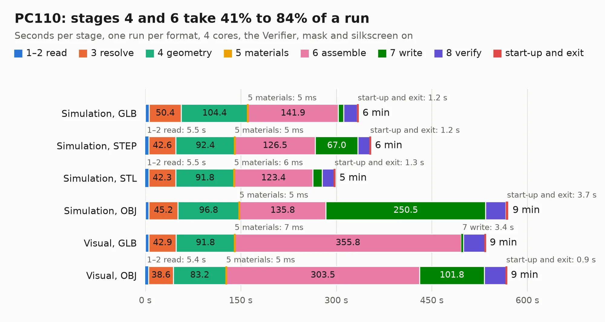

# 73. PC110

Board 73 of the 3,131 of [Corpus Testing](../Corpus-Testing.md), on [Corpus Page 1](../CorpusTestingPages/Corpus-Testing-01.md#73-pc110).

| Mode and format | 1–2 read | 3 resolve | 4 geometry | 5 materials | 6 assemble | 7 write | 8 verify | start-up and exit | Total |
|---|---:|---:|---:|---:|---:|---:|---:|---:|---:|
| Simulation, GLB | 6.2 | 50.4 | 104.4 | 5&nbsp;ms | 141.9 | 8.9 | 21.3 | 1.2 | 334.3 |
| Simulation, STEP | 5.5 | 42.6 | 92.4 | 5&nbsp;ms | 126.5 | 67.0 | 18.6 | 1.2 | 353.9 |
| Simulation, STL | 5.5 | 42.3 | 91.8 | 6&nbsp;ms | 123.4 | 14.9 | 18.8 | 1.3 | 298.1 |
| Simulation, OBJ | 5.9 | 45.2 | 96.8 | 5&nbsp;ms | 135.8 | 250.5 | 32.0 | 3.7 | 569.9 |
| Visual, GLB | 5.7 | 42.9 | 91.8 | 7&nbsp;ms | 355.8 | 3.4 | 33.6 | 0.9 | 534.1 |
| Visual, OBJ | 5.4 | 38.6 | 83.2 | 5&nbsp;ms | 303.5 | 101.8 | 34.0 | 0.9 | 567.4 |

<table align="center"><tr><td valign="top">

| Board | Repo: [ahmadexp/Open-Source-PC110](https://github.com/ahmadexp/Open-Source-PC110) Board: `PC110.kicad_pcb` |
|---|---|
| Folder | PCB / Mainboard / Single-Sheet-Schematic |
| Complexity | 563&nbsp;/&nbsp;1000 (size&nbsp;378, features&nbsp;185) |
| KESE&nbsp;features | through vias, blind and buried vias, slotted holes, custom pads, rounded, trapezoid or chamfered pads, filled zones, copper drawings, copper text, curved board outline, knockout text, stack-up, dielectric εr and tanδ |
| Tested | 9th November 2026 to 11th November 2026 |
| Copper&nbsp;layers | 10 |
| File&nbsp;format | KiCad 9 (20241229) |
| Parts,&nbsp;tracks,&nbsp;vias | 934, 44,600, 6,088 |
| Triangles,&nbsp;simulation | 30,715,986 in 1454 parts |
| Verifier | PASS in all six runs |
| Run&nbsp;again | Visual, OBJ: failed in the corpus run, run again with the memory cap raised from 11 GB to 14.5 GB, and passed |
| Run&nbsp;again | Simulation, OBJ: failed in the corpus run, run again with no memory cap and no time limit (swap added to a 16 GB machine), and passed |

</td><td valign="top">

<table>
<tr><th>File type</th><th>File size</th><th>Peak memory used</th></tr>
<tr><th colspan="3" align="left">Simulation</th></tr>
<tr><td>GLB</td><td align="right">1.0&nbsp;GB</td><td align="right">6.1&nbsp;GB</td></tr>
<tr><td>STEP</td><td align="right">3.4&nbsp;GB</td><td align="right">8.1&nbsp;GB</td></tr>
<tr><td>STL</td><td align="right">1.5&nbsp;GB</td><td align="right">6.0&nbsp;GB</td></tr>
<tr><td>OBJ</td><td align="right">3.5&nbsp;GB</td><td align="right">19&nbsp;GB</td></tr>
<tr><th colspan="3" align="left">Visual</th></tr>
<tr><td>GLB</td><td align="right">538&nbsp;MB</td><td align="right">8.6&nbsp;GB</td></tr>
<tr><td>OBJ</td><td align="right">1.8&nbsp;GB</td><td align="right">11&nbsp;GB</td></tr>
</table>

</td></tr></table>

| Previous | Next |
|:---|---:|
| [72. PC110](b0072b_Open-Source-PC110_PCB-Mainboard_PC110.md) | [74. Modem](b0074b_Open-Source-PC110_Modem.md) |
